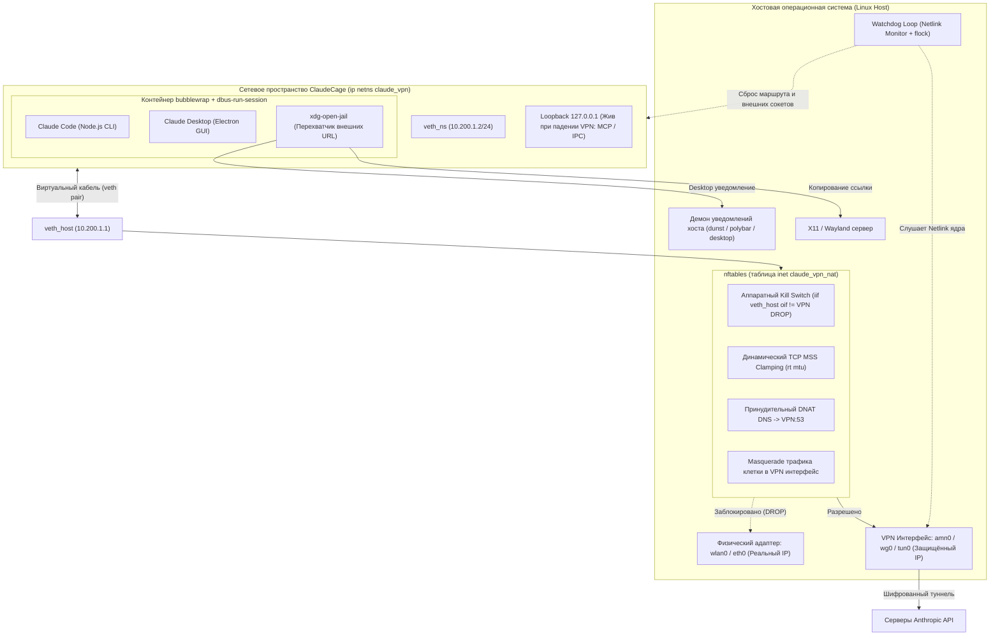
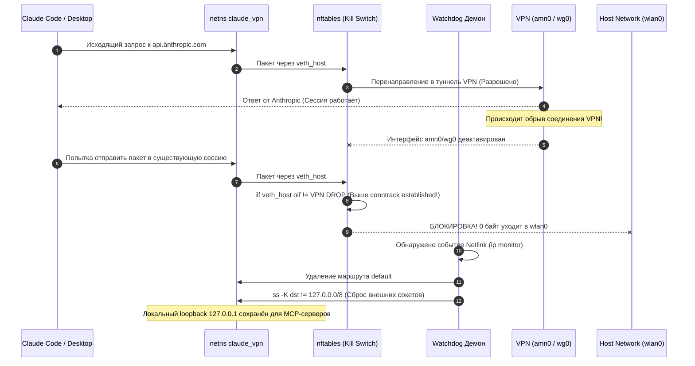

# 🛡️ ClaudeCage (Linux)

> **Military-grade, kernel-level network isolation sandbox & anti-leak jail for Claude Code (CLI) and Claude Desktop (Electron) on Linux.**

[-blue.svg?logo=linux)](https://github.com/NikitaLozinsky/ClaudeCage_Linux)
[](https://github.com/NikitaLozinsky/ClaudeCage_Linux)
[](https://github.com/NikitaLozinsky/ClaudeCage_Linux)
[](LICENSE)

---

## 📖 Содержание / Table of Contents

- [Что это такое? / Overview](#-что-это-такое--overview)
- [Проблема антифрода Anthropic / The Threat Model](#-проблема-антифрода-anthropic--the-threat-model)
- [Архитектура защиты (5 эшелонов) / 5-Layer Defense Architecture](#-архитектура-защиты-5-эшелонов--5-layer-defense-architecture)
- [Интерактивные диаграммы / Diagrams](#-интерактивные-диаграммы--diagrams)
- [Установка за 1 минуту / Quick Installation](#-установка-за-1-минуту--quick-installation)
- [Комплексная диагностика (`celltest`) / Diagnostics](#-комплексная-диагностика-celltest--diagnostics)
- [Использование / Usage Guide](#-использование--usage-guide)
- [Конфигурация / Configuration](#-конфигурация--configuration)
- [Безопасность и аудит / Security & Audit](#-безопасность-и-аудит--security--audit)
- [Лицензия / License](#-лицензия--license)

---

## 🎯 Что это такое? / Overview

**ClaudeCage** — это специализированная среда изоляции для Linux, предотвращающая блокировки аккаунтов Anthropic (Claude Pro / Team / Max / API) и утечки реального IP-адреса, DNS, WebRTC, D-Bus и локального времени хоста.

Система объединяет изоляцию на уровне пространства имён ядра Linux (`ip netns`), аппаратный сетевой фильтр `nftables`, монтирование изолированной файловой системы (`bubblewrap`), частную сессионную шину (`dbus-run-session`) и демона реального времени (`Netlink Watchdog`).

---

## ⚠️ Проблема антифрода Anthropic / The Threat Model

Использование стандартного системного VPN на Linux для работы с Claude таит в себе скрытые векторы утечек:

1. **Conntrack Session Bleed (Утечка при обрыве VPN)**: Если VPN падает, ядро Linux переключает маршрут по умолчанию на `wlan0`/`eth0`. Уже открытые TCP-сессии (`ct state established`) продолжают слать пакеты через провайдера без шифрования, мгновенно выдавая ваш реальный IP антифроду Anthropic.
2. **DNS & DoH Leaks (Утечки DNS)**: Системный `systemd-resolved` или локальный резолвер хоста обращается к DNS-серверам провайдера. Electron также может использовать встроенный DoH (DNS over HTTPS).
3. **WebRTC Local Candidate Leaks**: Electron и Chromium опрашивают локальные сетевые адаптеры через WebRTC, передавая внешний и локальный IP хоста.
4. **D-Bus Portal Escape (Утечка через порталы)**: При переходе по ссылкам (`shell.openExternal()`) Electron обращается к сервису `xdg-desktop-portal` через сессионный D-Bus хоста, открывая ссылку в браузере хоста **вне VPN**.
5. **Keyring & Timezone Anti-Fraud Mismatch**: Несоответствие между часовым поясом (`Intl.DateTimeFormat`) и IP-геолокацией VPN-сервера — один из ключевых триггеров банов в антифроде Anthropic.

---

## 🛡️ Архитектура защиты (5 эшелонов) / 5-Layer Defense Architecture

```
┌────────────────────────────────────────────────────────────────────────┐
│                   ЭШЕЛОН 1: Сетевое пространство netns                │
│       Виртуальный кабель veth_host (10.200.1.1) <-> veth_ns (10.200.1.2)│
│       Отсутствие физического доступа к сетевым картам хоста (wlan0)   │
└──────────────────────────────────┬─────────────────────────────────────┘
                                   ▼
┌────────────────────────────────────────────────────────────────────────┐
│                 ЭШЕЛОН 2: Аппаратный Kill Switch nftables              │
│       • Правило DROP стоит ВЫШЕ ct state established,related           │
│       • Динамический MSS Clamping (rt mtu) по пути следования пакетов  │
│       • Принудительный DNAT всех DNS-запросов (порт 53) в туннель VPN  │
│       • Блокировка доступа клетки к портам хоста (input isolation)     │
│       • Полное отключение IPv6 внутри клетки (disable_ipv6 = 1)        │
└──────────────────────────────────┬─────────────────────────────────────┘
                                   ▼
┌────────────────────────────────────────────────────────────────────────┐
│            ЭШЕЛОН 3: Файловая система и сокеты (bubblewrap)            │
│       • Сброс root-прав через setpriv ДО входа в контейнер             │
│       • Сокрытие системного D-Bus (/run/dbus) и DNS-стаба resolved     │
│       • Сокрытие сокетов пользовательского systemd хоста (защита от RCE)│
│       • Частная шина dbus-run-session с маскированием порталов         │
│       • Базовое хранилище сессий Electron (--password-store=basic)     │
└──────────────────────────────────┬─────────────────────────────────────┘
                                   ▼
┌────────────────────────────────────────────────────────────────────────┐
│             ЭШЕЛОН 4: Фоновый сторожевой демон (Netlink Watchdog)      │
│       • Мониторинг ядра в реальном времени через Netlink сокет         │
│       • Атомарная блокировка flock без утечки файловых дескрипторов    │
│       • Сброс маршрута и внешних сокетов: ss -K dst != 127.0.0.0/8     │
│       • Сохранение loopback 127.0.0.1 для MCP-серверов и локального IPC│
└──────────────────────────────────┬─────────────────────────────────────┘
                                   ▼
┌────────────────────────────────────────────────────────────────────────┐
│         ЭШЕЛОН 5: Перехват внешних ссылок и защита браузера            │
│       • Подмена xdg-open на скрипт-ловушку xdg-open-jail               │
│       • Принудительное копирование URL в системный буфер (xclip)       │
│       • Отправка системного баннера на хост (notify-send / dunst)      │
│       • Запрет запуска браузера хоста вне защищенного периметра        │
└────────────────────────────────────────────────────────────────────────┘
```

---

## 📊 Интерактивные диаграммы / Diagrams

### Архитектура периметра изоляции



### Поведение при обрыве туннеля VPN (Hard Kill Switch)



---

## 🚀 Установка за 1 минуту / Quick Installation

### 1. Клонирование репозитория

```bash
git clone https://github.com/NikitaLozinsky/ClaudeCage_Linux.git
cd ClaudeCage_Linux
```

### 2. Запуск автоматического установщика

```bash
./install.sh
```

Скрипт автоматически:
- Проверит системные зависимости (`iproute2`, `nftables`, `bubblewrap`, `util-linux`, `xclip`, `libnotify`).
- Установит системный оркестратор в `/usr/local/bin/claude-vpn` и перехватчик в `/usr/local/lib/claude-vpn/`.
- Сконфигурирует безопасный `sudoers` без ввода пароля (`!use_pty`, защита от LPE).
- Определит активный VPN-интерфейс (`amn0`, `wg0`, `tun0`, `proton0`).
- Настроит обёртки для консольного и оконного Claude в `~/.local/bin/`.
- Установит ярлык для меню приложений (Rofi, GNOME, KDE, XFCE).

---

## 🩺 Комплексная диагностика (`celltest`) / Diagnostics

Для мгновенной проверки герметичности песочницы включена утилита **`celltest`**, которая проверяет 20 параметров системы по 5 категориям:

```bash
celltest
```

Пример вывода:

```
╔══════════════════════════════════════════════════════════════════╗
║         CELLTEST: Диагностика изоляции и защиты от антифрода     ║
╚══════════════════════════════════════════════════════════════════╝

━━━ 1. Ядро Linux и Сетевой Namespace ━━━
  ✔ Сетевое пространство (netns) 'claude_vpn' создано в ядре
  ✔ Интерфейс veth_host на хосте активен (10.200.1.1)
  ✔ Интерфейс veth_ns внутри netns активен (10.200.1.2, MTU 1376)
  ✔ Фоновый Watchdog демон активен (PID: 208905)

━━━ 2. Kill Switch и Защита от Утечек Трафика ━━━
  ✔ VPN интерфейс (amn0) активен: 10.x.x.x (VPN IP)
  ✔ Таблица nftables 'inet claude_vpn_nat' загружена
  ✔ Аппаратный Kill Switch активен: весь трафик мимо amn0 сбрасывается (DROP)
  ✔ IPv6 внутри клетки полностью отключен (0 утечек через IPv6)

━━━ 3. Изоляция DNS (DNS Leak Protection) ━━━
  ✔ Системный DNS внутри клетки: 100.64.0.1 (изолированный резолвер VPN)
  ✔ DNS резолвинг доменов Anthropic через VPN: РАБОТАЕТ

━━━ 4. Защита от Антифрода (IP, Гео и Timezone) ━━━
  ✔ Часовой пояс среды совпадает с сервером VPN: Europe/Amsterdam
  ✔ Внешний IP адрес внутри клетки: 198.51.100.x (Защищённый выход VPN)
  ✔ VPN (amn0) является активным шлюзом (хост и клетка в одной сети VPN: 198.51.100.x)

━━━ 5. Точки запуска и Защита от Перезаписи (Обновления) ━━━
  ✔ Fish-функция 'claude' настроена (абсолютный приоритет над PATH)
  ✔ Fish-функция 'claude-desktop' настроена
  ✔ Обёртка ~/bin/claude готова к работе
  ✔ Обёртка ~/bin/claude-desktop готова к работе
  ✔ Перехватчик ~/.local/bin/claude активен
  ✔ Меню приложений и Rofi жестко привязаны к изолированной обертке
  ✔ Хоткей Super+Shift+C привязан к изолированному запуску (~/bin/claude-app)

━━━ Итоговый результат ━━━
Проверено тестов: 20 | Ошибок: 0 | Предупреждений: 0
╔══════════════════════════════════════════════════════════════════╗
║   [✓] ВСЕ СИСТЕМЫ ЗАЩИТЫ АКТИВНЫ (100% готов к безопасной работе)║
╚══════════════════════════════════════════════════════════════════╝
```

---

## 💻 Использование / Usage Guide

После установки вы можете использовать Claude как обычно — клетка прозрачно оборачивает вызовы:

```bash
# Запуск Claude Code CLI (терминал)
claude

# Запуск десктопного приложения
claude-desktop

# Выполнение любой произвольной команды внутри изолированной клетки
claude-vpn exec -- ping -c 1 127.0.0.1
claude-vpn exec -- curl https://icanhazip.com

# Ручное управление клеткой
claude-vpn --status      # Показать подробный статус сети, MTU и маршрутов
claude-vpn --up          # Поднять клетку и Kill Switch вручную
claude-vpn --down        # Полная очистка правил и удаление netns
```

---

## ⚙️ Конфигурация / Configuration

Конфигурационный файл расположен в `~/.config/claude-vpn.conf` (или системный `/etc/claude-vpn.conf`):

```ini
# Имя интерфейса вашего VPN соединения (default: amn0)
VPN_IFACE="amn0"

# Изолированный DNS резолвер VPN
VPN_DNS="100.64.0.1"

# Часовой пояс (должен совпадать с локацией IP-адреса VPN)
CLAUDE_TZ="Europe/Amsterdam"
```

---

## 🔒 Безопасность и аудит / Security & Audit

1. **Защита от повышения привилегий (LPE)**:
   - Основной скрипт хранится в `/usr/local/bin/claude-vpn` с правами `root:root 0755`.
   - В sudoers выставлена директива `!use_pty`, защищающая от перехвата терминала через TIOCSTI.
   - Пользовательские конфигурационные файлы парсятся регулярными выражениями **без использования команды `source`**.
2. **Сброс привилегий в mntns**:
   - `setpriv` понижает привилегии до реального UID пользователя **до** входа в `bubblewrap`, что исключает блокировки прав capability ядра Linux.
3. **Сохранение локального Loopback и сигналов**:
   - Сигналы изменения размера терминала (`SIGWINCH`), прерывания (`SIGINT`) и пайпы передаются процессам напрямую без промежуточных sudo-оболочек.
   - Сброс соединений при падении VPN (`ss -K`) затрагивает только внешние сокеты (`dst != 127.0.0.0/8`), сохраняя работоспособность локальных MCP-серверов.

---

## 📄 Лицензия / License

Проект распространяется под открытой лицензией [MIT](LICENSE).
Автор: **Nikita Lozinsky**
Code and Architecture contributions: **Google DeepMind Antigravity Pair-Programming Agent**.
