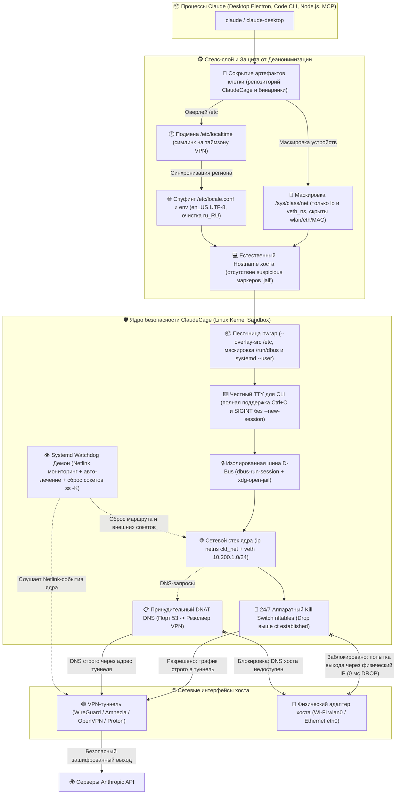

# 🛡️ ClaudeCage v3.0 (Linux)

> **Многоуровневая эшелонированная оборона на уровне ядра Linux для Claude Code (CLI) и Claude Desktop (Electron). 100% защита от антифрода Anthropic, аппаратный Kill Switch, нулевая утечка реального IP, DNS, WebRTC, региональных признаков (РФ/Europe/Moscow) и полная скрытность клетки от ИИ-агента.**

[-blue.svg?logo=linux)](https://github.com/NikitaLozinsky/ClaudeCage_Linux)
[](https://github.com/NikitaLozinsky/ClaudeCage_Linux)
[](https://github.com/NikitaLozinsky/ClaudeCage_Linux)
[](https://github.com/NikitaLozinsky/ClaudeCage_Linux)
[](LICENSE)

---

## 🚀 1. Как устроен ClaudeCage v3.0 и почему это круто

Внутри **ClaudeCage v3.0** реализована многоуровневая эшелонированная оборона и невидимая песочница на уровне ядра операционной системы Linux. Все процессы Claude изолируются в отдельном сетевом пространстве (`ip netns`), запускаются внутри песочницы монтирования (`bubblewrap`) с собственной шиной D-Bus и оверлеем `/etc`, а трафик фильтруется аппаратным брандмауэром `nftables`:



---

## ⚠️ 2. Модель угроз: почему обычного VPN недостаточно

1. **Conntrack Session Bleed (Утечка при обрыве туннеля)**:  
   При падении VPN ядро Linux переключает маршрут по умолчанию на `wlan0`/`eth0`. Уже открытые TCP-сессии продолжают слать пакеты через реального провайдера в обход туннеля. Антифрод Anthropic видит смену IP посреди сессии и блокирует аккаунт.
2. **Прямая деанонимизация страны через `/etc/localtime` и `/etc/locale.conf`**:  
   Даже если выставлен `TZ=Europe/Amsterdam`, чтение симлинка `/etc/localtime` (указывающего на `Europe/Moscow`) или файла `/etc/locale.conf` (`LANG=ru_RU.UTF-8`) мгновенно раскрывает реальное местоположение пользователя в России.
3. **Обнаружение клетки самим ИИ-агентом**:  
   Если агент Claude Code обладает доступом к файловой системе для выполнения задач разработки, он может обнаружить репозиторий клетки, конфигурационные файлы и понять, что его пытаются изолировать.
4. **Утечка аппаратных интерфейсов через `/sys/class/net`**:  
   В Linux монтирование корневой ФС открывает каталог `/sys/class/net`, раскрывая имена физических интерфейсов хоста (`wlan0`, `eth0`) и их MAC-адреса.
5. **D-Bus Portal & WebRTC Bypass**:  
   Electron опрашивает интерфейсы через WebRTC и обращается к `xdg-desktop-portal` через сессионный D-Bus хоста, пытаясь открыть ссылки в браузере хоста вне туннеля.

---

## 🛡️ 3. Шесть эшелонов обороны ядра v3.0

### Эшелон 1: Сетевой Namespace ядра (`ip netns`)
Процессы Claude помещаются в изолированное сетевое пространство `cld_net`. У них **физически отсутствуют** адаптеры `wlan0`, `eth0` или Docker-мосты. Связь с хостом происходит исключительно по виртуальному патч-корду `veth_host (10.200.1.1) <-> veth_ns (10.200.1.2)`. IPv6 внутри клетки аппаратно отключен (`disable_ipv6=1`), исключая утечки через IPv6 SLAAC/DHCPv6.

### Эшелон 2: Аппаратный сетевой фильтр `nftables` (Hard Kill Switch)
- **DROP выше conntrack**: Правило сброса `iifname "veth_host" oifname != "$VPN_IFACE" counter drop` расположено **строго выше** `ct state established,related accept`.
- **Защита от подмены IP (Anti-Spoofing)**: Пакеты с адресом источника, отличным от `10.200.1.2`, сбрасываются.
- **Динамический MSS Clamping**: Правило `tcp flags syn tcp option maxseg size set rt mtu` динамически подстраивает размер TCP-сегмента под реальный MTU туннеля.
- **Принудительный DNAT DNS**: Любые DNS-запросы (порт 53 UDP/TCP) принудительно перенаправляются на доверенный резолвер VPN (`100.64.0.1` или настроенный `VPN_DNS`).
- **Изоляция Input**: Клетка изолирована от локальных портов хоста (`10.200.1.1` и сервисов `localhost`).

### Эшелон 3: Песочница файловой системы и Стелс-сокрытие (`bubblewrap`)
- **Безопасный сброс привилегий**: `setpriv` сбрасывает UID/GID до непривилегированного пользователя с очисткой возможностей (`--inh-caps=-all`, `--no-new-privs`) **до** входа в `bwrap`, блокируя любые попытки LPE-побега через `sudo`.
- **Сокрытие репозитория ClaudeCage**: Каталог репозитория клетки монтируется как пустой `tmpfs`. Если агент попытается выполнить `ls` или просканировать домашнюю директорию, он увидит пустую папку.
- **Сокрытие служебных бинарников и служб**: Файлы `/usr/local/bin/cld-cage`, `/etc/cld-cage.conf`, `/etc/systemd/system/cld-cage*` полностью удалены из файловой системы внутри сэндбокса через оверлеи.
- **Маскировка `/sys/class/net`**: Внутри песочницы создана чистая виртуальная структура интерфейсов, содержащая только `lo` и `veth_ns`. Физические адаптеры `wlan0` и `eth0` не видны.
- **Естественный Hostname**: Hostname внутри песочницы наследует имя реального компьютера хоста (без выдающих песочницу названий вроде `claude-jail`).

### Эшелон 4: Нулевая утечка геолокации и языка (Anti-Fraud)
- **Спуфинг `/etc/localtime`**: Внутри временного оверлея `/etc` симлинк `/etc/localtime` перенаправлен на бинарный файл часового пояса туннеля (по умолчанию `Europe/Amsterdam`). Любые системные вызовы и Node.js `Intl.DateTimeFormat` видят европейское время.
- **Спуфинг `/etc/locale.conf`**: Файл принудительно подменён на `LANG=en_US.UTF-8` и `LC_ALL=en_US.UTF-8`. Хостовые русские локали `ru_RU` полностью вычищены.
- **Спуфинг раскладки**: `/etc/vconsole.conf` подменён на `KEYMAP=us`.

### Эшелон 5: Интерактивный TTY и изоляция D-Bus
- **Полноценный TTY для CLI**: Флаг `--new-session` применяется исключительно для GUI Electron. Для CLI Claude Code сохранён управляющий терминал, что обеспечивает бесперебойную работу сигналов `Ctrl+C` (SIGINT) и job control.
- **Автономный D-Bus**: Приложение запускается через `dbus-run-session`, поднимая чистую сессионную шину без сервисов хоста.
- **Перехватчик ссылок (`xdg-open-jail`)**: Перехватывает URL, копирует в буфер обмена и отправляет нейтральное уведомление на хост через фильтрованный сокет-прокси `xdg-dbus-proxy` (разрешён только `org.freedesktop.Notifications`).

### Эшелон 6: Systemd Watchdog демон реального времени (Netlink)
- Фоновый демон оформлен в виде системной службы `cld-cage-watchdog.service` с `KillMode=control-group`.
- Слушает события ядра через Netlink (`ip -o monitor link addr`).
- Основная служба `cld-cage.service` запускается с директивами `Before=network-pre.target` и `Wants=network-pre.target`, гарантируя Fail-Closed защиту с первой секунды загрузки ОС до поднятия сетевых интерфейсов.
- При падении туннеля VPN вызывается `ss -K dst != 127.0.0.0/8`: ядро мгновенно рвёт внешние соединения, но **сохраняет loopback `127.0.0.1`**, гарантируя бесперебойную работу локальных MCP-серверов и IPC Claude Code.

---

## 📦 4. Быстрый старт и установка

### Требования
- Linux-дистрибутив с ядром $\ge$ 5.4 (Arch Linux, Debian, Ubuntu, Fedora и др.)
- Установленные утилиты: `iproute2`, `nftables`, `bubblewrap`, `util-linux`, `xclip`, `libnotify`, `python3`

### Установка

```bash
git clone https://github.com/NikitaLozinsky/ClaudeCage_Linux.git
cd ClaudeCage_Linux
./install.sh
```

Инсталлятор в автоматическом режиме:
1. Проверит наличие всех необходимых зависимостей и синтаксис скриптов.
2. Установит системный оркестратор `/usr/local/bin/cld-cage` с правами `root:root 0755` (с алиасом `claude-vpn`).
3. Сконфигурирует безопасный `sudoers` с предварительной валидацией через `visudo -c`.
4. Автоматически определит активный VPN-интерфейс (`amn0`, `wg0`, `tun0`, `proton0`).
5. Установит systemd-службы `cld-cage.service` и `cld-cage-watchdog.service`.
6. Настроит прозрачные обёртки в `~/.local/bin/` с защитой от запуска внутри репозитория клетки.
7. Интегрирует Fish-функции и меню приложений.

---

## 🩺 5. Комплексная диагностика (`celltest`)

Для полной уверенности в неуязвимости системы используйте диагностическую утилиту **`celltest`**:

```bash
celltest
```

Пример диагностического отчёта:
```text
╔══════════════════════════════════════════════════════════════════╗
║       CELLTEST v3.0: Комплексный аудит защиты и невидимости      ║
╚══════════════════════════════════════════════════════════════════╝

━━━ 1. Ядро Linux и Сетевой Namespace (Netns) ━━━
  ✔ Сетевое пространство (netns) 'cld_net' создано в ядре
  ✔ Интерфейс veth_host на хосте активен (10.200.1.1)
  ✔ Фильтрация обратного пути (rp_filter=2) на veth_host
  ✔ IPv6 на хостовом конце veth_host отключён (disable_ipv6=1)
  ✔ Интерфейс veth_ns внутри netns активен (10.200.1.2)
  ✔ IPv6 внутри клетки полностью отключён (0 утечек через IPv6 SLAAC)
  ✔ Служба Watchdog активна (systemd: cld-cage-watchdog.service)

━━━ 2. Двухуровневый Fail-Closed Kill Switch ━━━
  ✔ VPN интерфейс (amn0) активен: 100.x.x.x
  ✔ Policy Routing rule активно (iif veth_host lookup 200, prio 100)
  ✔ Fail-Closed fallback маршрут активен (unreachable default table 200)
  ✔ Маршрут egress через VPN активен в table 200 (dev amn0 metric 10)
  ✔ Таблица nftables 'inet cld_cage_nat' загружена в ядре
  ✔ Аппаратный Kill Switch активен (DROP выше conntrack established)
  ✔ Защита от подмены IP активна (iifname veth_host ip saddr != 10.200.1.2 drop)
  ✔ Динамический MSS Clamping активен (tcp option maxseg size set rt mtu)
  ✔ Изоляция локальных портов хоста активна (iifname veth_host drop)

━━━ 3. Антифрод и Нулевая Утечка Региона (РФ / IP) ━━━
  ✔ Симлинк /etc/localtime внутри клетки указывает на Europe/Amsterdam (совпадает с VPN)
  ✔ Node.js Intl.DateTimeFormat().resolvedOptions().timeZone: Europe/Amsterdam
  ✔ /etc/locale.conf внутри клетки экранирован (en_US.UTF-8, без признаков РФ)
  ✔ Переменная среды LANG внутри клетки: en_US.UTF-8
  ✔ Внешний Egress IP клетки: 198.51.100.x (маршрутизируется через amn0)

━━━ 4. Невидимость и Сокрытие Клетки от ИИ-Агента ━━━
  ✔ Каталог ClaudeCage полностью скрыт (пустой tmpfs)
  ✔ Бинарники cld-cage / claude-vpn скрыты из файловой системы песочницы
  ✔ Конфиг /etc/cld-cage.conf скрыт из файловой системы песочницы
  ✔ Службы systemd клетки скрыты из /etc/systemd/system
  ✔ /sys/class/net содержит только 'lo' и 'veth_ns' (физические Wi-Fi/Ethernet скрыты)
  ✔ Имя хоста внутри клетки естественное: 'archarnel' (без подозрительных меток 'jail')
  ✔ Атрибут NoNewPrivs=1 активен (блокирует SUID/LPE побег из клетки)
  ✔ Хостовая сессионная шина D-Bus (/run/user/UID/bus) замаскирована

━━━ 5. DNS Изоляция и Перехват DNAT ━━━
  ✔ DNS внутри клетки указывает только на 100.64.0.1 (изолированный резолвер VPN)
  ✔ Принудительный DNAT порт 53 -> 100.64.0.1 активен в nftables prerouting
  ✔ DNS резолв api.anthropic.com через VPN-туннель: РАБОТАЕТ

━━━ 6. Сокеты и Гигиена Соединений ━━━
  ✔ Локальный сокет 127.0.0.1 пережил сброс ss -K (MCP-серверы и IPC не страдают)

━━━ 7. Точки запуска и Защита от Перезаписи ━━━
  ✔ Fish-функция 'claude' настроена
  ✔ Fish-функция 'claude-desktop' настроена
  ✔ Обёртка CLI ~/.local/bin/claude активна
  ✔ Обёртка GUI ~/.local/bin/claude-desktop активна

╔══════════════════════════════════════════════════════════════════╗
║ [✓] СИСТЕМА НЕУЯЗВИМА: НУЛЕВАЯ УТЕЧКА ДАННЫХ И ПОЛНАЯ НЕВИДИМОСТЬ║
╚══════════════════════════════════════════════════════════════════╝
```

Для стресс-тестирования алгоритмов самолечения Watchdog (намеренное удаление правил и проверка восстановления):

```bash
celltest --disruptive
```

---

## 🔍 5.1 `cld-probe`: Логгер и Аудитор Сетевой Видимости Глазами Claude

В то время как `celltest` проверяет административную конфигурацию ядра и служб, инструмент **`cld-probe`** (алиас: `claude-probe`) выполняет активный аудит безопасности **строго изнутри клетки глазами самого ИИ-агента**. Он имитирует действия исследователя или атакующего агента (как в CLI через Node.js/curl, так и в GUI через Electron/WebRTC) и фиксирует все лазейки в подробный структурированный лог:

```bash
cld-probe              # Комплексный аудит всех 8 векторов атак и запись лога
cld-probe --monitor    # Живой потоковый мониторинг сетевых соединений клетки (Ctrl+C для выхода)
cld-probe --cli        # Аудит в профиле Claude Code CLI (Node.js/bash)
cld-probe --desktop    # Аудит в профиле Claude Desktop (Electron/Chromium)
cld-probe --json       # Вывод структурированного отчета в JSON
```

### Пример вывода аудита:

```text
╔══════════════════════════════════════════════════════════════════╗
║    CLD-PROBE v1.0-stealth: Network Visibility & Leak Audit Logger ║
║         Телеметрия сети и аудит лазеек глазами Claude            ║
╚══════════════════════════════════════════════════════════════════╝
Время аудита: 2026-10-27 21:45:42 | Профиль: BOTH | Пользователь: milk13

━━━ 1. Сводная матрица векторов атак и доступных лазеек ━━━
Вектор атак / Лазейка              | Статус         | Восприятие Claude
──────────────────────────────────-+-──────────────-+-────────────────────────────────────────
1. Внешний IP (Egress HTTP/S)      | [БЕЗОПАСНО]    | Внешний IP: 89.105.203.114 (NL, AMS)
2. WebRTC STUN UDP-рефлексия       | [БЕЗОПАСНО]    | STUN Public Reflexive IP: 89.105.203.114:52435
3. Физические интерфейсы и MAC     | [БЕЗОПАСНО]    | Только виртуальные: veth_ns, lo (MAC железа скрыты)
4. Сканирование хоста (LAN/SSH)    | [БЕЗОПАСНО]    | Все порты хоста (SSH, Web, Dev, DB) заблокированы (Timeout / nft drop)
5. DNS утечки и DNAT перехват      | [БЕЗОПАСНО]    | /etc/resolv.conf: nameserver 100.64.0.1
6. D-Bus и IPC перехват            | [БЕЗОПАСНО]    | Системный D-Bus отключен; пользовательский bus изолирован (/dev/null)
7. Геолокация, Таймзона и Локаль   | [БЕЗОПАСНО]    | Таймзона: Europe/Amsterdam (/usr/share/zoneinfo/Europe/Amsterdam)
8. Сокрытие факта клетки от Claude | [БЕЗОПАСНО]    | Каталог ClaudeCage: пустой tmpfs (0 файлов); Бинарники клетки удалены из оверлея

━━━ 2. Сравнение окружения: Реальный Хост vs Клетка Claude ━━━
  • Видимый IP хоста:    fe80::fda4:d532:5cc2:6649, 192.168.0.40, 100.77.81.199
  • Видимый IP в клетке: 89.105.203.114 (Страна: NL, Colo: AMS)
  • STUN WebRTC IP:      89.105.203.114
  • Интерфейсы хоста:    4 шт. (wlan0, eth0 и др.)
  • Интерфейсы в клетке: lo, veth_ns (только виртуальные veth_ns, lo)
  • Таймзона хоста:      /usr/share/zoneinfo/Europe/Moscow
  • Таймзона в клетке:   Europe/Amsterdam (симлинк: /usr/share/zoneinfo/Europe/Amsterdam)
  • Доступ к хосту (SSH):DROPPED (Timeout)
  • Файлы ClaudeCage:    0 файлов (смонтирован пустой tmpfs)

━━━ 3. Итоговая оценка защищенности и скрытности ━━━
  Индекс безопасности: 100/100 | Утечек: 0 | Предупреждений: 0
  Вердикт: ПОЛНАЯ ИЗОЛЯЦИЯ: 100% STEALTH (Лазейки закрыты, утечек нет)

Подробный лог сохранён в:
  • ~/.local/state/cld-cage/audit_YYYYMMDD_HHMMSS.log
  • ~/.local/state/cld-cage/latest_audit.log
  • ~/.local/state/cld-cage/latest_audit.json
```

---

## 💻 6. Повседневное использование и CLI-команды

После установки использование Claude происходит привычным образом:

```bash
# Запуск Claude Code CLI (консольная версия)
claude

# Запуск десктопного приложения Claude Desktop
claude-desktop

# Выполнение любой утилиты внутри изолированной песочницы
cld-cage ping -c 1 127.0.0.1
cld-cage curl https://icanhazip.com

# Служебные команды оркестратора и аудита
cld-probe                # Полный аудит сетевой видимости и запись отчета
cld-probe --monitor      # Живой мониторинг соединений клетки в реальном времени
cld-cage --status        # Подробный статус туннеля, netns, MTU и маршрутов
cld-cage --up            # Принудительное поднятие сети клетки
cld-cage --down          # Полная очистка правил nftables и удаление netns
```

> [!IMPORTANT]
> **Защита от обнаружения клетки:** При попытке запустить команду `claude` непосредственно из каталога репозитория ClaudeCage обёртка прервёт выполнение с предупреждением. Это сделано для того, чтобы запущенный ИИ-агент не обнаружил файлы клетки и факт своей изоляции. Для работы перейдите в каталог вашего рабочего проекта.

---

## ⚙️ 7. Конфигурация (`/etc/cld-cage.conf`)

Конфигурационный файл располагается в `/etc/cld-cage.conf` (владелец `root:root 0644`, поддерживается fallback на `/etc/claude-vpn.conf`):

```ini
# Сетевой интерфейс вашего VPN-клиента (default: amn0)
VPN_IFACE="amn0"

# Адрес изолированного DNS-резолвера туннеля
VPN_DNS="100.64.0.1"

# Адрес для liveness-проверки жизнеспособности туннеля
VPN_PROBE="1.1.1.1"

# Эмулируемый часовой пояс (должен соответствовать локации вашего VPN)
CLD_TZ="Europe/Amsterdam"

# Путь к локальному репозиторию ClaudeCage для сокрытия от агента
CAGE_REPO_DIR="/home/milk13/ClaudeCage_Linux"
```

---

## 🔒 8. Безопасность и защита от LPE

- **Исключение LPE (Local Privilege Escalation)**: Оркестратор расположен в системной директории `/usr/local/bin/cld-cage` с владельцем `root:root` и правами `0755`. В конфигурации `sudoers` директива `!use_pty` блокирует атаки внедрения команд через TTY (TIOCSTI).
- **Безопасный парсинг**: Параметры конфигурации извлекаются с помощью регулярных выражений **без использования команды `source`**.
- **Сохранение интерактивности TTY**: Прямой вызов `exec` без промежуточных sudo-оболочек сохраняет обработку сигналов `SIGWINCH` (ресайз окна терминала) и `SIGINT` (Ctrl+C).

---

## 📄 9. Лицензия и копирайт

Проект распространяется под свободной лицензией [MIT](LICENSE).  
Автор: **Nikita Lozinsky**  
Архитектурные решения: **Google DeepMind Antigravity Pair-Programming Agent**.
