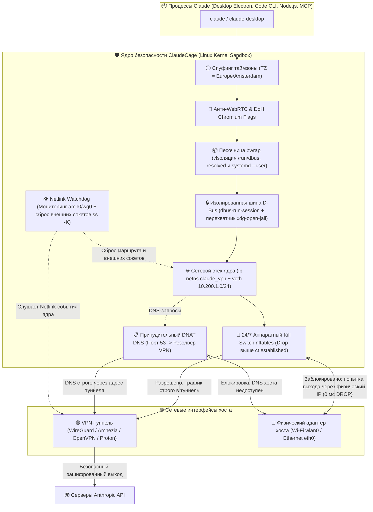
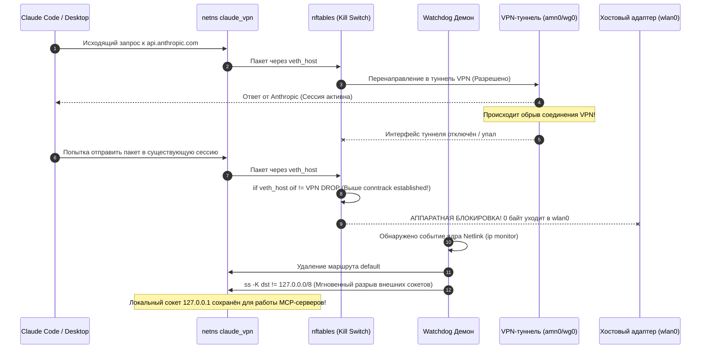

# 🛡️ ClaudeCage (Linux)

> **Многоуровневая эшелонированная оборона на уровне ядра Linux для Claude Code (CLI) и Claude Desktop (Electron). 100% защита от антифрода Anthropic, аппаратный Kill Switch и нулевая утечка реального IP, DNS, WebRTC и геолокации.**

[-blue.svg?logo=linux)](https://github.com/NikitaLozinsky/ClaudeCage_Linux)
[](https://github.com/NikitaLozinsky/ClaudeCage_Linux)
[](https://github.com/NikitaLozinsky/ClaudeCage_Linux)
[](https://github.com/NikitaLozinsky/ClaudeCage_Linux)
[](LICENSE)

---

## 🚀 1. Как устроен ClaudeCage и почему это круто

Внутри **ClaudeCage** реализована многоуровневая эшелонированная оборона на уровне ядра операционной системы Linux. Все процессы Claude изолируются в отдельном сетевом пространстве (`ip netns`), запускаются внутри песочницы монтирования (`bubblewrap`) с собственной шиной D-Bus, а трафик фильтруется аппаратным брандмауэром `nftables`:



---

## ⚠️ 2. Модель угроз: почему обычного VPN недостаточно под Linux

Использование стандартного системного VPN-клиента на рабочей станции Linux несёт в себе скрытые векторы деанонимизации для антифрод-систем Anthropic:

1. **Conntrack Session Bleed (Утечка при обрыве туннеля)**:  
   При падении VPN ядро Linux мгновенно переключает маршрут по умолчанию на `wlan0`/`eth0`. Уже открытые TCP-сессии (`ct state established`) продолжают слать пакеты через реального провайдера в обход туннеля. Антифрод Anthropic видит смену IP посреди сессии и отправляет аккаунт в бан.
2. **DNS & DoH Leaks (Утечки резолвинга)**:  
   Служба `systemd-resolved` или локальный кэширующий DNS хоста может резолвить домены через DNS-серверы провайдера. Встроенный в Electron механизм DoH (DNS over HTTPS) также способен обходить системный туннель.
3. **WebRTC Local Candidate Leaks**:  
   Chromium/Electron опрашивает сетевые интерфейсы через WebRTC, передавая внешний и локальный IP-адрес хоста даже при активном VPN.
4. **D-Bus Portal Bypass (Утечка через браузер хоста)**:  
   При переходе по внешним ссылкам (авторизация, документация) Electron обращается к сервису `xdg-desktop-portal` через сессионный D-Bus хоста, открывая ссылку в основном браузере хоста **вне защищенного туннеля**.
5. **Keyring & Timezone Anti-Fraud Mismatch**:  
   Несоответствие между системным временем (`Intl.DateTimeFormat`) и геолокацией VPN-сервера — мгновенный триггер для антифрода.

---

## 🛡️ 3. Пять эшелонов обороны ядра

### Эшелон 1: Сетевой Namespace ядра (`ip netns`)
Процессы Claude помещаются в изолированное сетевое пространство `claude_vpn`. У них **физически отсутствуют** адаптеры `wlan0`, `eth0` или Docker-мосты. Связь с хостом происходит исключительно по виртуальному патч-корду `veth_host (10.200.1.1) <-> veth_ns (10.200.1.2)`. IPv6 внутри клетки аппаратно отключен (`disable_ipv6=1`), исключая утечки через IPv6 SLAAC/DHCPv6.

### Эшелон 2: Аппаратный сетевой фильтр `nftables` (Hard Kill Switch)
- **DROP выше conntrack**: Правило сброса `iifname "veth_host" oifname != "$VPN_IFACE" drop` расположено **строго выше** `ct state established,related accept`. Даже если маршрут упал, ни один существующий сокет не просочится на хост.
- **Динамический MSS Clamping**: Правило `tcp flags syn tcp option maxseg size set rt mtu` динамически подстраивает размер TCP-сегмента под реальный MTU туннеля, устраняя фрагментацию и PMTUD-утечки.
- **Принудительный DNAT DNS**: Любые DNS-запросы (порт 53 UDP/TCP) принудительно перенаправляются на доверенный резолвер VPN (`100.64.0.1` или настроенный `VPN_DNS`).
- **Изоляция Input**: Клетка изолирована от локальных портов хоста (`10.200.1.1` и сервисов `localhost`).

### Эшелон 3: Песочница файловой системы и сокетов (`bubblewrap` + `setpriv`)
- **Безопасный сброс привилегий**: `setpriv` сбрасывает UID/GID до непривилегированного пользователя с очисткой возможностей (`--inh-caps=-all`) **до** входа в `bwrap`, исключая ошибки `setgroups failed` и LPE-векторы.
- **Сокрытие сокетов хоста**: Системный `/run/dbus`, `/run/systemd/resolve` и сокет пользовательского systemd (`${XDG_RUNTIME}/systemd`) скрываются через изолированные tmpfs.
- **Хранилище сессий**: Флаг `--password-store=basic` предотвращает потерю сессии Claude Desktop при отсутствии системного D-Bus keyring (`gnome-keyring` / `kwallet`).

### Эшелон 4: Автономный сессионный D-Bus и изоляция порталов
- Приложение запускается через `dbus-run-session`, поднимая чистую сессионную шину без сервисов хоста.
- Файл автоактивации портала `/usr/share/dbus-1/services/org.freedesktop.portal.Desktop.service` подменяется на `/dev/null`. Вызовы порталов возвращают `ServiceUnknown`, заставляя Electron использовать безопасный фолбэк на `xdg-open`.
- Выставлены переменные среды `GTK_USE_PORTAL=0 GDK_DEBUG=no-portals`.

### Эшелон 5: Watchdog демон реального времени (Netlink)
- Фоновый демон слушает события ядра через Netlink (`ip monitor link route`).
- Исключена утечка файловых дескрипторов `flock`: закрытие дескриптора в подпроцессе гарантирует мгновенный и чистый перезапуск клетки.
- При падении туннеля VPN вызывается `ss -K dst != 127.0.0.0/8`: ядро мгновенно рвёт внешние соединения, но **сохраняет loopback `127.0.0.1`**, гарантируя бесперебойную работу локальных MCP-серверов и IPC Claude Code.

---

## ⚡ 4. Поведение при обрыве связи (Hard Kill Switch в действии)



---

## 📦 5. Быстрый старт и установка за 1 минуту

### Требования
- Linux-дистрибутив с ядром $\ge$ 5.4 (Arch Linux, Debian, Ubuntu, Fedora, Manjaro и др.)
- Установленные утилиты: `iproute2`, `nftables`, `bubblewrap`, `util-linux`, `xclip`, `libnotify`, `dbus`

### Установка

```bash
git clone https://github.com/NikitaLozinsky/ClaudeCage_Linux.git
cd ClaudeCage_Linux
./install.sh
```

Инсталлятор в автоматическом режиме:
1. Проверит наличие всех необходимых зависимостей.
2. Установит системный оркестратор `/usr/local/bin/claude-vpn` с правами `root:root 0755`.
3. Сконфигурирует безопасный `sudoers` без ввода пароля (`!use_pty`, защита от LPE).
4. Определит ваш активный VPN-интерфейс (`amn0`, `wg0`, `tun0`, `proton0`).
5. Настроит прозрачные обёртки в `~/.local/bin/` и интеграции для Fish-шелла и меню приложений.

---

## 🩺 6. Комплексная диагностика (`celltest`)

Для полной уверенности в неуязвимости системы в репозиторий включена диагностическая утилита **`celltest`**, проверяющая **20 параметров** по 5 ключевым категориям:

```bash
celltest
```

```
╔══════════════════════════════════════════════════════════════════╗
║         CELLTEST: Диагностика изоляции и защиты от антифрода     ║
╚══════════════════════════════════════════════════════════════════╝

━━━ 1. Ядро Linux и Сетевой Namespace ━━━
  ✔ Сетевое пространство (netns) 'claude_vpn' создано в ядре
  ✔ Интерфейс veth_host на хосте активен (10.200.1.1)
  ✔ Интерфейс veth_ns внутри netns активен (10.200.1.2, MTU 1376)
  ✔ Фоновый Watchdog демон активен (PID: 208905)

━━━ 2. Kill Switch и Защита от Утечек Трафика ━━━
  ✔ VPN интерфейс (amn0) активен: 10.x.x.x (VPN IP)
  ✔ Таблица nftables 'inet claude_vpn_nat' загружена
  ✔ Аппаратный Kill Switch активен: весь трафик мимо amn0 сбрасывается (DROP)
  ✔ IPv6 внутри клетки полностью отключен (0 утечек через IPv6)

━━━ 3. Изоляция DNS (DNS Leak Protection) ━━━
  ✔ Системный DNS внутри клетки: 100.64.0.1 (изолированный резолвер VPN)
  ✔ DNS резолвинг доменов Anthropic через VPN: РАБОТАЕТ

━━━ 4. Защита от Антифрода (IP, Гео и Timezone) ━━━
  ✔ Часовой пояс среды совпадает с сервером VPN: Europe/Amsterdam
  ✔ Внешний IP адрес внутри клетки: 198.51.100.x (Защищённый выход VPN)
  ✔ VPN (amn0) является активным шлюзом (хост и клетка в одной сети VPN: 198.51.100.x)

━━━ 5. Точки запуска и Защита от Перезаписи (Обновления) ━━━
  ✔ Fish-функция 'claude' настроена (абсолютный приоритет над PATH)
  ✔ Fish-функция 'claude-desktop' настроена
  ✔ Обёртка ~/bin/claude готова к работе
  ✔ Обёртка ~/bin/claude-desktop готова к работе
  ✔ Перехватчик ~/.local/bin/claude активен
  ✔ Меню приложений и Rofi жестко привязаны к изолированной обертке
  ✔ Хоткей Super+Shift+C привязан к изолированному запуску (~/bin/claude-app)

━━━ Итоговый результат ━━━
Проверено тестов: 20 | Ошибок: 0 | Предупреждений: 0
╔══════════════════════════════════════════════════════════════════╗
║   [✓] ВСЕ СИСТЕМЫ ЗАЩИТЫ АКТИВНЫ (100% готов к безопасной работе)║
╚══════════════════════════════════════════════════════════════════╝
```

---

## 💻 7. Повседневное использование и CLI-команды

После установки использование Claude происходит привычным образом — скрипты прозрачно перехватывают вызовы:

```bash
# Запуск Claude Code CLI (консольная версия)
claude

# Запуск десктопного приложения Claude Desktop
claude-desktop

# Выполнение любой утилиты внутри изолированной клетки
claude-vpn exec -- ping -c 1 127.0.0.1
claude-vpn exec -- curl https://icanhazip.com

# Служебные команды оркестратора
claude-vpn --status      # Подробный статус туннеля, netns, MTU и маршрутов
claude-vpn --up          # Принудительное поднятие сети клетки
claude-vpn --down        # Полная очистка правил nftables и удаление netns
```

---

## ⚙️ 8. Конфигурация (`claude-vpn.conf`)

Конфигурационный файл создаётся автоматически в `~/.config/claude-vpn.conf` (или глобальный в `/etc/claude-vpn.conf`):

```ini
# Сетевой интерфейс вашего VPN-клиента (default: amn0)
# Поддерживаются: amn0 (Amnezia), wg0 (WireGuard), tun0 (OpenVPN), proton0 (ProtonVPN)
VPN_IFACE="amn0"

# Адрес изолированного DNS-резолвера туннеля
VPN_DNS="100.64.0.1"

# Эмулируемый часовой пояс (должен соответствовать локации вашего VPN)
CLAUDE_TZ="Europe/Amsterdam"
```

---

## 🔒 9. Безопасность и защита от LPE

- **Исключение LPE (Local Privilege Escalation)**: Оркестратор расположен в системной директории `/usr/local/bin/claude-vpn` с владельцем `root:root` и правами `0755`. В конфигурации `sudoers` директива `!use_pty` блокирует атаки внедрения команд через TTY (TIOCSTI).
- **Безопасный парсинг**: Параметры из пользовательских файлов конфигурации извлекаются с помощью строгой регулярной фильтрации **без использования команды `source`**.
- **Сохранение интерактивности TTY**: Прямой вызов `exec` без промежуточных sudo-оболочек сохраняет обработку сигналов `SIGWINCH` (ресайз окна терминала) и `SIGINT` (Ctrl+C).

---

## 📄 10. Лицензия и копирайт

Проект распространяется под свободной лицензией [MIT](LICENSE).  
Автор: **Nikita Lozinsky**  
Код и архитектурные решения: **Google DeepMind Antigravity Pair-Programming Agent**.
