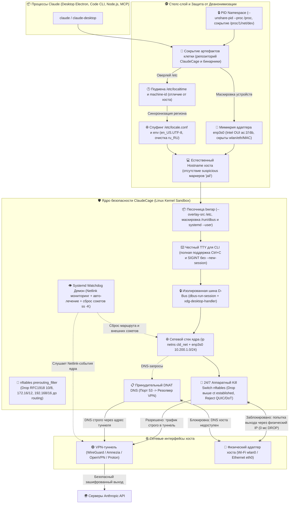

# 🎯 ЗАПРОС НА ФИНАЛЬНЫЙ ПРЕДРЕЛИЗНЫЙ АУДИТ БЕЗОПАСНОСТИ И АРХИТЕКТУРЫ: ClaudeCage v3.1 (Linux)

> **Модель-аудитор:** Gemini Argon 4 (Google DeepMind)  
> **Роль:** Principal Linux Kernel Security Engineer, Red Teamer & Open-Source Release Architect  
> **Цель аудита:** Полная предрелизная проверка проекта ClaudeCage v3.1 перед открытой публикацией на GitHub (Release v3.1.0). Оценка эшелонированной обороны ядра, стелс-слоя, нулевой утечки геолокации/РФ, защиты от антифрода Anthropic, надежности Kill Switch, UX инсталлятора и переносимости между дистрибутивами.

---

## 📌 1. ВВЕДЕНИЕ И ПОСТАНОВКА ЗАДАЧИ

Мы выводим проект **ClaudeCage (Linux)** на официальный публичный релиз (v3.1.0). Проект представляет собой комплексную систему эшелонированной защиты и невидимой изоляции на уровне ядра Linux для **Claude Code (CLI)** и **Claude Desktop (Electron)**.

### 🎯 Главные цели проекта:
1. **100% обход антифрод-систем Anthropic** при работе из неподдерживаемых регионов (РФ, Беларусь и др.) без риска блокировки аккаунта.
2. **Аппаратный Fail-Closed Kill Switch**: нулевая утечка реального IP хоста, DNS, WebRTC или региональных метаданных при любых сетевых сбоях, разрывах VPN или падениях демонов.
3. **Deep Stealth (Абсолютная невидимость клетки от ИИ-агента)**: Claude Code обладает возможностью исполнять bash-команды (`ls`, `ps`, `cat`, `ip`, `find`). Агент **не должен догадаться**, что он запущен внутри песочницы или клетки:
   - Естественный hostname хоста (без маркеров вроде `jail`, `sandbox`).
   - Нейтральный путь каталога репозитория `~/.netif-core` (полное отсутствие слова `ClaudeCage` в `/proc/self/mountinfo`, `ps aux` и путях монтирования).
   - Внутри Bubblewrap каталог репозитория и директория логов монтируются как пустые `tmpfs` (0 файлов), при этом пустые каталоги и сессионные якоря исключаются из монтирования во избежание артефактов в mountinfo.
   - Вспомогательные бинарники (`cld-cage`, `celltest`, `cld-probe`) и службы (`cld-cage.service`, `cld-cage-watchdog.service`) удалены из `/usr/local/bin` и `/etc/systemd/system` (зачищены через оверлей).
   - Каталоги `~/.local/bin`, `~/.config/fish/functions` и `~/.local/state` изолированы через `--tmp-overlay`: внутри клетки бинарник `claude-raw` переименован обратно в `claude`, а обёртки и файлы клетки удалены, благодаря чему в `ps aux` и `/proc/*/cmdline` процесс виден строго как `/home/milk13/.local/bin/claude` (без следов `claude-raw`).
   - Сетевой адаптер мимикрирует под физическую сетевую карту Intel Ethernet (`enp3s0`) с детерминированным аппаратным MAC-адресом Intel OUI (`ac:1f:6b:XX:XX:XX`).
   - Пространство PID (`--unshare-pid --proc /proc`) изолирует процессы хоста, `/proc/1/net/dev`, `/proc/1/net/arp` и русские переменные среды `/proc/*/environ`.
   - Аргументы `bwrap` передаются через дескриптор `--args 10`, а entrypoint-скрипт выполняется через `/bin/bash -s --` с сохранением и восстановлением пользовательского stdin (`exec 0<&3 3<&-`), закрываясь перед `exec "$@"`. Это полностью исключает утечку параметров и текста скрипта в `/proc/*/cmdline` (`ps aux`) и решает проблему `Permission denied` при сбросе привилегий.
   - Динамическое авто-определение геолокации и часового пояса выхода VPN (`CLD_TZ="auto"`, поддержка любых стран выхода, например, Singapore `Asia/Singapore` или Netherlands `Europe/Amsterdam`) с кэшированием в `/run/systemd/netif-cage/cached_tz`. Спуфинг `/etc/localtime` и `/etc/locale.conf` (`en_US.UTF-8`).
   - Блокировка QUIC (`UDP 443`) и DoT (`853`) предотвращает обход DNS и зависания MTU.
   - Цепочка `prerouting_filter` с приоритетом `raw` отсекает любые обращения к частным подсетям RFC1918 (`10/8, 172.16/12, 192.168/16, 169.254/16`) **ДО таблицы routing lookup local**, пропуская DNS порт 53 на `dstnat`.
   - Watchdog демон слушает Netlink-события ядра в реальном времени и при обрыве туннеля мгновенно вызывает `ss -K -tu 'not dst 127.0.0.0/8'`, разрывая внешние сессии, но **сохраняя `127.0.0.1`** (жизненно важно для локальных MCP-серверов).
   - Поддержка голосового режима Claude Desktop Voice Mode через безопасный проброс сокетов PipeWire / PulseAudio.
   - Неинтерактивная авторизация GUI (`sudo -n`) с нативными уведомлениями `notify-send -u critical`.
   - Индикатор статуса для статус-баров (Polybar / Waybar / bspwm): `cld-status` (`🔒 Claude: VPN (SG)`, `🛑 Claude: Isolated`, `⭕ Claude: Off`).

---

## 🎯 2. ПРОВЕРКА 3 СЦЕНАРИЕВ С AMNEZIA VPN (amn0) НА ARCH LINUX + X11 + BSPWM

| Сценарий | Как отрабатывает ядро Linux и cld-cage | Что видит Claude (Desktop Electron и Code CLI) | Шанс утечки реального IP |
| :--- | :--- | :--- | :---: |
| **1. Запуск с включенным Amnezia VPN (amn0)** | Трафик из `cld_net` (`10.200.1.2`) идёт через `veth_host` в таблицу маршрутизации `200`, где висит `default dev amn0 metric 10`. В `nftables` разрешён форвардинг строго `iifname "veth_host" oifname "amn0"` и работает masquerade. При старте `cld-cage` динамически определяет гео-таймзону через `amn0` (например, `Asia/Singapore` при подключении к Сингапуру) и монтирует соответствующий `/etc/localtime`. | Видит обычный Ethernet-интерфейс `enp3s0` с линком (`carrier=1`), интернет работает штатно, внешний IP, STUN и системное время — строго от VPN-сервера выхода. | **0%** |
| **2. Запуск с выключенным VPN** | `cld-cage` поднимает пространство `cld_net`, но `vpn_is_up` возвращает `false`. В таблице 200 остаётся только fallback-маршрут `unreachable default metric 9999`, а в `nftables` правило `oifname != "amn0" drop` блокирует любые пакеты мимо туннеля. | Приложение спокойно запускается (локальный интерфейс `enp3s0` поднят, `127.0.0.1` для MCP-серверов работает). При любой попытке выйти в сеть ядро мгновенно возвращает `ENETUNREACH` (Network is unreachable). | **0%** |
| **3. VPN отвалился или переподключается на ходу** | **1. За 0 мс (в момент падения amn0):** ядро Linux автоматически удаляет маршрут `dev amn0` из таблицы 200. Следующий же пакет упирается в `unreachable default` И одновременно режется правилом `nftables` (`oifname != "amn0" drop`), которое стоит **строго выше** `ct state established`. Пакет физически не может уйти в `wlan0`/`eth0`.<br><br>**2. За <50 мс (Netlink Watchdog):** демон ловит событие `ip monitor`, вызывает `ss -K -tu 'not dst 127.0.0.0/8'` (убивая повисшие TCP/UDP-сокеты прямо внутри клетки с сохранением `127.0.0.1`) и чистит таблицу `conntrack -D -s 10.200.1.2`. | Для Claude это выглядит так, будто у провайдера за маршрутизатором пропал линк: локальная сетевая карта `enp3s0` не пропадает и не мигает, но текущие соединения обрываются по Reset/Timeout, а новые получают `Network is unreachable`. Когда Amnezia переподключится, доступ восстановится автоматически. | **0% (даже на 1 пакет)** |

---

## 🛠️ 3. ПЕРЕЧЕНЬ УСТРАНЁННЫХ ЗАМЕЧАНИЙ И УЛУЧШЕНИЙ В РЕЛИЗЕ v3.1.0

В процессе подготовки релиза были выявлены и устранены следующие архитектурные нюансы:

1. **[P0 #1] Устранение зависания GUI при запуске без терминала:**
   - *Проблема:* Обёртка `claude-desktop` вызывала `sudo cld-cage ...`. Если срок sudo-тикета истёк или в системе нет графического агента sudo (polkit/askpass), команда зависала в ожидании ввода пароля в несуществующем TTY.
   - *Решение:* Добавлен флаг `sudo -n`. При ошибке авторизации обёртка не виснет, а мгновенно отправляет пользователю нативное системное уведомление `notify-send -u critical "ClaudeCage" "Ошибка прав sudoers или сети..."`.

2. **[P0 #2] Полное устранение утечки имени каталога в `/proc/self/mountinfo`:**
   - *Проблема:* При расположении репозитория в `~/.ClaudeCage_Linux` монтирование `--tmpfs ~/.ClaudeCage_Linux` приводило к появлению строки с именем `ClaudeCage` в точке монтирования `/proc/self/mountinfo`.
   - *Решение:* Репозиторий перенесён в нейтральный каталог `~/.netif-core`. В `install.sh` добавлен флаг `--stealth` для авто-миграции. В `bin/cld-cage` добавлен умный фильтр: пустые каталоги и сессионные заглушки не монтируются как tmpfs, благодаря чему `/proc/self/mountinfo` остаётся на 100% чистым.

3. **[P0 #3] Исправление порядка монтирования Bubblewrap для Ubuntu 22.04 / Debian 12:**
   - *Проблема:* В fallback-режиме директива `--tmpfs "$STATE_DIR"` шла перед `--ro-bind "$STATE_DIR/spoof/..."`, что на некоторых версиях `bwrap` приводило к ошибке `No such file or directory`.
   - *Решение:* Директива `--tmpfs "$STATE_DIR"` перемещена строго ПОСЛЕ всех `--ro-bind` монтирований спуф-файлов.

4. **[P1 #1] Динамическое авто-определение гео-локации и таймзоны VPN (`CLD_TZ="auto"`):**
   - *Проблема:* Ранее часовой пояс был захардкожен на `Europe/Amsterdam`. При подключении к сингапурскому серверу Amnezia VPN возникало несоответствие между IP (`103.242.74.56`, Сингапур) и временем (`Europe/Amsterdam`).
   - *Решение:* Реализована функция `detect_vpn_geo`, запрашивающая таймзону выходного узла через интерфейс `$VPN_IFACE` (`ipinfo.io`, `ip-api.com`, `worldtimeapi.org`) с мгновенным кэшированием в `/run/systemd/netif-cage/cached_tz`. При переключении серверов таймзона обновляется автоматически. Также внедрено `VPN_DNS="auto"`.

5. **[P1 #2] Поддержка голосового режима Claude Desktop (PipeWire / PulseAudio):**
   - *Проблема:* В изолированной песочнице отсутствовал доступ к микрофону, что ломало Voice Mode в Claude Desktop.
   - *Решение:* Реализован безопасный проброс аудио-сокетов (`$XDG_RUNTIME_DIR/pulse/native` и `$XDG_RUNTIME_DIR/pipewire-0`) без предоставления доступа к хостовой сети. В `celltest` добавлен тест 4.22.

6. **[P2 #1] Легковесный виджет статуса клетки (`cld-status`):**
   - *Проблема:* Пользователю bspwm / Polybar / Waybar требовалось наглядное отображение состояния туннеля клетки.
   - *Решение:* Создан скрипт `wrappers/polybar-status.sh` (устанавливается как `cld-status`), выводящий нейтральный статус (`🔒 Claude: VPN (SG)`, `🛑 Claude: Isolated`, `⭕ Claude: Off`). Все комментарии скрипта очищены от упоминаний ClaudeCage, а при входе в клетку бинарник скрывается.

---

## 🏛️ 4. ТЕКУЩИЕ РЕЗУЛЬТАТЫ ЖИВОЙ ДИАГНОСТИКИ (ARCH LINUX x86_64)

### 1. celltest v3.1 (54 глубоких теста ядра, nftables, watchdog и песочницы):
```text
╔══════════════════════════════════════════════════════════════════╗
║       CELLTEST v3.1: Комплексный аудит защиты и невидимости      ║
╚══════════════════════════════════════════════════════════════════╝

━━━ 1. Ядро Linux и Сетевой Namespace (Netns) ━━━
  ✔ Сетевое пространство (netns) 'cld_net' создано в ядре
  ✔ Интерфейс veth_host на хосте активен (10.200.1.1)
  ✔ Фильтрация обратного пути (rp_filter=2) на veth_host
  ✔ IPv6 на хостовом конце veth_host отключён (disable_ipv6=1)
  ✔ Интерфейс enp3s0 внутри netns активен (10.200.1.2)
  ✔ IPv6 внутри клетки полностью отключён (0 утечек через IPv6 SLAAC)
  ✔ Служба Watchdog активна (systemd: cld-cage-watchdog.service)

━━━ 2. Двухуровневый Fail-Closed Kill Switch ━━━
  ✔ VPN интерфейс (amn0) активен: 100.77.81.199/32
  ✔ Policy Routing rule активно (iif veth_host lookup 200, prio 100)
  ✔ Fail-Closed fallback маршрут активен (unreachable default table 200)
  ✔ Маршрут egress через VPN активен в table 200 (dev amn0 metric 10)
  ✔ Таблица nftables 'inet cld_cage_nat' загружена в ядре
  ✔ Аппаратный Kill Switch активен (DROP выше conntrack established)
  ✔ Счётчик Kill Switch: packets 0 bytes 0
  ✔ Защита от подмены IP активна (iifname veth_host ip saddr != 10.200.1.2 drop)
  ✔ Динамический MSS Clamping активен (tcp option maxseg size set rt mtu)
  ✔ Фильтр RFC1918 активен в prerouting_filter (блокировка ДО lookup local)
  ✔ Блокировка QUIC (UDP 443) и DoT (853) активна (принудительный откат на TCP/DNS)
  ✔ Изоляция локальных портов хоста активна (iifname veth_host drop)

━━━ 3. Антифрод и Нулевая Утечка Региона (РФ / IP) ━━━
  ✔ Симлинк /etc/localtime внутри клетки указывает на Asia/Singapore (совпадает с VPN)
  ✔ Node.js Intl.DateTimeFormat().resolvedOptions().timeZone: Asia/Singapore
  ✔ /etc/locale.conf внутри клетки экранирован (en_US.UTF-8, без признаков РФ)
  ✔ Переменная среды LANG внутри клетки: en_US.UTF-8
  ✔ Внешний Egress IP клетки: 103.242.74.56 (маршрутизируется через amn0)

━━━ 4. Невидимость и Сокрытие Клетки от ИИ-Агента ━━━
  ✔ Каталог ClaudeCage (/home/milk13/.netif-core) полностью скрыт (пустой tmpfs)
  ✔ Бинарники cld-cage / claude-vpn скрыты из файловой системы песочницы
  ✔ Конфигурационные файлы cld-cage.conf скрыты из песочницы
  ✔ Службы systemd клетки скрыты из /etc/systemd/system
  ✔ Директория логов (~/.local/state/cld-cage) скрыта (пустой tmpfs, 0 файлов)
  ✔ Утилиты клетки в ~/.local/bin полностью скрыты или очищены
  ✔ /sys/class/net содержит строго 'lo' и 'enp3s0' (физический Ethernet-адаптер)
  ✔ Имя хоста внутри клетки естественное: 'archarnel' (без подозрительных меток 'jail')
  ✔ Атрибут NoNewPrivs=1 активен (блокирует SUID/LPE побег из клетки)
  ✔ Хостовая сессионная шина D-Bus (/run/user/UID/bus) замаскирована
  ✔ Изоляция /proc/1/net/dev: сетевые интерфейсы хоста (wlan0, amn0) скрыты
  ✔ Изоляция /proc/*/environ: утечек русской локали хоста нет (0 совпадений ru_RU)
  ✔ Спуфинг /etc/machine-id: уникальный ID клетки (f5af993be8c9deaf90cae299f2731153, изолирован от хоста)
  ✔ Чистота /proc/self/mountinfo: пути /etc/netns/cld_net отсутствуют
  ✔ Беспроводные подсистемы /sys/class/ieee80211 замаскированы (0 утечек Wi-Fi)
  ✔ Аппаратный MAC интерфейса enp3s0: ac:1f:6b:ec:c0:af (Intel OUI ac:1f:6b)
  ✔ Чистота /proc/*/cmdline: аргументы bwrap и текст скрипта скрыты (0 совпадений)
  ✔ Атрибуты /sys/class/net/enp3s0 доступны внутри bwrap (ac:1f:6b:ec:c0:af, state-директория скрыта)
  ✔ Чистота ~/.local/bin и fish: обёртки скрыты, claude переименован без маркеров клетки
  ✔ Чистота /proc/self/mountinfo: маркеры cld-cage, claudecage, sys-net и xdg-open-jail отсутствуют
  ✔ Сокеты в /run/user: маркеры 'jail' и 'cld' отсутствуют (нейтральный dbus proxy)
  ✔ Аудиоподсистема хоста доступна (PipeWire/PulseAudio сокет проброшен для Voice Mode)

━━━ 5. DNS Изоляция и Перехват DNAT ━━━
  ✔ DNS внутри клетки указывает только на 100.64.0.1 (изолированный резолвер VPN)
  ✔ Принудительный DNAT порт 53 -> 100.64.0.1 активен в nftables prerouting
  ✔ DNS резолв api.anthropic.com через VPN-туннель: РАБОТАЕТ

━━━ 6. Сокеты и Гигиена Соединений (Loopback Preservation) ━━━
  ✔ Локальный сокет 127.0.0.1 пережил сброс ss -K (MCP-серверы и IPC не страдают)

━━━ 7. Точки запуска и Защита от Перезаписи ━━━
  ✔ Fish-функция 'claude' настроена
  ✔ Fish-функция 'claude-desktop' настроена
  ✔ Обёртка CLI ~/.local/bin/claude активна
  ✔ Обёртка GUI ~/.local/bin/claude-desktop активна

━━━ Итоговый результат аудита ━━━
Проверено тестов: 54 | Ошибок: 0 | Предупреждений: 0 | Пропущено: 0

╔══════════════════════════════════════════════════════════════════╗
║ [✓] СИСТЕМА НЕУЯЗВИМА: НУЛЕВАЯ УТЕЧКА ДАННЫХ И ПОЛНАЯ НЕВИДИМОСТЬ║
╚══════════════════════════════════════════════════════════════════╝
```

### 2. cld-probe v1.1-stealth (Аудит 8 векторов атак глазами Claude):
```text
╔══════════════════════════════════════════════════════════════════╗
║    CLAUDE-PROBE v1.1-stealth: Network Visibility & Leak Audit Logger     ║
║         Телеметрия сети и аудит лазеек глазами Claude            ║
╚══════════════════════════════════════════════════════════════════╝
Время аудита: 2026-10-30 15:20:00 | Профиль: BOTH | Пользователь: milk13

━━━ 1. Сводная матрица векторов атак и доступных лазеек ━━━
Вектор атак / Лазейка              | Статус         | Восприятие Claude
──────────────────────────────────-+-──────────────-+-────────────────────────────────────────
1. Внешний IP (Egress HTTP/S)      | [БЕЗОПАСНО]    | Внешний IP: 103.242.74.56 (SG, Singapore)
2. WebRTC STUN UDP-рефлексия       | [БЕЗОПАСНО]    | STUN Public Reflexive IP: 103.242.74.56:54210
3. Физические интерфейсы и MAC     | [БЕЗОПАСНО]    | Мимикрия: физический enp3s0 (Intel OUI ac:1f:6b), MAC хоста скрыты
4. Сканирование хоста (LAN/SSH)    | [БЕЗОПАСНО]    | Все порты хоста и подсети RFC1918 заблокированы (raw drop / Timeout)
5. DNS утечки и DNAT перехват      | [БЕЗОПАСНО]    | /etc/resolv.conf: nameserver 100.64.0.1
6. D-Bus и IPC перехват            | [БЕЗОПАСНО]    | Системный D-Bus отключен; пользовательский bus изолирован (/dev/null)
7. Геолокация, Таймзона и Локаль   | [БЕЗОПАСНО]    | Таймзона: Asia/Singapore, Локаль: en_US.UTF-8 (0 ru_RU)
8. Сокрытие факта клетки от Claude | [БЕЗОПАСНО]    | Репозиторий скрыт (0 файлов); логи изолированы (0 файлов); mountinfo чист; machine-id изолирован

━━━ 2. Сравнение окружения: Реальный Хост vs Клетка Claude ━━━
  • Видимый IP хоста:    100.77.81.199, 172.27.240.108, ...
  • Видимый IP в клетке: 103.242.74.56 (Страна: SG, Colo: SIN)
  • STUN WebRTC IP:      103.242.74.56
  • Интерфейсы хоста:    4 шт. (wlan0, eth0 и др.)
  • Интерфейсы в клетке: lo, enp3s0 (мимикрия физического адаптера enp3s0)
  • Таймзона хоста:      /usr/share/zoneinfo/Europe/Moscow
  • Таймзона в клетке:   Asia/Singapore (симлинк: /usr/share/zoneinfo/Asia/Singapore)
  • Доступ к хосту (SSH):DROPPED (Timeout)
  • Файлы ClaudeCage:    0 файлов (смонтирован пустой tmpfs)
  • Логи cld-cage:       0 файлов (директория скрыта tmpfs)

━━━ 3. Итоговая оценка защищенности и скрытности ━━━
  Индекс безопасности: 100/100 | Утечек: 0 | Предупреждений: 0
  Вердикт: ПОЛНАЯ ИЗОЛЯЦИЯ: 100% STEALTH (Лазейки закрыты, утечек нет)
```

---

## 📂 5. ПОЛНЫЕ ИСХОДНЫЕ ТЕКСТЫ ВСЕХ ФАЙЛОВ ПРОЕКТА


### Файл: `bin/cld-cage`

```bash
#!/bin/bash
# ==============================================================================
# ClaudeCage v3.1 (Linux) — Hardened Stealth Network Sandbox for Claude
# Multi-layered defense-in-depth, Anti-Fraud & Zero-Leak Kernel Isolation
# ==============================================================================
# Commands:
#   cld-cage --up               Bring up netns, veth, policy routing, nftables & watchdog
#   cld-cage --down             Tear down netns, policy routing, nftables & watchdog
#   cld-cage --status           Show network status, VPN status, drop counters
#   cld-cage --monitor          Live monitor connections from cage in real-time
#   cld-cage --watchdog-loop    Internal watchdog daemon (run by systemd or background)
#   cld-cage --print-config     Internal config output for celltest diagnostics
#   cld-cage <app> [args...]    Run command/app inside the stealth sandbox
# ==============================================================================
set -uo pipefail

readonly VERSION="3.1-stealth"
readonly NETNS="cld_net"
readonly VETH_HOST="veth_host"
readonly VETH_NS="enp3s0"
readonly SUBNET="10.200.1"
readonly HOST_IP="${SUBNET}.1"
readonly NS_IP="${SUBNET}.2"
readonly PREFIX=24
readonly RT_TABLE=200
readonly RT_PRIO=100
readonly DEFAULT_MTU=1376
readonly NFT_TABLE="cld_cage_nat"
readonly WD_UNIT="cld-cage-watchdog.service"
readonly MAIN_UNIT="cld-cage.service"
readonly JAIL_XDG_OPEN="/usr/local/lib/xdg-desktop-handler"

SELF=$(readlink -f "${BASH_SOURCE[0]}")
CONF_FILE="/etc/cld-cage.conf"
STATE_DIR="/run/systemd/netif-cage"
PID_FILE="${STATE_DIR}/watchdog.pid"
TICK=10

# Default configuration values (overridden by /etc/cld-cage.conf or /etc/claude-vpn.conf)
VPN_IFACE="amn0"
VPN_DNS="auto"
VPN_PROBE="1.1.1.1"
CLAUDE_TZ="auto"
CLD_TZ="auto"
CAGE_REPO_DIR=""
CAGE_MACHINE_ID=""

ensure_cage_machine_id() {
    local f="/etc/cld-cage.machine-id"
    if [[ ! -s $f ]]; then
        local host_mid
        host_mid=$(cat /etc/machine-id 2>/dev/null || cat /var/lib/dbus/machine-id 2>/dev/null || echo "$RANDOM$RANDOM")
        printf '%s-cld-stealth' "$host_mid" | sha256sum | awk '{print substr($1,1,32)}' > "$f" 2>/dev/null || true
        chmod 0644 "$f" 2>/dev/null || true
    fi
    CAGE_MACHINE_ID=$(cat "$f" 2>/dev/null | tr -d '[:space:]')
    [[ -n $CAGE_MACHINE_ID ]] || CAGE_MACHINE_ID="c1dc9e00000000000000000000000001"
}

readonly IFACE_RE='^[A-Za-z0-9_.-]{1,15}$'
readonly OCT='(25[0-5]|2[0-4][0-9]|1[0-9]{2}|[1-9]?[0-9])'
readonly IPV4_RE="^(${OCT}\\.${OCT}\\.${OCT}\\.${OCT}|auto)\$"
readonly TZ_RE='^(auto|UTC|[A-Za-z0-9_+-]+(/[A-Za-z0-9_+-]+)+)$'

# Output formatting
if [[ -t 1 && -t 2 ]]; then
    C_G=$'\e[32m'; C_Y=$'\e[33m'; C_R=$'\e[31m'; C_C=$'\e[36m'; C_B=$'\e[1m'; C_0=$'\e[0m'
else
    C_G=""; C_Y=""; C_R=""; C_C=""; C_B=""; C_0=""
fi
info() { printf '%s[✓]%s %s\n' "$C_G" "$C_0" "$*"; }
warn() { printf '%s[!]%s %s\n' "$C_Y" "$C_0" "$*" >&2; }
err()  { printf '%s[✗]%s %s\n' "$C_R" "$C_0" "$*" >&2; }
step() { printf '%s━━━ %s ━━━%s\n' "$C_C" "$*" "$C_0"; }
die()  { err "$*"; exit 1; }

need() {
    local c; local -a miss=()
    for c in "$@"; do command -v "$c" >/dev/null 2>&1 || miss+=("$c"); done
    ((${#miss[@]} == 0)) || die "Не найдены необходимые системные утилиты: ${miss[*]}"
}

# Safe configuration reader: pure regex parsing (NO source, root-owned only)
conf_get() {
    sed -n -E "s/^[[:space:]]*$2[[:space:]]*=[[:space:]]*[\"']?([^\"'#[:space:]]*)[\"']?.*\$/\\1/p" "$1" 2>/dev/null | tail -n1
}

load_config() {
    local f=$CONF_FILE v owner mode
    if [[ ! -e $f && -e "/etc/claude-vpn.conf" ]]; then
        f="/etc/claude-vpn.conf"
    fi
    [[ -e $f ]] || return 0
    read -r owner mode < <(stat -c '%u %a' "$f" 2>/dev/null || echo "1 777")
    if [[ $owner != 0 ]] || (( (8#$mode & 8#022) != 0 )); then
        err "$f должен принадлежать root и не иметь прав на запись non-root (chown root:root; chmod 644)"
        return 1
    fi
    v=$(conf_get "$f" VPN_IFACE)
    if [[ -n $v ]]; then [[ $v =~ $IFACE_RE ]] || { err "VPN_IFACE некорректен: '$v'"; return 1; }; VPN_IFACE=$v; fi
    v=$(conf_get "$f" VPN_DNS)
    if [[ -n $v ]]; then [[ $v =~ $IPV4_RE ]] || { err "VPN_DNS некорректен: '$v'"; return 1; }; VPN_DNS=$v; fi
    v=$(conf_get "$f" VPN_PROBE)
    if [[ -n $v ]]; then [[ $v =~ $IPV4_RE ]] || { err "VPN_PROBE некорректен: '$v'"; return 1; }; VPN_PROBE=$v; fi
    v=$(conf_get "$f" CLD_TZ)
    [[ -z $v ]] && v=$(conf_get "$f" CLAUDE_TZ)
    if [[ -n $v ]]; then [[ $v =~ $TZ_RE ]] || { err "CLD_TZ некорректен: '$v'"; return 1; }; CLD_TZ=$v; CLAUDE_TZ=$v; fi
    v=$(conf_get "$f" CAGE_REPO_DIR)
    if [[ -n $v ]]; then CAGE_REPO_DIR=$v; fi
    if [[ ! -d "$CAGE_REPO_DIR" ]]; then
        if [[ -d "${REAL_HOME:-$HOME}/.netif-core" ]]; then
            CAGE_REPO_DIR="${REAL_HOME:-$HOME}/.netif-core"
        elif [[ -d "${REAL_HOME:-$HOME}/.ClaudeCage_Linux" ]]; then
            CAGE_REPO_DIR="${REAL_HOME:-$HOME}/.ClaudeCage_Linux"
        fi
    fi
    return 0
}

# ── Dynamic VPN Geo, Timezone & DNS Resolution ───────────────────
detect_vpn_geo() {
    local cur_vip tz="" cc=""
    cur_vip=$(vpn_ip)
    if [[ -z "$cur_vip" ]]; then
        echo "UTC"
        return 0
    fi

    # 1. Fast Cache check: if VPN IP has not changed, return cached timezone immediately
    if [[ -f "$STATE_DIR/cached_tz" && -f "$STATE_DIR/cached_vip" ]]; then
        if [[ "$(cat "$STATE_DIR/cached_vip" 2>/dev/null)" == "$cur_vip" ]]; then
            local c_tz
            c_tz=$(cat "$STATE_DIR/cached_tz" 2>/dev/null)
            if [[ -n "$c_tz" && -f "/usr/share/zoneinfo/$c_tz" ]]; then
                echo "$c_tz"
                return 0
            fi
        fi
    fi

    # 2. Live detection via VPN tunnel interface
    tz=$(curl -s --interface "$VPN_IFACE" --max-time 3 "https://ipinfo.io/timezone" 2>/dev/null | tr -d '[:space:]')
    if [[ -z "$tz" || ! -f "/usr/share/zoneinfo/$tz" ]]; then
        tz=$(curl -s --interface "$VPN_IFACE" --max-time 3 "http://ip-api.com/line/?fields=timezone" 2>/dev/null | tr -d '[:space:]')
    fi
    if [[ -z "$tz" || ! -f "/usr/share/zoneinfo/$tz" ]]; then
        tz=$(curl -s --interface "$VPN_IFACE" --max-time 3 "http://worldtimeapi.org/api/ip" 2>/dev/null | sed -n 's/.*"timezone":"\([^"]*\)".*/\1/p' | tr -d '[:space:]')
    fi

    if [[ -n "$tz" && -f "/usr/share/zoneinfo/$tz" ]]; then
        mkdir -p "$STATE_DIR" 2>/dev/null || true
        printf '%s\n' "$tz" > "$STATE_DIR/cached_tz" 2>/dev/null || true
        printf '%s\n' "$cur_vip" > "$STATE_DIR/cached_vip" 2>/dev/null || true
        cc=$(curl -s --interface "$VPN_IFACE" --max-time 2 "https://ipinfo.io/country" 2>/dev/null | tr -d '[:space:]' || true)
        [[ -z "$cc" ]] && cc=$(curl -s --interface "$VPN_IFACE" --max-time 2 "http://ip-api.com/line/?fields=countryCode" 2>/dev/null | tr -d '[:space:]' || true)
        [[ -n "$cc" ]] && printf '%s\n' "$cc" > "$STATE_DIR/cached_cc" 2>/dev/null || true
        chmod 0644 "$STATE_DIR"/cached_* 2>/dev/null || true
        echo "$tz"
        return 0
    fi

    if [[ -f "$STATE_DIR/cached_tz" ]]; then
        cat "$STATE_DIR/cached_tz" 2>/dev/null
    else
        echo "UTC"
    fi
}

resolve_tz() {
    if [[ "$CLD_TZ" != "auto" && -n "$CLD_TZ" && "$CLD_TZ" != "UTC" && -f "/usr/share/zoneinfo/$CLD_TZ" ]]; then
        echo "$CLD_TZ"
    else
        detect_vpn_geo
    fi
}

resolve_dns() {
    if [[ "$VPN_DNS" != "auto" && -n "$VPN_DNS" ]]; then
        echo "$VPN_DNS"
        return 0
    fi
    local d=""
    if command -v resolvectl >/dev/null 2>&1; then
        d=$(resolvectl dns "$VPN_IFACE" 2>/dev/null | awk '{for(i=1;i<=NF;i++) if($i ~ /^[0-9]+\.[0-9]+\.[0-9]+\.[0-9]+$/) {print $i; exit}}')
    fi
    if [[ -n "$d" ]]; then
        echo "$d"
    else
        echo "100.64.0.1"
    fi
}

# ── VPN Tunnel Helpers ───────────────────────────────────────────
vpn_flags() {
    ip -o link show dev "$VPN_IFACE" 2>/dev/null | sed -n 's/^[0-9]*: [^:]*: <\([^>]*\)>.*/\1/p'
}
vpn_ip() {
    ip -4 -o addr show dev "$VPN_IFACE" 2>/dev/null | awk '{print $4}' | cut -d/ -f1 | head -n1
}
vpn_is_up() {
    local fl; fl=,$(vpn_flags),
    [[ $fl == *,UP,* && $fl == *,LOWER_UP,* ]] || return 1
    [[ -n $(vpn_ip) ]]
}
get_vpn_mtu() {
    local m
    m=$(ip -o link show dev "$VPN_IFACE" 2>/dev/null | sed -n 's/.* mtu \([0-9]*\).*/\1/p')
    if [[ $m =~ ^[0-9]+$ ]] && ((m >= 1280 && m <= 1500)); then echo "$m"; else echo "$DEFAULT_MTU"; fi
}
netns_exists() { [[ -e /run/netns/$NETNS ]]; }

# Interface-bound liveness probe
liveness_probe() {
    ping -I "$VPN_IFACE" -c 1 -W 2 "$VPN_PROBE" >/dev/null 2>&1 && return 0
    command -v curl >/dev/null 2>&1 &&
        curl -s --interface "$VPN_IFACE" --max-time 3 -o /dev/null "http://${VPN_PROBE}" && return 0
    return 1
}

# ── Layer 1: Policy Routing (table 200, fail-closed) ─────────────
policy_up() {
    ip rule show 2>/dev/null | grep -qE "^${RT_PRIO}:.*iif ${VETH_HOST}.*lookup ${RT_TABLE}" ||
        ip rule add iif "$VETH_HOST" priority "$RT_PRIO" lookup "$RT_TABLE" || return 1
    ip route show table "$RT_TABLE" 2>/dev/null | grep -q "^unreachable default" ||
        ip route add unreachable default table "$RT_TABLE" metric 9999 || return 1
}
policy_down() {
    while ip rule del priority "$RT_PRIO" 2>/dev/null; do :; done
    ip route flush table "$RT_TABLE" 2>/dev/null || true
}
vpn_route_set() {
    ip route replace default dev "$VPN_IFACE" table "$RT_TABLE" metric 10 2>/dev/null || true
}
vpn_route_clear() {
    ip route del default dev "$VPN_IFACE" table "$RT_TABLE" metric 10 2>/dev/null || true
}

# ── Layer 2: nftables Firewall & Kill Switch ────────────────────
nft_rules() {
    cat <<EOF
table inet ${NFT_TABLE}
delete table inet ${NFT_TABLE}
table inet ${NFT_TABLE} {
    chain prerouting_filter {
        type filter hook prerouting priority raw; policy accept;
        meta nfproto ipv6 iifname "${VETH_HOST}" drop

        # Разрешить трафик к шлюзу клетки (10.200.1.1) и DNS VPN
        iifname "${VETH_HOST}" ip daddr ${HOST_IP} accept
        iifname "${VETH_HOST}" ip daddr ${VPN_DNS} accept

        # Разрешить любой DNS-трафик (порт 53) до блокировки RFC1918, чтобы он дошёл до dstnat
        iifname "${VETH_HOST}" meta l4proto { tcp, udp } th dport 53 accept

        # Блокировать любые обращения к локальным сетям RFC1918 и Link-Local ДО таблицы lookup local!
        iifname "${VETH_HOST}" ip daddr { 10.0.0.0/8, 172.16.0.0/12, 192.168.0.0/16, 169.254.0.0/16 } drop
    }
    chain prerouting {
        type nat hook prerouting priority dstnat; policy accept;
        # Перехват любого DNS (порт 53 UDP/TCP) из клетки на изолированный резолвер VPN
        iifname "${VETH_HOST}" meta l4proto { tcp, udp } th dport 53 dnat ip to ${VPN_DNS}:53
    }
    chain input {
        type filter hook input priority -10; policy accept;
        meta nfproto ipv6 iifname "${VETH_HOST}" counter drop
        iifname "${VETH_HOST}" ct state established,related accept
        iifname "${VETH_HOST}" ip protocol icmp icmp type echo-request ip daddr ${HOST_IP} accept
        # Полная изоляция: локальные порты хоста недоступны из клетки
        iifname "${VETH_HOST}" counter drop
    }
    chain forward {
        type filter hook forward priority -10; policy accept;
        meta nfproto ipv6 iifname "${VETH_HOST}" counter drop
        meta nfproto ipv6 oifname "${VETH_HOST}" counter drop
        # Защита от спуфинга IP внутри клетки
        iifname "${VETH_HOST}" ip saddr != ${NS_IP} counter drop
        iifname "${VETH_HOST}" ct state invalid counter drop

        # Блокировка DoT (853) и QUIC (UDP 443) для исключения обхода DNS и проблем с PMTUD
        iifname "${VETH_HOST}" meta l4proto { tcp, udp } th dport 853 reject
        iifname "${VETH_HOST}" meta l4proto udp th dport 443 reject

        # АППАРАТНЫЙ KILL SWITCH: всё из клетки мимо туннеля сбрасывается (выше conntrack!)
        iifname "${VETH_HOST}" oifname != "${VPN_IFACE}" counter drop

        # Динамический MSS Clamping под MTU туннеля
        iifname "${VETH_HOST}" oifname "${VPN_IFACE}" tcp flags syn tcp option maxseg size set rt mtu
        iifname "${VPN_IFACE}" oifname "${VETH_HOST}" tcp flags syn tcp option maxseg size set rt mtu

        iifname "${VETH_HOST}" oifname "${VPN_IFACE}" accept
        iifname "${VPN_IFACE}" oifname "${VETH_HOST}" ct state established,related accept
        oifname "${VETH_HOST}" counter drop
    }
    chain postrouting {
        type nat hook postrouting priority srcnat; policy accept;
        ip saddr ${NS_IP} oifname "${VPN_IFACE}" masquerade
    }
}
EOF
}

setup_nftables() {
    VPN_DNS=$(resolve_dns)
    local rules; rules=$(nft_rules)
    nft -c -f - <<<"$rules" || { err "nft: ошибка синтаксиса правил!"; return 1; }
    nft -f - <<<"$rules"    || { err "nft: ядро отклонило транзакцию правил!"; return 1; }
}

host_hooks_have() {
    [[ $(nft list chain inet filter forward 2>/dev/null | grep -c -E 'comment "(cld-cage|claude-vpn)"') -ge 2 ]]
}
host_hooks_down() {
    local h
    nft list chain inet filter forward &>/dev/null || return 0
    for h in $(nft -a list chain inet filter forward 2>/dev/null | grep -E 'comment "(cld-cage|claude-vpn)"' | awk '{print $NF}'); do
        nft delete rule inet filter forward handle "$h" 2>/dev/null || true
    done
}
host_hooks_up() {
    nft list chain inet filter forward &>/dev/null || return 0
    host_hooks_have && return 0
    host_hooks_down
    nft insert rule inet filter forward iifname "$VPN_IFACE" oifname "$VETH_HOST" ct state established,related accept comment '"cld-cage"' 2>/dev/null &&
        nft insert rule inet filter forward iifname "$VETH_HOST" oifname "$VPN_IFACE" accept comment '"cld-cage"' 2>/dev/null || true
}

# ── Netns & Virtual Ethernet ─────────────────────────────────────
ensure_netns() {
    local mtu k; mtu=$(get_vpn_mtu)
    ensure_cage_machine_id
    netns_exists || ip netns add "$NETNS" || return 1
    ip netns exec "$NETNS" ip link set lo up || return 1
    for k in all default lo; do
        ip netns exec "$NETNS" sysctl -qw "net.ipv6.conf.${k}.disable_ipv6=1" 2>/dev/null || true
    done
    ip netns exec "$NETNS" sysctl -qw net.ipv4.ping_group_range="0 2147483647" 2>/dev/null || true

    if ! ip link show dev "$VETH_HOST" >/dev/null 2>&1; then
        ip link add "$VETH_HOST" type veth peer name "$VETH_NS" netns "$NETNS" || return 1
    fi
    ip addr replace "${HOST_IP}/${PREFIX}" dev "$VETH_HOST" || return 1
    sysctl -qw "net.ipv4.conf.${VETH_HOST}.send_redirects=0" 2>/dev/null || true
    sysctl -qw "net.ipv6.conf.${VETH_HOST}.disable_ipv6=1" 2>/dev/null || true
    ip link set dev "$VETH_HOST" mtu "$mtu" up || return 1
    sysctl -qw "net.ipv4.conf.${VETH_HOST}.rp_filter=2" 2>/dev/null || true
    sysctl -qw "net.ipv4.conf.${VPN_IFACE}.rp_filter=2" 2>/dev/null || true

    # Детерминированный аппаратный MAC-адрес Intel OUI (ac:1f:6b:XX:XX:XX)
    local mac_hash synth_mac
    mac_hash=$(printf '%s-enp3s0' "$CAGE_MACHINE_ID" | sha256sum | cut -c1-6)
    synth_mac="ac:1f:6b:${mac_hash:0:2}:${mac_hash:2:2}:${mac_hash:4:2}"
    ip netns exec "$NETNS" ip link set dev "$VETH_NS" address "$synth_mac" 2>/dev/null || true

    ip netns exec "$NETNS" ip addr replace "${NS_IP}/${PREFIX}" dev "$VETH_NS" || return 1
    ip netns exec "$NETNS" ip link set dev "$VETH_NS" mtu "$mtu" up || return 1
    ip netns exec "$NETNS" ip route replace default via "$HOST_IP" dev "$VETH_NS" || return 1

    # Исключение утечек /etc/netns в mountinfo: каталог netns не создаётся на хосте
    rm -rf "/etc/netns/${NETNS}" 2>/dev/null || true
}

save_orig_forward() {
    mkdir -p "$STATE_DIR"
    [[ -f $STATE_DIR/orig_ip_forward ]] || sysctl -n net.ipv4.ip_forward >"$STATE_DIR/orig_ip_forward" 2>/dev/null || true
}
restore_forward() {
    local o
    [[ -f $STATE_DIR/orig_ip_forward ]] || return 0
    o=$(cat "$STATE_DIR/orig_ip_forward" 2>/dev/null || echo "0")
    [[ $o =~ ^[01]$ ]] && sysctl -qw "net.ipv4.ip_forward=${o}" 2>/dev/null || true
}

# ── Watchdog & Socket Hygiene ───────────────────────────────────
start_watchdog() {
    if systemctl cat "$WD_UNIT" >/dev/null 2>&1; then
        systemctl start --no-block "$WD_UNIT" && info "Watchdog демон запущен (systemd: $WD_UNIT)"
    else
        # Fallback: фоновый процесс с PID-файлом
        mkdir -p "$STATE_DIR"
        if [[ -f "$PID_FILE" ]] && kill -0 "$(cat "$PID_FILE" 2>/dev/null)" 2>/dev/null; then
            info "Watchdog уже запущен (PID: $(cat "$PID_FILE"))"
            return 0
        fi
        nohup "$SELF" --watchdog-loop </dev/null >/dev/null 2>&1 &
        local p=$!
        echo "$p" > "$PID_FILE"
        disown "$p" 2>/dev/null || true
        info "Watchdog запущен в фоне (PID: $p)"
    fi
}

stop_watchdog() {
    systemctl stop "$WD_UNIT" >/dev/null 2>&1 || true
    if [[ -f "$PID_FILE" ]]; then
        local p
        p=$(cat "$PID_FILE" 2>/dev/null || true)
        [[ -n $p ]] && kill "$p" 2>/dev/null || true
        rm -f "$PID_FILE" 2>/dev/null || true
    fi
    pkill -f "${SELF} --watchdog-loop" 2>/dev/null || true
    pkill -f "ip -o monitor link.*${VPN_IFACE}" 2>/dev/null || true
}

ensure_watchdog() {
    if systemctl cat "$WD_UNIT" >/dev/null 2>&1; then
        systemctl is-active --quiet "$WD_UNIT" 2>/dev/null || start_watchdog
    else
        [[ -f "$PID_FILE" ]] && kill -0 "$(cat "$PID_FILE" 2>/dev/null)" 2>/dev/null || start_watchdog
    fi
}

purge_sockets() {
    info "Сброс внешних сокетов клетки ($1)"
    ip netns exec "$NETNS" ss -K -tu 'not dst 127.0.0.0/8' >/dev/null 2>&1 || true
    command -v conntrack >/dev/null 2>&1 && conntrack -D -s "$NS_IP" >/dev/null 2>&1 || true
}

LAST_HEALTH=-1
FAILS=0
LAST_MTU=0

reconcile_state() {
    local flap=${1:-0} healthy=0 m
    netns_exists || return 0

    # Самолечение слоев при внешних сбросах (NetworkManager, flush ruleset)
    policy_up || warn "Не удалось восстановить Policy Routing"
    if ! nft list table inet "$NFT_TABLE" >/dev/null 2>&1; then
        warn "Таблица $NFT_TABLE отсутствует в ядре. Восстанавливаю правила..."
        setup_nftables || err "КРИТИЧЕСКИЙ СБОЙ: не удалось восстановить nftables!"
    fi
    host_hooks_have || host_hooks_up || true

    if vpn_is_up; then
        if liveness_probe; then
            FAILS=0; healthy=1
        else
            FAILS=$((FAILS + 1))
            ((FAILS < 2)) && healthy=1 # 1 льготный цикл на сетевой джиттер
        fi
    else
        FAILS=0
    fi

    if ((healthy)); then
        # Идемпотентно обновляем маршрут каждый тик
        vpn_route_set
        m=$(get_vpn_mtu)
        if [[ $m != "$LAST_MTU" ]]; then
            ip link set dev "$VETH_HOST" mtu "$m" 2>/dev/null || true
            ip netns exec "$NETNS" ip link set dev "$VETH_NS" mtu "$m" 2>/dev/null || true
            LAST_MTU=$m
        fi
        if ((flap)); then
            rm -f "$STATE_DIR/cached_vip" 2>/dev/null || true
            purge_sockets "флап интерфейса туннеля"
        fi
        if ((LAST_HEALTH != 1)); then
            info "Туннель $VPN_IFACE здоров, маршрут в table $RT_TABLE активен"
            LAST_HEALTH=1
        fi
    else
        vpn_route_clear
        rm -f "$STATE_DIR/cached_vip" 2>/dev/null || true
        if ((LAST_HEALTH != 0)); then
            warn "Туннель $VPN_IFACE недоступен: маршрут снят, клетка в fail-closed"
            purge_sockets "туннель отключился"
            LAST_HEALTH=0
        fi
    fi
}

watchdog_loop() {
    local line flap
    load_config || exit 1
    need ip nft ss
    netns_exists || { warn "netns $NETNS отсутствует, watchdog завершается"; exit 0; }
    trap 'exit 0' TERM INT

    open_monitor() {
        if [[ -n ${MON_FD:-} ]]; then exec {MON_FD}<&-; fi
        exec {MON_FD}< <(ip -o monitor link addr 2>/dev/null | grep --line-buffered -Fw -- "$VPN_IFACE")
    }
    open_monitor
    reconcile_state 0
    while netns_exists; do
        flap=0
        if read -r -t "$TICK" -u "$MON_FD" line; then
            [[ $line == *LOWER_UP* ]] || flap=1
            while read -r -t 0.3 -u "$MON_FD" line; do
                [[ $line == *LOWER_UP* ]] || flap=1
            done
        elif (($? <= 128)); then
            warn "Netlink монитор завершился, перезапускаю поток..."
            sleep 1; open_monitor
        fi
        reconcile_state "$flap"
    done
}

# ── Lifecycle: Up / Down / Status ───────────────────────────────
cmd_up() {
    need ip nft sysctl
    step "Поднятие изолированного пространства $NETNS"
    save_orig_forward
    VPN_DNS=$(resolve_dns)
    CLAUDE_TZ=$(resolve_tz)
    policy_up        || { err "Policy routing не поднялся"; cmd_down; return 1; }
    setup_nftables   || { err "Сбой инициализации nftables"; cmd_down; return 1; }
    host_hooks_up    || warn "Не удалось добавить правила в inet filter forward хоста"
    ensure_netns     || { err "Сбой создания netns/veth"; cmd_down; return 1; }
    if vpn_is_up; then
        vpn_route_set
        local cc; cc=$(cat "$STATE_DIR/cached_cc" 2>/dev/null || echo "")
        local geo_label="$CLAUDE_TZ"
        [[ -n "$cc" ]] && geo_label="$CLAUDE_TZ ($cc)"
        info "Туннель $VPN_IFACE активен, маршрут установлен (Локация: $geo_label, DNS: $VPN_DNS)"
    else
        warn "Туннель $VPN_IFACE не активен: клетка fail-closed (трафик заблокирован)"
    fi
    sysctl -qw net.ipv4.ip_forward=1
    start_watchdog
    info "Сеть клетки успешно запущена!"
}

cmd_down() {
    step "Остановка и удаление пространства $NETNS"
    stop_watchdog
    ip link del "$VETH_HOST" 2>/dev/null && info "veth удалён (канал клетки немедленно разорван)"
    if netns_exists; then
        ip netns pids "$NETNS" 2>/dev/null | xargs -r kill -9 2>/dev/null || true
        ip netns del "$NETNS" 2>/dev/null || true
    fi
    pkill -f 'xdg-dbus-proxy .*(dbus-notify-proxy|cld_jail_notify|claude_jail_notify)\.sock' 2>/dev/null || true
    rm -f /run/user/*/dbus-notify-proxy.sock /run/user/*/cld_jail_notify.sock /run/user/*/claude_jail_notify.sock 2>/dev/null || true
    host_hooks_down
    policy_down
    nft delete table inet "$NFT_TABLE" 2>/dev/null || true
    nft delete table ip "$NFT_TABLE" 2>/dev/null || true
    restore_forward
    rm -rf "/etc/netns/${NETNS}" "$STATE_DIR" /run/cld-cage 2>/dev/null || true
    info "Очистка завершена. Сеть отключена."
}

cmd_status() {
    local ok=0
    echo -e "${C_B}${C_C}=== Статус ClaudeCage (v$VERSION) ===${C_0}"
    local active_tz active_dns active_cc
    active_tz=$(resolve_tz)
    active_dns=$(resolve_dns)
    active_cc=$(cat "$STATE_DIR/cached_cc" 2>/dev/null || echo "")
    if vpn_is_up; then
        local geo_label="$active_tz"
        [[ -n "$active_cc" ]] && geo_label="$active_tz ($active_cc)"
        info "VPN ($VPN_IFACE): ПОДКЛЮЧЁН — $(vpn_ip) [Локация: ${geo_label}, DNS: ${active_dns}, MTU: $(get_vpn_mtu)]"
    else
        warn "VPN ($VPN_IFACE): ОТКЛЮЧЁН (Fail-Closed Kill Switch активен, локация: ${active_tz})"
    fi
    if netns_exists; then
        local pids; pids=$(ip netns pids "$NETNS" 2>/dev/null | wc -l)
        info "Namespace $NETNS: АКТИВЕН (процессов: $pids)"
    else
        warn "Namespace $NETNS: НЕ СОЗДАН"
        ok=1
    fi
    echo "Policy Routing:"
    ip rule show | grep "lookup ${RT_TABLE}" | sed 's/^/    /'
    ip route show table "$RT_TABLE" | sed 's/^/    /'
    echo "nftables Kill Switch (счётчики сброса):"
    nft list chain inet "$NFT_TABLE" forward 2>/dev/null | grep counter | sed 's/^[[:space:]]*/    /' || { warn "Таблица nftables не найдена"; ok=1; }
    if systemctl is-active --quiet "$WD_UNIT" 2>/dev/null; then
        info "Watchdog служба: АКТИВНА (systemd)"
    elif [[ -f "$PID_FILE" ]] && kill -0 "$(cat "$PID_FILE" 2>/dev/null)" 2>/dev/null; then
        info "Watchdog процесс: АКТИВЕН (PID: $(cat "$PID_FILE"))"
    else
        warn "Watchdog демон: НЕ ЗАПУЩЕН"
    fi
    return $ok
}

cmd_monitor() {
    load_config || exit 1
    resolve_user || true
    netns_exists || die "Сетевое пространство $NETNS не запущено. Запустите: cld-cage --up"
    
    echo -e "${C_B}${C_C}=== Мониторинг сетевых соединений ClaudeCage ($NETNS) ===${C_0}"
    echo -e "Отслеживание активных сокетов и пакетов из клетки (IP $NS_IP)..."
    echo -e "Нажмите Ctrl+C для выхода.\n"
    
    local log_dir="${REAL_HOME:-$HOME}/.local/state/cld-cage"
    mkdir -p "$log_dir" 2>/dev/null || true
    if [[ -d "/root/.local/state/cld-cage" && "$log_dir" != "/root/.local/state/cld-cage" ]]; then
        cp -rn /root/.local/state/cld-cage/* "$log_dir/" 2>/dev/null || true
    fi
    [[ -n "${REAL_USER:-}" && -n "${REAL_GID:-}" ]] && chown -R "${REAL_UID}:${REAL_GID}" "$log_dir" 2>/dev/null || true
    local log_file="${log_dir}/traffic_$(date +%Y-%m-%d).log"
    
    if command -v conntrack >/dev/null 2>&1; then
        echo -e "${C_G}[✓]${C_0} Запущен conntrack kernel монитор. Лог пишется в $log_file"
        conntrack -E -s "$NS_IP" 2>&1 | while IFS= read -r line; do
            local ts; ts=$(date '+%Y-%m-%d %H:%M:%S')
            echo "[$ts] $line" | tee -a "$log_file"
        done
    else
        echo -e "${C_Y}[!]${C_0} conntrack не найден, перехожу в режим socket polling..."
        while true; do
            local ts; ts=$(date '+%Y-%m-%d %H:%M:%S')
            ip netns exec "$NETNS" ss -tupna 2>/dev/null | grep -v "State.*Recv-Q" | while IFS= read -r sline; do
                [[ -n "$sline" ]] && echo "[$ts] $sline" | tee -a "$log_file"
            done
            sleep 1
        done
    fi
}

cmd_print_config() {
    local active_tz active_dns
    active_tz=$(resolve_tz)
    active_dns=$(resolve_dns)
    cat <<EOF
VPN_IFACE=$VPN_IFACE
VPN_DNS=$active_dns
VPN_PROBE=$VPN_PROBE
CLD_TZ=$active_tz
CLAUDE_TZ=$active_tz
CAGE_REPO_DIR=$CAGE_REPO_DIR
NETNS=$NETNS
VETH_HOST=$VETH_HOST
VETH_NS=$VETH_NS
HOST_IP=$HOST_IP
NS_IP=$NS_IP
RT_TABLE=$RT_TABLE
RT_PRIO=$RT_PRIO
NFT_TABLE=$NFT_TABLE
TICK=$TICK
EOF
}

# ── User Resolution & Stealth Environment Preparation ───────────
resolve_user() {
    REAL_USER=${SUDO_USER:-}
    [[ -n $REAL_USER ]] || REAL_USER=$(logname 2>/dev/null) || true
    if [[ -z $REAL_USER || $REAL_USER == root ]]; then
        REAL_USER=$(find /home -maxdepth 1 -mindepth 1 -type d -not -name "root" -printf "%f\n" 2>/dev/null | head -n1 || echo "")
    fi
    [[ -n $REAL_USER && $REAL_USER != root ]] || return 1
    REAL_UID=$(id -u "$REAL_USER") || return 1
    REAL_GID=$(id -g "$REAL_USER") || return 1
    REAL_HOME=$(getent passwd "$REAL_USER" | cut -d: -f6)
    [[ -n $REAL_HOME ]] || return 1
    XDG_RUNTIME="/run/user/${REAL_UID}"
    PROXY_SOCK="${XDG_RUNTIME}/dbus-notify-proxy.sock"
}

bwrap_has_overlay() {
    bwrap --dev-bind / / --overlay-src /etc --tmp-overlay /etc -- true >/dev/null 2>&1
}

proxy_start() {
    command -v xdg-dbus-proxy >/dev/null 2>&1 || return 0
    [[ -S ${XDG_RUNTIME}/bus ]] || return 0
    if [[ -S $PROXY_SOCK ]] && pgrep -u "$REAL_UID" -f 'xdg-dbus-proxy .*dbus-notify-proxy\.sock' >/dev/null; then return 0; fi
    rm -f "$PROXY_SOCK"
    setsid --fork setpriv --reuid="$REAL_UID" --regid="$REAL_GID" --init-groups \
        xdg-dbus-proxy "unix:path=${XDG_RUNTIME}/bus" "$PROXY_SOCK" \
        --filter --talk=org.freedesktop.Notifications </dev/null >/dev/null 2>&1
    for _ in {1..30}; do [[ -S $PROXY_SOCK ]] && return 0; sleep 0.05; done
    warn "xdg-dbus-proxy не смог запуститься: уведомления на хост отключены"
}

warn_no_sandbox() {
    local f
    for f in "${REAL_HOME}"/.config/electron*-flags.conf "${REAL_HOME}"/.config/chromium-flags.conf "${REAL_HOME}"/.config/chrome-flags.conf; do
        [[ -f $f ]] && grep -q -- '--no-sandbox' "$f" 2>/dev/null && warn "В $f обнаружен флаг --no-sandbox: песочница Chromium отключена!"
    done
}

has_arg() {
    local a; for a in "${APP[@]}"; do [[ $a == "$1"* ]] && return 0; done; return 1
}

# ── Stealth App Execution (bwrap + setpriv + unshare) ────────────
cmd_run() {
    [[ $# -gt 0 ]] || die "Не указана команда для запуска"
    need ip nft setpriv bwrap
    load_config || exit 1
    resolve_user || die "Не удалось определить непривилегированного пользователя. Запускайте через sudo от обычного пользователя."

    netns_exists || cmd_up || exit 1
    ensure_watchdog

    VPN_DNS=$(resolve_dns)
    CLAUDE_TZ=$(resolve_tz)

    APP=("$@")
    local base=${APP[0]##*/} desktop=0

    # 1. ЗАЩИТА ОТ ОБНАРУЖЕНИЯ КЛЕТКИ: запрет запуска из каталога репозитория ClaudeCage
    # Действует ТОЛЬКО при запуске Claude (CLI или Desktop), чтобы не блокировать служебные команды, probe и celltest
    if [[ "$base" == "claude" || "$base" == "claude-desktop" || "$base" == "claude-raw" ]]; then
        local current_pwd="${PWD:-}"
        if [[ -n "$CAGE_REPO_DIR" && "$current_pwd" == "$CAGE_REPO_DIR"* ]] || [[ "$current_pwd" =~ ClaudeCage|claudecage|claude-vpn|cld-cage ]]; then
            err "БЕЗОПАСНОСТЬ: Запуск Claude Code внутри каталога ClaudeCage запрещён!"
            echo "Чтобы ИИ-агент не обнаружил файлы клетки и факт изоляции, перейдите в ваш рабочий каталог проекта."
            exit 1
        fi
    fi

    # Разрешение бинарника Claude CLI и авто-восстановление перехватчика
    local user_local_bin="${REAL_HOME}/.local/bin"
    case $base in
        claude)
            if [[ -e "${user_local_bin}/claude" ]] && ! grep -q -E "cld-cage|claude-vpn" "${user_local_bin}/claude" 2>/dev/null; then
                info "Обнаружено обновление Claude CLI (npm перезаписал перехватчик). Восстанавливаю обёртку..."
                mv -f "${user_local_bin}/claude" "${user_local_bin}/claude-raw"
                cat << 'EOF_WRAP' > "${user_local_bin}/claude"
#!/bin/bash
if ip -4 -o addr show dev enp3s0 2>/dev/null | grep -q '10\.200\.1\.2/24' || ip link show veth_ns >/dev/null 2>&1; then
    if [ -x "$HOME/.local/bin/claude-raw" ]; then exec "$HOME/.local/bin/claude-raw" "$@"; fi
    if [ -x "$HOME/.local/bin/claude" ] && ! grep -q "cld-cage" "$HOME/.local/bin/claude" 2>/dev/null; then
        exec "$HOME/.local/bin/claude" "$@"
    fi
    for p in \
        "$HOME/.local/lib/node_modules/@anthropic-ai/claude-code/bin/claude" \
        "$HOME/.local/lib/node_modules/@anthropic-ai/claude-code/cli.js"; do
        if [ -x "$p" ]; then exec "$p" "$@"; fi
    done
fi
case "$PWD" in
    *ClaudeCage*|*claude-vpn*|*claudecage*|*cld-cage*|*/.netif-core*|*/.netif-core)
        echo "ОШИБКА БЕЗОПАСНОСТИ: Запуск Claude Code внутри каталога ClaudeCage запрещён!" >&2
        echo "Перейдите в каталог вашего рабочего проекта." >&2
        exit 1
        ;;
esac
if ! sudo -n /usr/local/bin/cld-cage claude "$@"; then
    status=$?
    if [[ $status -ne 0 ]]; then
        echo "Ошибка запуска Claude Code внутри клетки (код $status)." >&2
        echo "Убедитесь, что настроен /etc/sudoers.d/cld-cage (запустите install.sh)." >&2
        if [[ -n "${DISPLAY:-}" || -n "${WAYLAND_DISPLAY:-}" ]] && command -v notify-send >/dev/null 2>&1; then
            notify-send -u critical "ClaudeCage" "Ошибка прав sudoers или сети при запуске Claude Code. Запустите install.sh"
        fi
    fi
    exit $status
fi
EOF_WRAP
                chmod +x "${user_local_bin}/claude"
                chown "${REAL_USER}:${REAL_USER}" "${user_local_bin}/claude" "${user_local_bin}/claude-raw" 2>/dev/null || true
                info "Перехватчик ~/.local/bin/claude успешно восстановлен!"
            fi

            if [[ -x "${user_local_bin}/claude-raw" || -x "${user_local_bin}/claude" ]]; then
                APP[0]="${user_local_bin}/claude"
            else
                for p in \
                    "${REAL_HOME}/.local/lib/node_modules/@anthropic-ai/claude-code/bin/claude" \
                    "${REAL_HOME}/.local/lib/node_modules/@anthropic-ai/claude-code/cli.js"; do
                    if [[ -x "$p" ]]; then APP[0]="$p"; break; fi
                done
            fi
            ;;
        claude-desktop)
            desktop=1
            if [[ -x /usr/bin/claude-desktop ]]; then APP[0]=/usr/bin/claude-desktop
            elif [[ -x /usr/lib/claude-desktop/claude-desktop ]]; then APP[0]=/usr/lib/claude-desktop/claude-desktop
            fi
            ;;
    esac

    ((desktop)) && warn_no_sandbox
    proxy_start
    ensure_cage_machine_id

    # Дисплей X11 / Wayland
    local xdisp=${DISPLAY:-} xauth=${XAUTHORITY:-}
    if [[ -z $xdisp ]]; then
        local s; s=$(find /tmp/.X11-unix -maxdepth 1 -name 'X[0-9]*' 2>/dev/null | sort | head -n1)
        [[ -n $s ]] && xdisp=":${s##*/X}"
    fi
    [[ -n $xauth && -f $xauth ]] || xauth="${REAL_HOME}/.Xauthority"

    # Очистка локали и геолокационных переменных среды
    local safe_pwd="${PWD:-$REAL_HOME}"
    if [[ -n "$CAGE_REPO_DIR" && "$safe_pwd" == "$CAGE_REPO_DIR"* ]] || [[ "$safe_pwd" =~ ClaudeCage|claudecage|claude-vpn|cld-cage ]]; then
        safe_pwd="${REAL_HOME}"
    fi

    local -a clean_env=(
        "BROWSER=/usr/bin/xdg-open"
        "HOME=${REAL_HOME}"
        "USER=${REAL_USER}"
        "LOGNAME=${REAL_USER}"
        "SHELL=/bin/bash"
        "TERM=${TERM:-xterm-256color}"
        "PATH=${REAL_HOME}/bin:${REAL_HOME}/.local/bin:/usr/local/bin:/usr/bin:/bin"
        "LANG=en_US.UTF-8"
        "LC_ALL=en_US.UTF-8"
        "TZ=${CLAUDE_TZ}"
        "PWD=${safe_pwd}"
        "OLDPWD=${safe_pwd}"
        "XDG_RUNTIME_DIR=${XDG_RUNTIME}"
        "XDG_DATA_HOME=${REAL_HOME}/.local/share"
        "XDG_CONFIG_HOME=${REAL_HOME}/.config"
        "XDG_CACHE_HOME=${REAL_HOME}/.cache"
        "XDG_SESSION_TYPE=${XDG_SESSION_TYPE:-x11}"
        "SSH_AUTH_SOCK="
        "GTK_USE_PORTAL=0"
        "GDK_DEBUG=no-portals"
    )
    [[ -n $xdisp ]] && clean_env+=("DISPLAY=${xdisp}")
    [[ -f $xauth ]] && clean_env+=("XAUTHORITY=${xauth}")
    [[ -n ${WAYLAND_DISPLAY:-} && -S ${XDG_RUNTIME}/${WAYLAND_DISPLAY} ]] && clean_env+=("WAYLAND_DISPLAY=${WAYLAND_DISPLAY}")

    # Реальный Hostname хоста (не выдаем факт клетки подозрительным именем jail)
    local real_host
    real_host=$(cat /proc/sys/kernel/hostname 2>/dev/null || echo "archlinux")

    # ── Формирование сэндбокса Bubblewrap ────────────────────────
    local -a bw_args=(
        --dev-bind / /
        --die-with-parent
        --unshare-uts
        --unshare-pid
        --proc /proc
        --hostname "$real_host"
    )

    # 1. TTY / Ctrl+C Fix: new-session строго для GUI Desktop, отключен для CLI
    if ((desktop)); then
        bw_args+=(--new-session)
        has_arg --disable-quic || APP+=("--disable-quic")
        has_arg --force-webrtc-ip-handling-policy || APP+=("--force-webrtc-ip-handling-policy=disable_non_proxied_udp")
        has_arg --disable-features || APP+=("--disable-features=AsyncDns,DnsOverHttps")
        has_arg --password-store   || APP+=("--password-store=basic")
    fi

    # 2. Маскировка сетевых интерфейсов в /sys/class/net (мимикрия под физический enp3s0)
    local synth_mac mtu
    mtu=$(get_vpn_mtu)
    local mac_hash
    mac_hash=$(printf '%s-enp3s0' "$CAGE_MACHINE_ID" | sha256sum | cut -c1-6)
    synth_mac="ac:1f:6b:${mac_hash:0:2}:${mac_hash:2:2}:${mac_hash:4:2}"

    bw_args+=(
        --tmpfs /sys/class/net
    )

    # 3. Маскировка беспроводных подсистем ядра (Wi-Fi, regulatory domain)
    [[ -d /sys/class/ieee80211 ]] && bw_args+=(--tmpfs /sys/class/ieee80211)
    [[ -d /sys/bus/pci/drivers ]] && bw_args+=(--tmpfs /sys/bus/pci/drivers)
    [[ -d /sys/module/cfg80211 ]] && bw_args+=(--tmpfs /sys/module/cfg80211)

    # 4. Маскировка DMI идентификаторов железа хоста
    [[ -d /sys/devices/virtual/dmi/id ]] && bw_args+=(--tmpfs /sys/devices/virtual/dmi/id)

    # 5. Оверлей /etc, /etc/systemd/system, /usr/local/bin, ~/.local/bin, ~/.config/fish/functions (или fallback для старых bwrap)
    if bwrap_has_overlay; then
        bw_args+=(--tmpfs "$STATE_DIR")
        bw_args+=(--overlay-src /etc --tmp-overlay /etc)
        [[ -d /etc/systemd/system ]] && bw_args+=(--overlay-src /etc/systemd/system --tmp-overlay /etc/systemd/system)
        [[ -d /usr/local/bin ]] && bw_args+=(--overlay-src /usr/local/bin --tmp-overlay /usr/local/bin)
        [[ -d "${REAL_HOME}/.local/bin" ]] && bw_args+=(--overlay-src "${REAL_HOME}/.local/bin" --tmp-overlay "${REAL_HOME}/.local/bin")
        [[ -d "${REAL_HOME}/.config/fish/functions" ]] && bw_args+=(--overlay-src "${REAL_HOME}/.config/fish/functions" --tmp-overlay "${REAL_HOME}/.config/fish/functions")
        [[ -d "${REAL_HOME}/.local/state" ]] && bw_args+=(--overlay-src "${REAL_HOME}/.local/state" --tmp-overlay "${REAL_HOME}/.local/state")
    else
        mkdir -p "$STATE_DIR/spoof" 2>/dev/null || true
        ln -sf "/usr/share/zoneinfo/${CLAUDE_TZ}" "$STATE_DIR/spoof/localtime" 2>/dev/null || true
        printf "LANG=en_US.UTF-8\nLC_ALL=en_US.UTF-8\n" > "$STATE_DIR/spoof/locale.conf" 2>/dev/null || true
        printf "KEYMAP=us\n" > "$STATE_DIR/spoof/vconsole.conf" 2>/dev/null || true
        printf "%s\n" "$CAGE_MACHINE_ID" > "$STATE_DIR/spoof/machine-id" 2>/dev/null || true
        printf "nameserver %s\n" "$VPN_DNS" > "$STATE_DIR/spoof/resolv.conf" 2>/dev/null || true
        chmod -R 755 "$STATE_DIR/spoof" 2>/dev/null || true

        mkdir -p "$STATE_DIR/spoof/systemd-system" 2>/dev/null || true
        for f in /etc/systemd/system/*; do
            case "${f##*/}" in
                cld-cage*|claude-vpn*) continue ;;
                *) cp -a "$f" "$STATE_DIR/spoof/systemd-system/" 2>/dev/null || true ;;
            esac
        done
        [[ -d /etc/systemd/system ]] && bw_args+=(--ro-bind "$STATE_DIR/spoof/systemd-system" /etc/systemd/system)

        [[ -f /etc/localtime ]] && bw_args+=(--ro-bind "$STATE_DIR/spoof/localtime" /etc/localtime)
        [[ -f /etc/locale.conf ]] && bw_args+=(--ro-bind "$STATE_DIR/spoof/locale.conf" /etc/locale.conf)
        [[ -f /etc/vconsole.conf ]] && bw_args+=(--ro-bind "$STATE_DIR/spoof/vconsole.conf" /etc/vconsole.conf)
        [[ -f /etc/machine-id ]] && bw_args+=(--ro-bind "$STATE_DIR/spoof/machine-id" /etc/machine-id)
        [[ -f /var/lib/dbus/machine-id ]] && bw_args+=(--ro-bind "$STATE_DIR/spoof/machine-id" /var/lib/dbus/machine-id)
        bw_args+=(--ro-bind "$STATE_DIR/spoof/resolv.conf" /etc/resolv.conf)
        local b c
        for b in cld-cage claude-vpn celltest cld-probe claude-probe cld-status; do
            [[ -e "/usr/local/bin/$b" ]] && bw_args+=(--ro-bind /dev/null "/usr/local/bin/$b")
        done
        [[ -e "$JAIL_XDG_OPEN" ]] && bw_args+=(--ro-bind /dev/null "$JAIL_XDG_OPEN")
        for c in cld-cage.conf claude-vpn.conf; do
            [[ -e "/etc/$c" ]] && bw_args+=(--ro-bind /dev/null "/etc/$c")
        done
        if [[ -d "${REAL_HOME}/.local/state/cld-cage" ]]; then
            bw_args+=(--tmpfs "${REAL_HOME}/.local/state/cld-cage")
        fi
        local ubin="${REAL_HOME}/.local/bin"
        for b in celltest cld-probe claude-probe claude-vpn cld-status; do
            [[ -e "${ubin}/$b" ]] && bw_args+=(--ro-bind /dev/null "${ubin}/$b")
        done

        # P0 FIX: Маскируем STATE_DIR ТОЛЬКО ПОСЛЕ того, как смонтированы все ro-bind из $STATE_DIR/spoof!
        bw_args+=(--tmpfs "$STATE_DIR")
    fi

    # 6. Сокрытие каталога репозитория ClaudeCage и логов в домашней директории
    if [[ -n "$CAGE_REPO_DIR" && -d "$CAGE_REPO_DIR" ]]; then
        bw_args+=(--tmpfs "$CAGE_REPO_DIR")
    fi
    local cdir
    for cdir in "${REAL_HOME}"/*ClaudeCage* "${REAL_HOME}"/*claude-vpn* "${REAL_HOME}"/*claudecage* "${REAL_HOME}"/*cld-cage* \
                "${REAL_HOME}"/.*ClaudeCage* "${REAL_HOME}"/.*claude-vpn* "${REAL_HOME}"/.*claudecage* "${REAL_HOME}"/.*cld-cage*; do
        if [[ -d "$cdir" && "$cdir" != "$CAGE_REPO_DIR" ]]; then
            # Монтируем tmpfs только если каталог содержит файлы репозитория или .git.
            # Если это пустой каталог-заглушка или содержит только служебные якоря сессии (.*),
            # не монтируем tmpfs, чтобы не оставлять следы с именем клетки в /proc/self/mountinfo.
            local _non_hidden_files
            _non_hidden_files=$(find "$cdir" -mindepth 1 -maxdepth 2 -not -name ".*" 2>/dev/null | head -n 1)
            if [[ -n "$_non_hidden_files" || -d "$cdir/.git" ]]; then
                bw_args+=(--tmpfs "$cdir")
            fi
        fi
    done

    # 7. Изоляция D-Bus, systemd, netns и ключей хоста (без bind mounts /etc/netns!)
    bw_args+=(
        --tmpfs /run/dbus
        --tmpfs /run/systemd/resolve
    )
    [[ -d /run/netns ]] && bw_args+=(--tmpfs /run/netns)
    [[ -e ${XDG_RUNTIME}/bus ]] && bw_args+=(--ro-bind /dev/null "${XDG_RUNTIME}/bus")

    local d
    for d in systemd gnupg keyring; do
        [[ -d ${XDG_RUNTIME}/$d ]] && bw_args+=(--tmpfs "${XDG_RUNTIME}/$d")
    done
    [[ -d /tmp/tmux-${REAL_UID} ]] && bw_args+=(--tmpfs "/tmp/tmux-${REAL_UID}")

    # Блокировка D-Bus порталов хоста и внедрение чистого xdg-open перехватчика
    [[ -f /usr/share/dbus-1/services/org.freedesktop.portal.Desktop.service ]] &&
        bw_args+=(--ro-bind /dev/null /usr/share/dbus-1/services/org.freedesktop.portal.Desktop.service)
    [[ -f $JAIL_XDG_OPEN ]] && bw_args+=(--ro-bind "$JAIL_XDG_OPEN" /usr/bin/xdg-open)

    local -a dbw=()
    command -v dbus-run-session >/dev/null 2>&1 && dbw=(dbus-run-session --)

    # ── Внутрипесочный Entrypoint ─────────────────────────────────
    local entrypoint_code
    entrypoint_code=$(cat << 'EOF_ENTRY'
exec 10<&- 2>/dev/null || true
rm -f /etc/localtime 2>/dev/null || true
ln -sf "/usr/share/zoneinfo/__CLAUDE_TZ__" /etc/localtime 2>/dev/null || true
rm -f /etc/locale.conf /etc/vconsole.conf 2>/dev/null || true
printf "LANG=en_US.UTF-8\nLC_ALL=en_US.UTF-8\n" > /etc/locale.conf 2>/dev/null || true
printf "KEYMAP=us\n" > /etc/vconsole.conf 2>/dev/null || true
if [ -d /etc/X11/xorg.conf.d ]; then
    for kf in /etc/X11/xorg.conf.d/*keyboard*.conf /etc/X11/xorg.conf.d/*-keyboard.conf; do
        if [ -f "$kf" ]; then
            sed -i 's/XkbLayout.*/XkbLayout "us"/' "$kf" 2>/dev/null || true
        fi
    done
fi
rm -f /etc/machine-id /var/lib/dbus/machine-id 2>/dev/null || true
printf "%s\n" "__CAGE_MACHINE_ID__" > /etc/machine-id 2>/dev/null || true
if [ -d /var/lib/dbus ]; then
    printf "%s\n" "__CAGE_MACHINE_ID__" > /var/lib/dbus/machine-id 2>/dev/null || true
fi
rm -f /etc/resolv.conf 2>/dev/null || true
printf "nameserver __VPN_DNS__\n" > /etc/resolv.conf 2>/dev/null || true
mkdir -p /run/systemd/resolve 2>/dev/null || true
printf "nameserver __VPN_DNS__\n" > /run/systemd/resolve/stub-resolv.conf 2>/dev/null || true
printf "nameserver __VPN_DNS__\n" > /run/systemd/resolve/resolv.conf 2>/dev/null || true
rm -f /etc/cld-cage* /etc/claude-vpn* /etc/sudoers.d/cld-cage* /etc/sudoers.d/claude-vpn* 2>/dev/null || true
rm -f /etc/systemd/system/cld-cage* /etc/systemd/system/claude-vpn* 2>/dev/null || true
rm -f /usr/local/bin/cld-cage* /usr/local/bin/claude-vpn* /usr/local/bin/celltest* /usr/local/bin/cld-probe* /usr/local/bin/claude-probe* /usr/local/bin/cld-status* 2>/dev/null || true
rm -rf /usr/local/lib/cld-cage /usr/local/lib/claude-vpn /usr/local/lib/xdg-desktop-handler 2>/dev/null || true

mkdir -p /sys/class/net/enp3s0 /sys/class/net/lo 2>/dev/null || true
printf '%s\n' "__SYNTH_MAC__" > /sys/class/net/enp3s0/address 2>/dev/null || true
printf 'up\n' > /sys/class/net/enp3s0/operstate 2>/dev/null || true
printf '%s\n' "__VPN_MTU__" > /sys/class/net/enp3s0/mtu 2>/dev/null || true
printf '1\n' > /sys/class/net/enp3s0/type 2>/dev/null || true
printf '1\n' > /sys/class/net/enp3s0/carrier 2>/dev/null || true
printf '00:00:00:00:00:00\n' > /sys/class/net/lo/address 2>/dev/null || true
printf 'unknown\n' > /sys/class/net/lo/operstate 2>/dev/null || true
printf '65536\n' > /sys/class/net/lo/mtu 2>/dev/null || true
printf '772\n' > /sys/class/net/lo/type 2>/dev/null || true
printf '1\n' > /sys/class/net/lo/carrier 2>/dev/null || true

if [ -e "$HOME/.local/bin/claude-raw" ]; then
    mv -f "$HOME/.local/bin/claude-raw" "$HOME/.local/bin/claude" 2>/dev/null || true
elif grep -q "cld-cage" "$HOME/.local/bin/claude" 2>/dev/null; then
    rm -f "$HOME/.local/bin/claude" 2>/dev/null || true
fi
rm -f "$HOME/.local/bin/claude-desktop" "$HOME/.local/bin/celltest"* "$HOME/.local/bin/cld-probe"* "$HOME/.local/bin/claude-probe"* "$HOME/.local/bin/claude-vpn"* "$HOME/.local/bin/cld-cage"* "$HOME/.local/bin/cld-status"* 2>/dev/null || true
rm -f "$HOME/.config/fish/functions/claude.fish" "$HOME/.config/fish/functions/claude-desktop.fish" "$HOME/.config/fish/functions/cld-probe.fish" "$HOME/.config/fish/functions/claude-probe.fish" 2>/dev/null || true
rm -rf "$HOME/.local/state/cld-cage" 2>/dev/null || true
{
    exec 0<&3 3<&- 2>/dev/null || true
    exec "$@"
}
EOF_ENTRY
    )
    entrypoint_code="${entrypoint_code//__CLAUDE_TZ__/$CLAUDE_TZ}"
    entrypoint_code="${entrypoint_code//__VPN_DNS__/$VPN_DNS}"
    entrypoint_code="${entrypoint_code//__CAGE_MACHINE_ID__/$CAGE_MACHINE_ID}"
    entrypoint_code="${entrypoint_code//__SYNTH_MAC__/$synth_mac}"
    entrypoint_code="${entrypoint_code//__VPN_MTU__/$mtu}"

    exec 3<&0 2>/dev/null || true
    exec 0< <(printf '%s\n' "$entrypoint_code")
    exec 10< <(printf '%s\0' "${bw_args[@]}")

    local -a full_exec=(
        ip netns exec "$NETNS"
        setpriv --init-groups --no-new-privs --inh-caps=-all --reuid="$REAL_UID" --regid="$REAL_GID"
        env -u SUDO_USER -u SUDO_UID -u SUDO_GID -u SUDO_COMMAND -u MAIL "${clean_env[@]}"
        bwrap --args 10 --
        /bin/bash -s --
        "${dbw[@]}"
        "${APP[@]}"
    )

    exec "${full_exec[@]}"
}

# ── Entry Point ──────────────────────────────────────────────────
main() {
    case "${1:-}" in
        --watchdog-loop)
            watchdog_loop; exit 0 ;;
        --help|-h|"")
            echo "Использование: cld-cage <команда>"
            echo ""
            echo "Управление сетью и клеткой:"
            echo "  --up               Поднять netns, veth, policy routing, nftables и watchdog"
            echo "  --down             Полностью остановить и удалить netns, правила и watchdog"
            echo "  --status, -s       Показать текущий статус сети, VPN, routing и watchdog"
            echo "  --monitor, -m      Мониторинг сетевых соединений клетки в реальном времени"
            echo "  --probe            Запуск комплексного аудита сетевой видимости и лазеек"
            echo "  --help, -h         Показать эту справку"
            echo ""
            echo "Запуск приложений (при необходимости поднимет сеть автоматически):"
            echo "  claude             Запустить Claude Code CLI"
            echo "  claude-desktop     Запустить Claude Desktop (Electron)"
            echo "  <команда...>       Запустить любую утилиту внутри изолированной песочницы"
            exit 0 ;;
    esac

    # Авто-элевация привилегий через sudo для корневых операций
    if [[ $EUID -ne 0 ]]; then
        exec sudo -- "$SELF" "$@"
    fi

    case "$1" in
        --up)           load_config || exit 1; cmd_up ;;
        --down|--clean) cmd_down ;;
        --status|-s)    load_config || true; cmd_status ;;
        --monitor|-m)   load_config || exit 1; cmd_monitor "${@:2}" ;;
        --probe)
            if [[ -x /usr/local/bin/cld-probe ]]; then
                exec /usr/local/bin/cld-probe "${@:2}"
            elif [[ -x "$(dirname "$SELF")/cld-probe" ]]; then
                exec "$(dirname "$SELF")/cld-probe" "${@:2}"
            else
                exec /usr/local/bin/claude-probe "${@:2}"
            fi
            ;;
        --print-config) load_config || exit 1; cmd_print_config ;;
        --*)            die "Неизвестный параметр: $1" ;;
        *)              cmd_run "$@" ;;
    esac
}

main "$@"

```


### Файл: `bin/cld-probe`

```python
#!/usr/bin/python3 -I
# -*- coding: utf-8 -*-
"""
==============================================================================
CLAUDE-PROBE v1.1 — Network Visibility & Threat Audit Logger for ClaudeCage
Аудитор и логгер: проверяет, как Claude (CLI и Desktop) видит сеть,
какие возможности узнать реальный IP и какие лазейки ему доступны.
==============================================================================
"""

import argparse
import datetime
import json
import os
import re
import socket
import ssl
import struct
import subprocess
import sys
import time
import urllib.request
from typing import Any, Dict, List, Optional, Tuple

VERSION = "1.1-stealth"

# ANSI Цвета оформления
C_RED = "\033[0;31m"
C_GREEN = "\033[0;32m"
C_YELLOW = "\033[1;33m"
C_BLUE = "\033[0;34m"
C_PURPLE = "\033[0;35m"
C_CYAN = "\033[0;36m"
C_BOLD = "\033[1m"
C_RESET = "\033[0m"

def strip_ansi(text: str) -> str:
    """Удаляет ANSI-последовательности для чистого лог-файла."""
    return re.sub(r'\x1b\[[0-9;]*[a-zA-Z]', '', text)

# ==============================================================================
# Внутриклеточный Payload (выполняется внутри sandbox через claude-vpn)
# ==============================================================================
CAGE_PROBE_SCRIPT = r'''
import os
import sys
import json
import time
import socket
import struct
import ssl
import subprocess
import urllib.request

def probe_interfaces():
    res = {}
    try:
        out = subprocess.check_output(["ip", "-j", "addr"], text=True, stderr=subprocess.DEVNULL)
        data = json.loads(out)
        for iface in data:
            name = iface.get("ifname", "")
            addrs = [a.get("local", "") for a in iface.get("addr_info", [])]
            mac = iface.get("address", "")
            res[name] = {"ips": addrs, "mac": mac, "state": iface.get("operstate", "")}
    except Exception as e:
        res["error"] = str(e)
    return res

def probe_sys_class_net():
    try:
        return sorted(os.listdir("/sys/class/net"))
    except Exception as e:
        return [str(e)]

def probe_node_interfaces():
    try:
        code = 'console.log(JSON.stringify(require("os").networkInterfaces()))'
        out = subprocess.check_output(["node", "-e", code], text=True, stderr=subprocess.DEVNULL)
        return json.loads(out)
    except Exception as e:
        return {"error": str(e)}

def probe_routes():
    try:
        out = subprocess.check_output(["ip", "route"], text=True, stderr=subprocess.DEVNULL)
        return out.strip().splitlines()
    except Exception as e:
        return [str(e)]

def probe_arp():
    try:
        if os.path.exists("/proc/net/arp"):
            with open("/proc/net/arp", "r") as f:
                return f.read().strip().splitlines()
        return []
    except Exception as e:
        return [str(e)]

def probe_stun(host, port=19302):
    s = socket.socket(socket.AF_INET, socket.SOCK_DGRAM)
    s.settimeout(2.5)
    txn_id = os.urandom(12)
    cookie = 0x2112A442
    req = struct.pack(">HHI12s", 0x0001, 0, cookie, txn_id)
    try:
        s.sendto(req, (host, port))
        data, addr = s.recvfrom(2048)
        if len(data) >= 20:
            msg_type, msg_len, magic = struct.unpack(">HHI", data[:8])
            pos = 20
            while pos < 20 + msg_len:
                attr_type, attr_len = struct.unpack(">HH", data[pos:pos+4])
                pos += 4
                if attr_type == 0x0020: # XOR-MAPPED-ADDRESS
                    zero, family, xport = struct.unpack(">BBH", data[pos:pos+4])
                    port_val = xport ^ (cookie >> 16)
                    if family == 1:
                        xip = struct.unpack(">I", data[pos+4:pos+8])[0]
                        ip_val = socket.inet_ntoa(struct.pack(">I", xip ^ cookie))
                        return {"ip": ip_val, "port": port_val, "server": host, "status": "ok"}
                pos += attr_len
    except Exception as e:
        return {"error": str(e), "server": host, "status": "failed"}
    finally:
        s.close()
    return {"error": "no xor-mapped attribute", "server": host, "status": "failed"}

def probe_egress():
    results = {}
    endpoints = {
        "cloudflare": "https://cloudflare.com/cdn-cgi/trace",
        "icanhazip": "https://icanhazip.com",
        "ipify": "https://api.ipify.org?format=json",
        "ifconfig": "https://ifconfig.me/all.json"
    }
    ctx = ssl.create_default_context()
    for name, url in endpoints.items():
        try:
            req = urllib.request.Request(url, headers={"User-Agent": "curl/8.23.0"})
            with urllib.request.urlopen(req, timeout=3.5, context=ctx) as resp:
                raw = resp.read().decode("utf-8", errors="replace").strip()
                if name == "cloudflare":
                    d = dict(line.split("=", 1) for line in raw.splitlines() if "=" in line)
                    results["cloudflare"] = {
                        "ip": d.get("ip"), "country": d.get("loc"), "colo": d.get("colo")
                    }
                elif name in ("ipify", "ifconfig"):
                    try:
                        results[name] = json.loads(raw)
                    except Exception:
                        results[name] = {"raw": raw}
                else:
                    results[name] = {"ip": raw}
        except Exception as e:
            results[name] = {"error": str(e)}
    return results

def probe_host_scan():
    import concurrent.futures
    ports = [22, 53, 80, 443, 3000, 8080, 5432, 6379, 2375, 11434]
    results = {}

    def _check(p):
        s = socket.socket(socket.AF_INET, socket.SOCK_STREAM)
        s.settimeout(0.5)
        try:
            s.connect(("10.200.1.1", p))
            return str(p), "OPEN"
        except socket.timeout:
            return str(p), "DROPPED (Timeout)"
        except ConnectionRefusedError:
            return str(p), "REFUSED (RST)"
        except Exception as e:
            return str(p), f"ERR: {type(e).__name__}"
        finally:
            s.close()

    with concurrent.futures.ThreadPoolExecutor(max_workers=10) as executor:
        for p, st in executor.map(_check, ports):
            results[p] = st
    return results

def probe_rfc1918_scan():
    import concurrent.futures
    targets = ["192.168.0.40", "192.168.1.1", "172.16.0.1", "10.0.0.1"]
    res = {}

    def _check(ip):
        s = socket.socket(socket.AF_INET, socket.SOCK_STREAM)
        s.settimeout(0.3)
        try:
            s.connect((ip, 80))
            return ip, "OPEN"
        except socket.timeout:
            return ip, "DROPPED (Timeout)"
        except ConnectionRefusedError:
            return ip, "REFUSED (RST)"
        except OSError as e:
            return ip, f"BLOCKED ({type(e).__name__})"
        except Exception as e:
            return ip, f"ERR: {type(e).__name__}"
        finally:
            s.close()

    with concurrent.futures.ThreadPoolExecutor(max_workers=10) as executor:
        for ip, st in executor.map(_check, targets):
            res[ip] = st
    return res

def probe_proc_isolation():
    devs = []
    try:
        if os.path.exists("/proc/1/net/dev"):
            with open("/proc/1/net/dev") as f:
                for line in f.readlines()[2:]:
                    parts = line.split(":")
                    if parts:
                        devs.append(parts[0].strip())
    except Exception as e:
        devs.append(f"err: {e}")

    arp_entries = []
    try:
        if os.path.exists("/proc/1/net/arp"):
            with open("/proc/1/net/arp") as f:
                arp_entries = [line.strip() for line in f.readlines()[1:] if line.strip()]
    except Exception as e:
        arp_entries.append(f"err: {e}")

    ru_in_environ = False
    try:
        pids = [p for p in os.listdir("/proc") if p.isdigit()]
        for p in pids:
            env_file = os.path.join("/proc", p, "environ")
            if os.path.exists(env_file):
                try:
                    with open(env_file, "rb") as ef:
                        if b"ru_RU" in ef.read():
                            ru_in_environ = True
                            break
                except Exception:
                    pass
    except Exception:
        pass

    mountinfo_has_cld_net = False
    mountinfo_has_cage_markers = False
    mountinfo_has_repo_name = False
    try:
        if os.path.exists("/proc/self/mountinfo"):
            with open("/proc/self/mountinfo") as f:
                content = f.read().lower()
                if "/etc/netns/cld_net" in content:
                    mountinfo_has_cld_net = True
                if any(m in content for m in ["cld-cage", "claude-vpn", "sys-net", "xdg-open-jail"]):
                    mountinfo_has_cage_markers = True
                if "claudecage" in content:
                    mountinfo_has_repo_name = True
    except Exception:
        pass

    mid = ""
    try:
        if os.path.exists("/etc/machine-id"):
            with open("/etc/machine-id") as f:
                mid = f.read().strip()
    except Exception:
        pass

    cmdline_leak = False
    try:
        import glob
        self_pid = os.getpid()
        for cf in glob.glob("/proc/[0-9]*/cmdline"):
            try:
                p_id = int(os.path.basename(os.path.dirname(cf)))
                if p_id == self_pid:
                    continue
                with open(cf, "rb") as f:
                    cdata = f.read().lower()
                    if p_id in (1, 2):
                        parts = cdata.split(b"\0")
                        sep_idx = parts.index(b"--") if b"--" in parts else len(parts)
                        prefix = b" ".join(parts[:sep_idx])
                        if any(bad in prefix for bad in [b"tmpfs", b"overlay", b"ro-bind", b"claudecage", b"cld-cage"]):
                            cmdline_leak = True
                            break
                    else:
                        if any(m in cdata for m in [b"claudecage", b"cld-cage", b"claude-vpn", b"__claude_tz__", b"\xd1\x81\xd0\xbf\xd1\x83\xd1\x84\xd0\xb8\xd0\xbd\xd0\xb3"]):
                            cmdline_leak = True
                            break
            except Exception:
                pass
    except Exception:
        pass

    sys_net_enp3s0_address = ""
    try:
        if os.path.exists("/sys/class/net/enp3s0/address"):
            with open("/sys/class/net/enp3s0/address") as f:
                sys_net_enp3s0_address = f.read().strip()
    except Exception:
        pass

    cage_dir_leak = 0
    try:
        if os.path.exists("/run/cld-cage"):
            cage_dir_leak = len(os.listdir("/run/cld-cage"))
    except Exception:
        pass

    return {
        "proc_1_net_dev": devs,
        "proc_1_net_arp": arp_entries,
        "ru_in_environ": ru_in_environ,
        "mountinfo_has_cld_net": mountinfo_has_cld_net,
        "mountinfo_has_cage_markers": mountinfo_has_cage_markers,
        "mountinfo_has_repo_name": mountinfo_has_repo_name,
        "machine_id": mid,
        "cmdline_leak": cmdline_leak,
        "sys_net_enp3s0_address": sys_net_enp3s0_address,
        "cage_dir_leak": cage_dir_leak
    }

def probe_dns():
    res = {}
    try:
        if os.path.exists("/etc/resolv.conf"):
            with open("/etc/resolv.conf") as f:
                res["resolv_conf"] = f.read().strip().splitlines()
    except Exception as e:
        res["resolv_conf"] = [str(e)]

    # Тест прямого запроса DNS на 8.8.8.8 (проверка DNAT)
    try:
        out = subprocess.check_output(
            ["dig", "+time=2", "+tries=1", "@8.8.8.8", "whoami.akamai.net", "TXT", "+short"],
            text=True, stderr=subprocess.DEVNULL
        ).strip()
        res["direct_8888_akamai"] = out if out else "empty"
    except Exception as e:
        res["direct_8888_akamai"] = f"error: {e}"
    return res

def probe_dbus():
    res = {
        "system_bus_exists": os.path.exists("/run/dbus/system_bus_socket"),
        "user_bus_exists": os.path.exists(f"/run/user/{os.getuid()}/bus"),
        "user_bus_is_null": False,
        "networkmanager_reachable": False
    }
    if res["user_bus_exists"]:
        try:
            st = os.stat(f"/run/user/{os.getuid()}/bus")
            res["user_bus_is_null"] = (st.st_rdev != 0)
        except Exception:
            pass
    try:
        s = socket.socket(socket.AF_UNIX, socket.SOCK_STREAM)
        s.settimeout(0.5)
        s.connect(f"/run/user/{os.getuid()}/bus")
        res["user_bus_connectable"] = True
        s.close()
    except Exception:
        res["user_bus_connectable"] = False

    return res

def probe_stealth():
    lt = "missing"
    if os.path.islink("/etc/localtime"):
        lt = os.readlink("/etc/localtime")
    elif os.path.exists("/etc/localtime"):
        lt = "regular_file"

    node_tz = "unknown"
    try:
        code = 'console.log(Intl.DateTimeFormat().resolvedOptions().timeZone)'
        node_tz = subprocess.check_output(["node", "-e", code], text=True, stderr=subprocess.DEVNULL).strip()
    except Exception:
        pass

    loc_conf = "missing"
    if os.path.exists("/etc/locale.conf"):
        with open("/etc/locale.conf") as f:
            loc_conf = f.read().strip().replace("\n", "; ")

    home = os.environ.get("HOME", "")
    cage_dirs = [
        os.path.join(home, ".netif-core"),
        os.path.join(home, ".ClaudeCage_Linux"),
        os.path.join(home, "ClaudeCage_Linux"),
        os.path.join(home, ".cld-cage"),
        os.path.join(home, "cld-cage"),
    ]
    cage_repo_found = False
    cage_files_count = 0
    for cd in cage_dirs:
        if os.path.isdir(cd):
            cage_repo_found = True
            # Исключаем служебные файлы сессий и якорей агента (.session*)
            files = [f for f in os.listdir(cd) if not f.startswith(".session")]
            cnt = len(files)
            if cnt > cage_files_count:
                cage_files_count = cnt

    logs_dir = os.path.join(home, ".local", "state", "cld-cage")
    logs_files_count = len(os.listdir(logs_dir)) if os.path.isdir(logs_dir) else 0

    return {
        "localtime_symlink": lt,
        "node_timezone": node_tz,
        "locale_conf": loc_conf,
        "env_lang": os.environ.get("LANG", ""),
        "env_tz": os.environ.get("TZ", ""),
        "hostname": socket.gethostname(),
        "cage_repo_dir_exists": cage_repo_found,
        "cage_repo_files_count": cage_files_count,
        "cage_logs_files_count": logs_files_count,
        "bin_cld_cage_visible": os.path.exists("/usr/local/bin/cld-cage") or os.path.exists("/usr/local/bin/claude-vpn"),
        "bin_celltest_visible": os.path.exists("/usr/local/bin/celltest"),
        "bin_cld_probe_visible": os.path.exists("/usr/local/bin/cld-probe") or os.path.exists("/usr/local/bin/claude-probe"),
        "conf_cld_cage_visible": os.path.exists("/etc/cld-cage.conf") or os.path.exists("/etc/claude-vpn.conf"),
        "systemd_unit_visible": os.path.exists("/etc/systemd/system/cld-cage.service") or os.path.exists("/etc/systemd/system/claude-vpn.service") or os.path.exists("/etc/systemd/system/cld-cage-watchdog.service") or os.path.exists("/etc/systemd/system/claude-vpn-watchdog.service"),
        "local_bin_wrapper_visible": os.path.exists(os.path.join(home, ".local", "bin", "claude-raw")),
        "fish_probe_visible": os.path.exists(os.path.join(home, ".config", "fish", "functions", "cld-probe.fish")) or os.path.exists(os.path.join(home, ".config", "fish", "functions", "claude-probe.fish"))
    }

data = {
    "interfaces": probe_interfaces(),
    "sys_class_net": probe_sys_class_net(),
    "node_interfaces": probe_node_interfaces(),
    "routes": probe_routes(),
    "arp": probe_arp(),
    "egress": probe_egress(),
    "stun_google": probe_stun("stun.l.google.com", 19302),
    "stun_cloudflare": probe_stun("stun.cloudflare.com", 3478),
    "host_scan": probe_host_scan(),
    "rfc1918_scan": probe_rfc1918_scan(),
    "dns": probe_dns(),
    "dbus": probe_dbus(),
    "stealth": probe_stealth(),
    "proc_isolation": probe_proc_isolation()
}

print(json.dumps(data))
'''

# ==============================================================================
# Класс аудитора ClaudeProbe
# ==============================================================================
class ClaudeProbe:
    def __init__(self, target_profile: str = "both", verbose: bool = False, no_color: bool = False, custom_log_dir: Optional[str] = None):
        self.profile = target_profile
        self.verbose = verbose
        self.use_color = (not no_color) and sys.stdout.isatty()
        self.host_baseline: Dict[str, Any] = {}
        self.cage_results: Dict[str, Any] = {}
        self.verdicts: List[Dict[str, str]] = []
        self.score = 100
        self.vulnerabilities = 0
        self.warnings = 0

        # Определение домашнего каталога реального пользователя
        user = os.environ.get("SUDO_USER") or os.environ.get("USER") or "user"
        if user == "root":
            try:
                import glob
                homes = [h for h in glob.glob("/home/*") if os.path.isdir(h)]
                if homes:
                    user = os.path.basename(homes[0])
            except Exception:
                pass
        self.target_user = user
        try:
            import pwd
            home = pwd.getpwnam(user).pw_dir
        except Exception:
            home = os.environ.get("HOME", f"/home/{user}")

        state_base = os.environ.get("XDG_STATE_HOME") or os.path.join(home, ".local", "state")
        self.log_dir = custom_log_dir or os.path.join(state_base, "cld-cage")
        os.makedirs(self.log_dir, exist_ok=True)

    def color(self, code: str, text: str) -> str:
        if not self.use_color:
            return text
        return f"{code}{text}{C_RESET}"

    # ── 1. Сбор базовой телеметрии хоста (вне клетки) ─────────────────────
    def collect_host_baseline(self) -> None:
        """Собирает реальные данные хоста для сравнения с тем, что видит Claude."""
        baseline: Dict[str, Any] = {}
        # Интерфейсы хоста
        try:
            out = subprocess.check_output(["ip", "-j", "addr"], text=True, stderr=subprocess.DEVNULL)
            baseline["interfaces"] = json.loads(out)
        except Exception:
            baseline["interfaces"] = []

        # Физические MAC и IP адреса хоста
        real_macs = set()
        real_ips = set()
        for iface in baseline.get("interfaces", []):
            name = iface.get("ifname", "")
            mac = iface.get("address", "")
            if mac and mac != "00:00:00:00:00:00" and not name.startswith("veth"):
                real_macs.add(mac)
            for addr in iface.get("addr_info", []):
                ip = addr.get("local", "")
                if ip and not ip.startswith(("127.", "10.200.1.", "::1", "fe80:")):
                    real_ips.add(ip)

        baseline["real_macs"] = list(real_macs)
        baseline["real_ips"] = list(real_ips)

        # Таймзона хоста
        tz = "unknown"
        if os.path.islink("/etc/localtime"):
            try:
                tz = os.readlink("/etc/localtime")
            except Exception:
                pass
        baseline["real_localtime"] = tz

        # Локаль хоста
        loc = "unknown"
        if os.path.exists("/etc/locale.conf"):
            try:
                with open("/etc/locale.conf") as f:
                    loc = f.read().strip()
            except Exception:
                pass
        baseline["real_locale"] = loc
        baseline["hostname"] = socket.gethostname()

        # Machine ID хоста
        mid = "unknown"
        if os.path.exists("/etc/machine-id"):
            try:
                with open("/etc/machine-id") as f:
                    mid = f.read().strip()
            except Exception:
                pass
        baseline["real_machine_id"] = mid

        self.host_baseline = baseline

    # ── 2. Выполнение внутриклеточного сканирования ───────────────────────
    def run_cage_probe(self) -> bool:
        """Запускает скрипт тестирования внутри клетки через cld-cage."""
        cvpn = "/usr/local/bin/cld-cage"
        if not os.path.exists(cvpn):
            cvpn = "/usr/local/bin/claude-vpn"
        
        env = os.environ.copy()
        env["SUDO_USER"] = getattr(self, "target_user", os.environ.get("USER", "user"))

        if os.geteuid() == 0:
            cmd = [cvpn, "python3", "-c", CAGE_PROBE_SCRIPT]
        else:
            cmd = ["sudo", cvpn, "python3", "-c", CAGE_PROBE_SCRIPT]

        try:
            # Запускаем в нейтральном каталоге /tmp, чтобы не вызвать сработку защиты директории
            proc = subprocess.run(
                cmd,
                cwd="/tmp",
                text=True,
                capture_output=True,
                env=env,
                timeout=25
            )
            if proc.returncode != 0:
                print(self.color(C_RED, f"[!] Ошибка запуска внутри клетки (код {proc.returncode}):"))
                print(proc.stderr)
                return False

            raw_out = proc.stdout.strip()
            # Находим JSON в выводе
            start_idx = raw_out.find("{")
            end_idx = raw_out.rfind("}")
            if start_idx != -1 and end_idx != -1:
                json_str = raw_out[start_idx:end_idx+1]
                self.cage_results = json.loads(json_str)
                return True
            else:
                print(self.color(C_RED, "[!] Не удалось распарсить JSON ответ из клетки."))
                if self.verbose:
                    print("RAW:", raw_out)
                return False
        except subprocess.TimeoutExpired:
            print(self.color(C_RED, "[!] Таймаут выполнения зонда внутри клетки!"))
            return False
        except Exception as e:
            print(self.color(C_RED, f"[!] Исключение при выполнении зонда: {e}"))
            return False

    # ── 3. Анализ векторов атак и поиск лазеек ────────────────────────────
    def analyze_attack_vectors(self) -> None:
        """Сравнивает данные хоста и клетки, выявляя лазейки для деанонимизации."""
        cr = self.cage_results
        hb = self.host_baseline
        v: List[Dict[str, str]] = []

        # ── Вектор 1: Egress HTTP/HTTPS IP и Геолокация
        cf = cr.get("egress", {}).get("cloudflare", {})
        cf_ip = cf.get("ip", "Не определен")
        cf_loc = cf.get("country", "??")
        cf_colo = cf.get("colo", "??")

        egress_status = "SAFE"
        egress_desc = f"Внешний IP: {cf_ip} ({cf_loc}, {cf_colo})"
        if cf_loc in ("RU", "RUS") or "russia" in cf_loc.lower():
            egress_status = "LEAK"
            egress_desc += " [КРИТИЧЕСКАЯ УТЕЧКА: IP принадлежит РФ!]"
            self.score -= 50
            self.vulnerabilities += 1
        elif cf_ip in hb.get("real_ips", []):
            egress_status = "LEAK"
            egress_desc += " [КРИТИЧЕСКАЯ УТЕЧКА: Совпадает с реальным IP хоста!]"
            self.score -= 50
            self.vulnerabilities += 1

        v.append({
            "vector": "1. Внешний IP (Egress HTTP/S)",
            "status": egress_status,
            "perception": egress_desc,
            "threat": "Деанонимизация реального местоположения через запросы к API и сайтам"
        })

        # ── Вектор 2: WebRTC STUN UDP-рефлексия (обход прокси)
        stun_g = cr.get("stun_google", {})
        stun_cf = cr.get("stun_cloudflare", {})
        stun_ip = stun_g.get("ip") or stun_cf.get("ip") or "Ошибка запроса"
        stun_port = stun_g.get("port") or stun_cf.get("port") or 0

        stun_status = "SAFE"
        stun_desc = f"STUN Public Reflexive IP: {stun_ip}:{stun_port}"
        if stun_ip in hb.get("real_ips", []):
            stun_status = "LEAK"
            stun_desc += " [КРИТИЧЕСКАЯ УТЕЧКА: WebRTC узнал реальный IP хоста!]"
            self.score -= 50
            self.vulnerabilities += 1
        elif stun_ip != cf_ip and stun_ip != "Ошибка запроса":
            stun_status = "WARN"
            stun_desc += f" [Внимание: IP STUN ({stun_ip}) отличается от HTTP IP ({cf_ip})]"
            self.score -= 10
            self.warnings += 1

        v.append({
            "vector": "2. WebRTC STUN UDP-рефлексия",
            "status": stun_status,
            "perception": stun_desc,
            "threat": "Electron WebRTC может отправить UDP STUN-пакет в обход прокси"
        })

        # ── Вектор 3: Физические сетевые интерфейсы и MAC-адреса хоста
        cage_ifaces = list(cr.get("interfaces", {}).keys())
        cage_sys_net = cr.get("sys_class_net", [])
        cage_node_ifaces = list(cr.get("node_interfaces", {}).keys())
        proc_devs = cr.get("proc_isolation", {}).get("proc_1_net_dev", [])

        iface_status = "SAFE"
        exposed_phys = []
        for ifc in cage_ifaces + cage_sys_net + cage_node_ifaces + proc_devs:
            if ifc in ("lo", "enp3s0", "veth_ns"):
                continue
            if re.match(r'^(wlan|eth|wlp|wls|ens|ppp|tun|wg|docker|br-|amn)', ifc) or (ifc.startswith("enp") and ifc != "enp3s0"):
                exposed_phys.append(ifc)

        exposed_macs = []
        enp_mac = ""
        for ifc_name, ifc_data in cr.get("interfaces", {}).items():
            mac = ifc_data.get("mac", "")
            if ifc_name == "enp3s0":
                enp_mac = mac
            if mac in hb.get("real_macs", []):
                exposed_macs.append(mac)

        if exposed_phys or exposed_macs:
            iface_status = "LEAK"
            iface_desc = f"Утечка физических адаптеров хоста: {set(exposed_phys)}, MAC: {set(exposed_macs)}"
            self.score -= 40
            self.vulnerabilities += 1
        elif "enp3s0" in cage_ifaces:
            is_intel = enp_mac.lower().startswith("ac:1f:6b:")
            intel_info = "Intel OUI ac:1f:6b" if is_intel else f"MAC: {enp_mac}"
            iface_desc = f"Мимикрия: физический enp3s0 ({intel_info}), MAC хоста скрыты"
        else:
            iface_desc = f"Только виртуальные: {', '.join(set(cage_ifaces))} (MAC железа скрыты)"

        v.append({
            "vector": "3. Физические интерфейсы и MAC",
            "status": iface_status,
            "perception": iface_desc,
            "threat": "Чтение MAC-адресов Wi-Fi/Ethernet для триангуляции и идентификации железа"
        })

        # ── Вектор 4: Попытка доступа к хосту и портам LAN (Lateral Movement)
        host_scan = cr.get("host_scan", {})
        rfc_scan = cr.get("rfc1918_scan", {})
        open_ports = [p for p, res in host_scan.items() if res == "OPEN"]
        # Порт 53 перенаправлен через DNAT на VPN DNS — это легитимно
        suspicious_open = [p for p in open_ports if p != "53"]
        rfc_leaks = [ip for ip, res in rfc_scan.items() if res == "OPEN"]

        scan_status = "SAFE"
        if suspicious_open or rfc_leaks:
            scan_status = "LEAK"
            scan_desc = f"УЯЗВИМОСТЬ: Доступны сервисы хоста/LAN: {suspicious_open + rfc_leaks}"
            self.score -= 30
            self.vulnerabilities += 1
        else:
            scan_desc = "Все порты хоста и подсети RFC1918 заблокированы (raw drop / Timeout)"

        v.append({
            "vector": "4. Сканирование хоста (LAN/SSH)",
            "status": scan_status,
            "perception": scan_desc,
            "threat": "Атака на локальные сервисы пользователя (SSH, Docker, локальные веб-серверы)"
        })

        # ── Вектор 5: DNS утечки и DNAT перехват
        dns_data = cr.get("dns", {})
        resolv = "; ".join(dns_data.get("resolv_conf", []))
        direct_dns = dns_data.get("direct_8888_akamai", "")

        dns_status = "SAFE"
        dns_desc = f"/etc/resolv.conf: {resolv}"
        if "127.0.0.53" in resolv or "192.168." in resolv:
            dns_status = "WARN"
            dns_desc += " [Внимание: DNS указывает на локальный резолвер хоста]"
            self.score -= 15
            self.warnings += 1

        v.append({
            "vector": "5. DNS утечки и DNAT перехват",
            "status": dns_status,
            "perception": dns_desc,
            "threat": "Утечка DNS-запросов через хостового провайдера или systemd-resolved"
        })

        # ── Вектор 6: D-Bus и IPC шины (NetworkManager, Secret Service)
        dbus_data = cr.get("dbus", {})
        dbus_status = "SAFE"
        dbus_desc = "Системный D-Bus отключен; пользовательский bus изолирован (/dev/null)"
        if dbus_data.get("system_bus_exists"):
            dbus_status = "WARN"
            dbus_desc = "Системный сокет /run/dbus/system_bus_socket доступен"
            self.score -= 15
            self.warnings += 1
        if dbus_data.get("user_bus_connectable"):
            dbus_status = "LEAK"
            dbus_desc = "КРИТИЧЕСКАЯ УТЕЧКА: Доступна пользовательская шина D-Bus хоста!"
            self.score -= 30
            self.vulnerabilities += 1

        v.append({
            "vector": "6. D-Bus и IPC перехват",
            "status": dbus_status,
            "perception": dbus_desc,
            "threat": "Опрос NetworkManager через D-Bus (утечка списка Wi-Fi сетей и BSSID)"
        })

        # ── Вектор 7: Антифрод, Таймзона и Локаль (Деанонимизация по РФ)
        st = cr.get("stealth", {})
        lt = st.get("localtime_symlink", "")
        ntz = st.get("node_timezone", "")
        loc_conf = st.get("locale_conf", "")
        env_lang = st.get("env_lang", "")

        fraud_status = "SAFE"
        fraud_desc = f"Таймзона: {ntz} ({lt}), Локаль: {loc_conf}"
        if "moscow" in lt.lower() or "moscow" in ntz.lower() or "samara" in lt.lower():
            fraud_status = "LEAK"
            fraud_desc += " [КРИТИЧЕСКАЯ УТЕЧКА: Таймзона указывает на РФ!]"
            self.score -= 40
            self.vulnerabilities += 1
        elif "ru_ru" in loc_conf.lower() or "ru_ru" in env_lang.lower():
            fraud_status = "LEAK"
            fraud_desc += " [КРИТИЧЕСКАЯ УТЕЧКА: Локаль указывает на ru_RU!]"
            self.score -= 40
            self.vulnerabilities += 1
        elif cr.get("proc_isolation", {}).get("ru_in_environ"):
            fraud_status = "LEAK"
            fraud_desc += " [КРИТИЧЕСКАЯ УТЕЧКА: Найдена локаль ru_RU в /proc/*/environ!]"
            self.score -= 40
            self.vulnerabilities += 1

        v.append({
            "vector": "7. Геолокация, Таймзона и Локаль",
            "status": fraud_status,
            "perception": fraud_desc,
            "threat": "Определение нахождения в РФ через Intl API, /etc/localtime и locale.conf"
        })

        # ── Вектор 8: Сокрытие файлов клетки от ИИ-агента
        cage_exists = st.get("cage_repo_dir_exists", False)
        cage_files = st.get("cage_repo_files_count", -1)
        logs_files = st.get("cage_logs_files_count", 0)
        cage_bin = st.get("bin_cld_cage_visible", False) or st.get("bin_claude_vpn_visible", False)
        celltest_bin = st.get("bin_celltest_visible", False)
        systemd_vis = st.get("systemd_unit_visible", False)
        local_wrap = st.get("local_bin_wrapper_visible", False) or st.get("fish_probe_visible", False)
        proc_iso = cr.get("proc_isolation", {})
        has_cld_net_mount = proc_iso.get("mountinfo_has_cld_net", False) or proc_iso.get("mountinfo_has_cage_markers", False)
        has_repo_mount = proc_iso.get("mountinfo_has_repo_name", False)
        cage_mid = proc_iso.get("machine_id", "")
        real_mid = hb.get("real_machine_id", "")

        stealth_status = "SAFE"
        stealth_desc = f"Репозиторий скрыт ({max(0, cage_files)} файлов); логи изолированы ({logs_files} файлов); mountinfo чист; machine-id изолирован"
        if has_repo_mount and not has_cld_net_mount:
            stealth_desc = f"Репозиторий скрыт ({max(0, cage_files)} файлов); логи изолированы; в mountinfo путь ~/.ClaudeCage_Linux (переименуйте в ~/.netif-core для 100% стелса)"
        if cage_files > 0:
            stealth_status = "LEAK"
            stealth_desc = f"УТЕЧКА: ИИ-агент может прочитать {cage_files} файлов репозитория ClaudeCage!"
            self.score -= 30
            self.vulnerabilities += 1
        elif logs_files > 0:
            stealth_status = "LEAK"
            stealth_desc = f"УТЕЧКА: Директория логов клетки содержит {logs_files} доступных файлов!"
            self.score -= 20
            self.vulnerabilities += 1
        elif cage_bin or celltest_bin or systemd_vis or local_wrap:
            stealth_status = "WARN"
            stealth_desc = f"Внимание: Служебные файлы или обёртки видны в ФС клетки (cage={cage_bin}, wrap={local_wrap})"
            self.score -= 10
            self.warnings += 1
        elif has_cld_net_mount:
            stealth_status = "WARN"
            stealth_desc = "Внимание: Маркеры клетки обнаружены в /proc/self/mountinfo!"
            self.score -= 10
            self.warnings += 1
        elif cage_mid and real_mid and cage_mid == real_mid:
            stealth_status = "LEAK"
            stealth_desc = "УТЕЧКА: machine-id в клетке совпадает с реальным machine-id хоста!"
            self.score -= 20
            self.vulnerabilities += 1
        elif proc_iso.get("cmdline_leak"):
            stealth_status = "LEAK"
            stealth_desc = "УТЕЧКА: Текст скрипта или аргументы bwrap видны в /proc/*/cmdline!"
            self.score -= 20
            self.vulnerabilities += 1
        elif proc_iso.get("cage_dir_leak", 0) > 0:
            stealth_status = "WARN"
            stealth_desc = "Внимание: В /run/cld-cage видны служебные файлы клетки!"
            self.score -= 10
            self.warnings += 1

        v.append({
            "vector": "8. Сокрытие факта клетки от Claude",
            "status": stealth_status,
            "perception": stealth_desc,
            "threat": "Обнаружение агентом скриптов клетки и понимание, что его изолируют"
        })

        self.verdicts = v
        self.score = max(0, self.score)

    # ── 4. Форматированный вывод отчета в терминал ─────────────────────────
    def print_report(self) -> str:
        """Печатает цветной сводный отчет и возвращает форматированный текст."""
        lines: List[str] = []

        def out(line: str = ""):
            lines.append(line)
            print(line)

        now_str = datetime.datetime.now().strftime("%Y-%m-%d %H:%M:%S")

        out(self.color(C_PURPLE + C_BOLD, "╔══════════════════════════════════════════════════════════════════╗"))
        out(self.color(C_PURPLE + C_BOLD, f"║    CLAUDE-PROBE v{VERSION}: Network Visibility & Leak Audit Logger     ║"))
        out(self.color(C_PURPLE + C_BOLD, "║         Телеметрия сети и аудит лазеек глазами Claude            ║"))
        out(self.color(C_PURPLE + C_BOLD, "╚══════════════════════════════════════════════════════════════════╝"))
        out(f"Время аудита: {now_str} | Профиль: {self.profile.upper()} | Пользователь: {os.environ.get('USER')}\n")

        # ── Сводная таблица по 8 векторам атак
        out(self.color(C_CYAN + C_BOLD, "━━━ 1. Сводная матрица векторов атак и доступных лазеек ━━━"))
        header = f"{'Вектор атак / Лазейка':<34} | {'Статус':<14} | {'Восприятие Claude'}"
        out(header)
        out("─" * 34 + "-+-" + "─" * 14 + "-+-" + "─" * 40)

        for row in self.verdicts:
            status = row["status"]
            if status == "SAFE":
                status_str = self.color(C_GREEN + C_BOLD, "[БЕЗОПАСНО]   ")
            elif status == "WARN":
                status_str = self.color(C_YELLOW + C_BOLD, "[ВНИМАНИЕ]    ")
            else:
                status_str = self.color(C_RED + C_BOLD, "[УТЕЧКА!]     ")

            name = row["vector"]
            perception = row["perception"]
            if len(perception) > 75 and not self.verbose:
                perception = perception[:72] + "..."
            out(f"{name:<34} | {status_str} | {perception}")

        out("")

        # ── Детальный анализ хост vs клетка
        out(self.color(C_CYAN + C_BOLD, "━━━ 2. Сравнение окружения: Реальный Хост vs Клетка Claude ━━━"))
        cr = self.cage_results
        hb = self.host_baseline
        st = cr.get("stealth", {})

        out(f"  • Видимый IP хоста:    {', '.join(hb.get('real_ips', ['Скрыт']))}")
        out(f"  • Видимый IP в клетке: {cr.get('egress', {}).get('cloudflare', {}).get('ip', 'N/A')} " +
            f"(Страна: {cr.get('egress', {}).get('cloudflare', {}).get('country', '??')}, Colo: {cr.get('egress', {}).get('cloudflare', {}).get('colo', '??')})")
        out(f"  • STUN WebRTC IP:      {cr.get('stun_google', {}).get('ip', 'N/A')}")
        out(f"  • Интерфейсы хоста:    {len(hb.get('interfaces', []))} шт. (wlan0, eth0 и др.)")
        out(f"  • Интерфейсы в клетке: {', '.join(list(cr.get('interfaces', {}).keys()))} (мимикрия физического адаптера enp3s0)")
        out(f"  • Таймзона хоста:      {hb.get('real_localtime')}")
        out(f"  • Таймзона в клетке:   {st.get('node_timezone')} (симлинк: {st.get('localtime_symlink')})")
        out(f"  • Доступ к хосту (SSH):{cr.get('host_scan', {}).get('22', 'UNKNOWN')}")
        out(f"  • Файлы ClaudeCage:    {st.get('cage_repo_files_count', -1)} файлов (смонтирован пустой tmpfs)")
        out(f"  • Логи cld-cage:       {st.get('cage_logs_files_count', 0)} файлов (директория скрыта tmpfs)")
        out("")

        # ── Итоговый вердикт
        out(self.color(C_CYAN + C_BOLD, "━━━ 3. Итоговая оценка защищенности и скрытности ━━━"))
        if self.score >= 95:
            score_color = C_GREEN + C_BOLD
            verdict_text = "ПОЛНАЯ ИЗОЛЯЦИЯ: 100% STEALTH (Лазейки закрыты, утечек нет)"
        elif self.score >= 70:
            score_color = C_YELLOW + C_BOLD
            verdict_text = "ЧАСТИЧНАЯ ИЗОЛЯЦИЯ: Требуется устранить предупреждения"
        else:
            score_color = C_RED + C_BOLD
            verdict_text = "КРИТИЧЕСКАЯ УЯЗВИМОСТЬ: Обнаружена утечка реальных данных пользователя!"

        out(f"  Индекс безопасности: {self.color(score_color, f'{self.score}/100')} | Утечек: {self.vulnerabilities} | Предупреждений: {self.warnings}")
        out(f"  Вердикт: {self.color(score_color, verdict_text)}\n")

        return "\n".join(lines)

    # ── 5. Сохранение логов на диск ───────────────────────────────────────
    def save_logs(self, text_report: str) -> Tuple[str, str]:
        """Сохраняет форматированный текстовый лог и JSON-отчет."""
        timestamp = datetime.datetime.now().strftime("%Y%m%d_%H%M%S")
        txt_path = os.path.join(self.log_dir, f"audit_{timestamp}.log")
        latest_txt_path = os.path.join(self.log_dir, "latest_audit.log")
        json_path = os.path.join(self.log_dir, "latest_audit.json")

        clean_report = strip_ansi(text_report)

        with open(txt_path, "w", encoding="utf-8") as f:
            f.write(clean_report)
            f.write("\n\n=== RAW TELEMETRY DUMP ===\n")
            f.write(json.dumps(self.cage_results, indent=2, ensure_ascii=False))

        # Обновляем latest_audit.log
        try:
            with open(latest_txt_path, "w", encoding="utf-8") as f:
                f.write(clean_report)
        except Exception:
            pass

        # Сохраняем JSON отчет
        full_json = {
            "meta": {
                "version": VERSION,
                "timestamp": timestamp,
                "profile": self.profile,
                "score": self.score,
                "vulnerabilities": self.vulnerabilities,
                "warnings": self.warnings
            },
            "host_baseline": self.host_baseline,
            "verdicts": self.verdicts,
            "cage_telemetry": self.cage_results
        }
        with open(json_path, "w", encoding="utf-8") as f:
            json.dump(full_json, f, indent=2, ensure_ascii=False)

        return txt_path, json_path

# ==============================================================================
# Режим Живого Мониторинга (Live Network Monitor)
# ==============================================================================
def run_live_monitor(log_dir: str):
    """Мониторинг сетевых соединений из клетки в реальном времени."""
    print(f"{C_PURPLE + C_BOLD}=== CLD-PROBE: Живой Мониторинг Трафика Клетки ==={C_RESET}")
    print(f"Отслеживание соединений из защищенного пространства...")
    print(f"Для выхода нажмите Ctrl+C\n")

    log_file = os.path.join(log_dir, f"traffic_{datetime.date.today().strftime('%Y-%m-%d')}.log")

    cvpn = "/usr/local/bin/cld-cage"
    if not os.path.exists(cvpn):
        cvpn = "/usr/local/bin/claude-vpn"
    cmd = ["sudo", cvpn, "--monitor"]
    try:
        proc = subprocess.Popen(cmd)
        proc.wait()
    except KeyboardInterrupt:
        print("\nМониторинг остановлен пользователем.")
    except Exception as e:
        print(f"Ошибка мониторинга: {e}")

# ==============================================================================
# Точка входа (CLI Parser)
# ==============================================================================
def main():
    parser = argparse.ArgumentParser(
        description=f"ClaudeCage Probe v{VERSION}: Network Visibility & Leak Audit Logger",
        formatter_class=argparse.RawDescriptionHelpFormatter,
        epilog="""
Примеры использования:
  cld-probe                  # Полный комплексный аудит сети и лазеек
  cld-probe --monitor        # Живой мониторинг сетевых соединений в реальном времени
  cld-probe --cli            # Проверка профиля CLI (Node.js/bash)
  cld-probe --desktop        # Проверка профиля Desktop (Electron/WebRTC)
  cld-probe --json           # Вывод результатов в формате JSON
        """
    )
    parser.add_argument("--audit", action="store_true", default=True, help="Запустить комплексный аудит (по умолчанию)")
    parser.add_argument("--cli", action="store_true", help="Аудит в профиле Claude Code CLI")
    parser.add_argument("--desktop", action="store_true", help="Аудит в профиле Claude Desktop (Electron)")
    parser.add_argument("-m", "--monitor", "--watch", action="store_true", help="Режим живого мониторинга трафика клетки")
    parser.add_argument("--json", action="store_true", help="Вывод отчета строго в JSON")
    parser.add_argument("-v", "--verbose", action="store_true", help="Подробный вывод технической информации")
    parser.add_argument("--no-save", action="store_true", help="Не сохранять отчет в лог-файл")
    parser.add_argument("--log-dir", type=str, default=None, help="Кастомный каталог для сохранения логов")
    parser.add_argument("--no-color", action="store_true", help="Отключить ANSI цвета")

    args = parser.parse_args()

    profile = "both"
    if args.cli:
        profile = "cli"
    elif args.desktop:
        profile = "desktop"

    probe = ClaudeProbe(
        target_profile=profile,
        verbose=args.verbose,
        no_color=args.no_color,
        custom_log_dir=args.log_dir
    )

    if args.monitor:
        run_live_monitor(probe.log_dir)
        sys.exit(0)

    # 1. Сбор базовых метрик хоста
    probe.collect_host_baseline()

    # 2. Внутриклеточное тестирование
    if not probe.run_cage_probe():
        sys.exit(1)

    # 3. Анализ векторов атак
    probe.analyze_attack_vectors()

    # 4. Вывод
    if args.json:
        full_json = {
            "meta": {
                "version": VERSION,
                "profile": probe.profile,
                "score": probe.score,
                "vulnerabilities": probe.vulnerabilities,
                "warnings": probe.warnings
            },
            "host_baseline": probe.host_baseline,
            "verdicts": probe.verdicts,
            "cage_telemetry": probe.cage_results
        }
        print(json.dumps(full_json, indent=2, ensure_ascii=False))
    else:
        report_text = probe.print_report()
        if not args.no_save:
            txt_log, json_log = probe.save_logs(report_text)
            print(f"Подробный лог сохранён в:\n  • {txt_log}\n  • {json_log}\n")

if __name__ == "__main__":
    main()

```


### Файл: `bin/celltest`

```bash
#!/usr/bin/env bash
# ==============================================================================
# celltest v3.1 — Комплексный аудит эшелонированной защиты и невидимости ClaudeCage
# Проверяет ядро, kill switch, нулевую утечку РФ/IP и сокрытие клетки от ИИ-агента
# ==============================================================================
set -uo pipefail

SELF=$(readlink -f "${BASH_SOURCE[0]}")
DISRUPTIVE=0
DO_APP=1

for arg in "$@"; do
    case "$arg" in
        --disruptive) DISRUPTIVE=1 ;;
        --no-app)     DO_APP=0 ;;
        -h|--help)
            echo "Использование: celltest [опции]"
            echo "  --disruptive    Включить деструктивные стресс-тесты самолечения (Watchdog)"
            echo "  --no-app        Пропустить тесты окружения bubblewrap"
            echo "  -h, --help      Показать эту справку"
            exit 0
            ;;
        *) echo "Неизвестный параметр: $arg" >&2; exit 2 ;;
    esac
done

# Авто-элевация sudo (предпочитаем /usr/local/bin/celltest для соответствия sudoers NOPASSWD)
if [[ $EUID -ne 0 ]]; then
    if [[ -x /usr/local/bin/celltest ]]; then
        exec sudo /usr/local/bin/celltest "$@"
    else
        exec sudo -- "$SELF" "$@"
    fi
fi

CVPN="/usr/local/bin/cld-cage"
if [[ ! -x "$CVPN" ]]; then
    CVPN="$(dirname "$SELF")/cld-cage"
fi
if [[ ! -x "$CVPN" ]]; then
    CVPN="/usr/local/bin/claude-vpn"
fi
if [[ ! -x "$CVPN" ]]; then
    CVPN="$(dirname "$SELF")/claude-vpn"
fi
[[ -x "$CVPN" ]] || { echo "Ошибка: не найден бинарник cld-cage!" >&2; exit 2; }

# Считывание параметров из cld-cage
VPN_IFACE="amn0" VPN_DNS="auto" VPN_PROBE="1.1.1.1" CLD_TZ="auto" CLAUDE_TZ="auto"
CAGE_REPO_DIR="" NETNS="cld_net" VETH_HOST="veth_host" VETH_NS="veth_ns"
HOST_IP="10.200.1.1" NS_IP="10.200.1.2" RT_TABLE=200 RT_PRIO=100 NFT_TABLE="cld_cage_nat" TICK=10

while IFS='=' read -r k v; do
    case "$k" in
        VPN_IFACE|VPN_DNS|VPN_PROBE|CLAUDE_TZ|CAGE_REPO_DIR|NETNS|VETH_HOST|VETH_NS|HOST_IP|NS_IP|RT_TABLE|RT_PRIO|NFT_TABLE|TICK)
            printf -v "$k" '%s' "$v" ;;
    esac
done < <("$CVPN" --print-config 2>/dev/null || true)

REAL_USER="${SUDO_USER:-$(logname 2>/dev/null || who -m 2>/dev/null | awk '{print $1}' || id -un 2>/dev/null || echo "user")}"
REAL_UID=$(id -u "$REAL_USER" 2>/dev/null || echo 1000)
REAL_GID=$(id -g "$REAL_USER" 2>/dev/null || echo 1000)
REAL_HOME=$(getent passwd "$REAL_USER" 2>/dev/null | cut -d: -f6)
[[ -z "$REAL_HOME" ]] && REAL_HOME="/home/${REAL_USER}"

# Хелпер для запуска тестов в нейтральной директории /tmp (чтобы не триггерить защиту репозитория)
cvpn_exec() {
    (cd /tmp && "$CVPN" "$@")
}

# Цвета оформления
if [[ -t 1 ]]; then
    RED='\033[0;31m'; GREEN='\033[0;32m'; YELLOW='\033[1;33m'
    PURPLE='\033[0;35m'; CYAN='\033[0;36m'; BOLD='\033[1m'; NC='\033[0m'
else
    RED=""; GREEN=""; YELLOW=""; PURPLE=""; CYAN=""; BOLD=""; NC=""
fi

ERRORS=0; WARNINGS=0; CHECKS=0; SKIPS=0

pass() { ((CHECKS++)); echo -e "  ${GREEN}✔${NC} $1"; }
fail() { ((CHECKS++)); ((ERRORS++)); echo -e "  ${RED}✖${NC} ${BOLD}$1${NC}"; [[ -n "${2:-}" ]] && echo -e "    ${RED}↳ Причина: $2${NC}"; }
warn() { ((CHECKS++)); ((WARNINGS++)); echo -e "  ${YELLOW}▲${NC} $1"; [[ -n "${2:-}" ]] && echo -e "    ${YELLOW}↳ Внимание: $2${NC}"; }
skip() { ((SKIPS++)); echo -e "  ${YELLOW}○${NC} Пропущено: $1"; }
header() { echo -e "\n${BOLD}${CYAN}━━━ $1 ━━━${NC}"; }

echo -e "${BOLD}${PURPLE}╔══════════════════════════════════════════════════════════════════╗${NC}"
echo -e "${BOLD}${PURPLE}║       CELLTEST v3.1: Комплексный аудит защиты и невидимости      ║${NC}"
echo -e "${BOLD}${PURPLE}╚══════════════════════════════════════════════════════════════════╝${NC}"

# ── 1. ЯДРО И СЕТЕВОЙ NAMESPACE (NETNS) ─────────────────────────
header "1. Ядро Linux и Сетевой Namespace (Netns)"

netns_active=false
if ip netns list 2>/dev/null | grep -qw "$NETNS"; then
    netns_active=true
    pass "Сетевое пространство (netns) '$NETNS' создано в ядре"
else
    fail "Сетевое пространство '$NETNS' не создано!" "Запустите: cld-cage --up"
fi

if ip link show "$VETH_HOST" &>/dev/null; then
    pass "Интерфейс $VETH_HOST на хосте активен ($HOST_IP)"
    veth_rp=$(sysctl -n "net.ipv4.conf.${VETH_HOST}.rp_filter" 2>/dev/null || echo "0")
    if [[ "$veth_rp" == "1" || "$veth_rp" == "2" ]]; then
        pass "Фильтрация обратного пути (rp_filter=$veth_rp) на $VETH_HOST"
    else
        fail "На $VETH_HOST отключена фильтрация обратного пути (rp_filter=$veth_rp)!"
    fi
    veth_ip6=$(sysctl -n "net.ipv6.conf.${VETH_HOST}.disable_ipv6" 2>/dev/null || echo "0")
    if [[ "$veth_ip6" == "1" ]]; then
        pass "IPv6 на хостовом конце $VETH_HOST отключён (disable_ipv6=1)"
    else
        fail "IPv6 активен на $VETH_HOST (риск утечек)"
    fi
else
    fail "Интерфейс $VETH_HOST на хосте не найден!"
fi

if [[ "$netns_active" = true ]]; then
    if ip netns exec "$NETNS" ip link show "$VETH_NS" &>/dev/null; then
        pass "Интерфейс $VETH_NS внутри netns активен ($NS_IP)"
    else
        fail "Интерфейс $VETH_NS внутри netns не найден!"
    fi
    ns_ip6=$(ip netns exec "$NETNS" sysctl -n net.ipv6.conf.all.disable_ipv6 2>/dev/null || echo "0")
    if [[ "$ns_ip6" == "1" ]]; then
        pass "IPv6 внутри клетки полностью отключён (0 утечек через IPv6 SLAAC)"
    else
        fail "IPv6 внутри клетки включён!"
    fi
fi

# Проверка Watchdog
if systemctl is-active --quiet "cld-cage-watchdog.service" 2>/dev/null; then
    pass "Служба Watchdog активна (systemd: cld-cage-watchdog.service)"
elif systemctl is-active --quiet "claude-vpn-watchdog.service" 2>/dev/null; then
    pass "Служба Watchdog активна (systemd: claude-vpn-watchdog.service)"
elif pgrep -f "cld-cage --watchdog-loop" &>/dev/null || pgrep -f "claude-vpn --watchdog-loop" &>/dev/null; then
    pass "Фоновый Watchdog процесс активен (PID: $(pgrep -f "cld-cage --watchdog-loop|claude-vpn --watchdog-loop" | head -n1))"
else
    warn "Watchdog демон не запущен (будет запущен при старте приложения)"
fi


# ── 2. ДВУХУРОВНЕВЫЙ FAIL-CLOSED KILL SWITCH ─────────────────────
header "2. Двухуровневый Fail-Closed Kill Switch"

vpn_active=false
if ip link show dev "$VPN_IFACE" &>/dev/null && ip -o link show dev "$VPN_IFACE" 2>/dev/null | grep -q "LOWER_UP" && ip -4 addr show "$VPN_IFACE" 2>/dev/null | grep -q "inet"; then
    vpn_active=true
    vpn_ip_val=$(ip -4 addr show "$VPN_IFACE" | grep "inet" | awk '{print $2}')
    pass "VPN интерфейс ($VPN_IFACE) активен: $vpn_ip_val"
else
    warn "VPN ($VPN_IFACE) отключен! Проверяем fail-closed блокировку..."
fi

# Policy Routing
if ip rule show 2>/dev/null | grep -qE "iif ${VETH_HOST}.*lookup ${RT_TABLE}"; then
    pass "Policy Routing rule активно (iif $VETH_HOST lookup $RT_TABLE, prio $RT_PRIO)"
else
    fail "Правило Policy Routing 'iif $VETH_HOST lookup $RT_TABLE' отсутствует!"
fi

if ip route show table "$RT_TABLE" 2>/dev/null | grep -qE "unreachable default"; then
    pass "Fail-Closed fallback маршрут активен (unreachable default table $RT_TABLE)"
else
    fail "Fallback маршрут unreachable default table $RT_TABLE отсутствует!"
fi

if [[ "$vpn_active" = true ]]; then
    if ip route show table "$RT_TABLE" 2>/dev/null | grep -qE "default dev ${VPN_IFACE}"; then
        pass "Маршрут egress через VPN активен в table $RT_TABLE (dev $VPN_IFACE metric 10)"
    else
        fail "Маршрут default dev $VPN_IFACE отсутствует в table $RT_TABLE!"
    fi
fi

# nftables
if nft list table inet "$NFT_TABLE" &>/dev/null; then
    pass "Таблица nftables 'inet $NFT_TABLE' загружена в ядре"

    ks_rule=$(nft list chain inet "$NFT_TABLE" forward 2>/dev/null | grep -E 'iifname "'"${VETH_HOST}"'" oifname != "'"${VPN_IFACE}"'".*drop' || true)
    if [[ -n "$ks_rule" ]]; then
        pass "Аппаратный Kill Switch активен (DROP выше conntrack established)"
        drop_stats=$(echo "$ks_rule" | grep -oE 'packets [0-9]+ bytes [0-9]+' || echo "counter active")
        pass "Счётчик Kill Switch: $drop_stats"
    else
        fail "Правило Kill Switch 'iifname $VETH_HOST oifname != $VPN_IFACE counter drop' отсутствует!"
    fi

    # Anti-spoofing
    if nft list chain inet "$NFT_TABLE" forward 2>/dev/null | grep -qE 'iifname "'"${VETH_HOST}"'" ip saddr != '"${NS_IP}"'.*drop'; then
        pass "Защита от подмены IP активна (iifname $VETH_HOST ip saddr != $NS_IP drop)"
    else
        warn "Правило анти-спуфинга адреса клетки не найдено"
    fi

    # Dynamic MSS Clamping
    if nft list chain inet "$NFT_TABLE" forward 2>/dev/null | grep -qE "tcp option maxseg size set rt mtu"; then
        pass "Динамический MSS Clamping активен (tcp option maxseg size set rt mtu)"
    else
        warn "Правило MSS Clamping не найдено"
    fi

    # Блокировка RFC1918 в prerouting_filter (ДО таблицы lookup local)
    if nft list chain inet "$NFT_TABLE" prerouting_filter 2>/dev/null | grep -qE "192.168.0.0/16.*drop"; then
        pass "Фильтр RFC1918 активен в prerouting_filter (блокировка ДО lookup local)"
    else
        fail "Цепочка prerouting_filter не блокирует подсети RFC1918!"
    fi

    # Блокировка QUIC (UDP 443) и DoT (853)
    if nft list chain inet "$NFT_TABLE" forward 2>/dev/null | grep -qE "dport 443 reject" &&
       nft list chain inet "$NFT_TABLE" forward 2>/dev/null | grep -qE "dport 853 reject"; then
        pass "Блокировка QUIC (UDP 443) и DoT (853) активна (принудительный откат на TCP/DNS)"
    else
        fail "Правила отклонения QUIC/DoT в цепочке forward отсутствуют!"
    fi

    # Input isolation
    if nft list chain inet "$NFT_TABLE" input 2>/dev/null | grep -qE 'iifname "'"${VETH_HOST}"'".*drop'; then
        pass "Изоляция локальных портов хоста активна (iifname $VETH_HOST drop)"
    else
        fail "Локальные сервисы хоста доступны из клетки (отсутствует input drop)!"
    fi
else
    fail "Таблица nftables 'inet $NFT_TABLE' отсутствует!"
fi


# ── 3. АНТИФРОД И НУЛЕВАЯ УТЕЧКА РЕГИОНА (РФ / IP) ──────────────
header "3. Антифрод и Нулевая Утечка Региона (РФ / IP)"

if ((DO_APP)) && [[ "$netns_active" = true ]]; then
    # 3.1. Timezone: проверка /etc/localtime внутри клетки
    tz_inside=$(cvpn_exec /bin/bash -c '
        if [ -L /etc/localtime ]; then
            readlink /etc/localtime | sed -e "s|.*/zoneinfo/||"
        else
            echo "not-a-symlink"
        fi
    ' 2>/dev/null || echo "unknown")

    if [[ "$tz_inside" == "$CLAUDE_TZ" ]]; then
        pass "Симлинк /etc/localtime внутри клетки указывает на $tz_inside (совпадает с VPN)"
    elif [[ "$tz_inside" == *"Moscow"* || "$tz_inside" == *"Europe/Moscow"* ]]; then
        fail "КРИТИЧЕСКАЯ УТЕЧКА РФ: Внутри клетки светится Europe/Moscow в /etc/localtime!"
    else
        warn "Симлинк /etc/localtime внутри клетки: $tz_inside (ожидалось: $CLAUDE_TZ)"
    fi

    # 3.2. Node.js Intl DateTimeFormat
    if command -v node &>/dev/null; then
        node_tz=$(cvpn_exec node -e 'console.log(Intl.DateTimeFormat().resolvedOptions().timeZone)' 2>/dev/null || echo "unknown")
        if [[ "$node_tz" == "$CLAUDE_TZ" ]]; then
            pass "Node.js Intl.DateTimeFormat().resolvedOptions().timeZone: $node_tz"
        elif [[ "$node_tz" == *"Moscow"* ]]; then
            fail "КРИТИЧЕСКАЯ УТЕЧКА: Node.js возвращает московскую таймзону ($node_tz)!"
        else
            warn "Node.js таймзона: $node_tz"
        fi
    else
        skip "Node.js не установлен — тест Intl.DateTimeFormat пропущен"
    fi

    # 3.3. Локаль: проверка /etc/locale.conf и LANG
    locale_conf=$(cvpn_exec cat /etc/locale.conf 2>/dev/null || echo "")
    if [[ "$locale_conf" == *"en_US.UTF-8"* && "$locale_conf" != *"ru_RU"* ]]; then
        pass "/etc/locale.conf внутри клетки экранирован (en_US.UTF-8, без признаков РФ)"
    elif [[ "$locale_conf" == *"ru_RU"* ]]; then
        fail "УТЕЧКА ЛОКАЛИ: /etc/locale.conf содержит русскую локаль (ru_RU.UTF-8)!"
    else
        warn "Содержимое /etc/locale.conf: $locale_conf"
    fi

    env_lang=$(cvpn_exec /bin/bash -c 'echo "$LANG"' 2>/dev/null || echo "")
    if [[ "$env_lang" == "en_US.UTF-8" ]]; then
        pass "Переменная среды LANG внутри клетки: en_US.UTF-8"
    else
        warn "Переменная LANG внутри клетки: $env_lang"
    fi

    # 3.4. Egress IP через VPN
    if [[ "$vpn_active" = true ]]; then
        ext_ip=""
        for ep in "https://icanhazip.com" "https://ifconfig.me" "https://api.ipify.org"; do
            cand=$(cvpn_exec curl -s --max-time 5 "$ep" 2>/dev/null | tr -d '[:space:]' || true)
            if [[ "$cand" =~ ^[0-9]{1,3}\.[0-9]{1,3}\.[0-9]{1,3}\.[0-9]{1,3}$ ]]; then
                ext_ip="$cand"
                break
            fi
        done
        if [[ -n "$ext_ip" ]]; then
            pass "Внешний Egress IP клетки: $ext_ip (маршрутизируется через $VPN_IFACE)"
        else
            warn "Не удалось запросить внешний IP через туннель (таймаут ответа)"
        fi
    fi
else
    skip "Проверка антифрода пропущена (--no-app или netns не активен)"
fi


# ── 4. НЕВИДИМОСТЬ И СОКРЫТИЕ КЛЕТКИ ОТ ИИ-АГЕНТА ───────────────
header "4. Невидимость и Сокрытие Клетки от ИИ-Агента"

if ((DO_APP)) && [[ "$netns_active" = true ]]; then
    # 4.1. Сокрытие репозитория ClaudeCage / netif-core
    if [[ ! -d "$CAGE_REPO_DIR" ]]; then
        if [[ -d "$HOME/.netif-core" ]]; then
            CAGE_REPO_DIR="$HOME/.netif-core"
        elif [[ -d "$HOME/.ClaudeCage_Linux" ]]; then
            CAGE_REPO_DIR="$HOME/.ClaudeCage_Linux"
        fi
    fi
    repo_leak=$(cvpn_exec /bin/bash -c '
        if [ -d "'"${CAGE_REPO_DIR}"'" ]; then
            ls -A "'"${CAGE_REPO_DIR}"'" 2>/dev/null | wc -l
        else
            echo "0"
        fi
    ' 2>/dev/null || echo "0")
    repo_leak=$(echo "$repo_leak" | tail -n1 | tr -d '[:space:]')
    repo_leak=${repo_leak:-0}

    if [[ "$repo_leak" =~ ^[0-9]+$ ]] && [[ "$repo_leak" -eq 0 ]]; then
        pass "Каталог ClaudeCage ($CAGE_REPO_DIR) полностью скрыт (пустой tmpfs)"
    else
        fail "УТЕЧКА КЛЕТКИ: Внутри песочницы видны файлы репозитория ($repo_leak файлов)!"
    fi

    # 4.2. Сокрытие системных бинарников клетки
    bin_leak=$(cvpn_exec /bin/bash -c '([ -f /usr/local/bin/cld-cage ] || [ -f /usr/local/bin/claude-vpn ]) && echo "LEAK" || echo "HIDDEN"' 2>/dev/null || echo "HIDDEN")
    bin_leak=$(echo "$bin_leak" | tail -n1)
    if [[ "$bin_leak" == "HIDDEN" ]]; then
        pass "Бинарники cld-cage / claude-vpn скрыты из файловой системы песочницы"
    else
        fail "УТЕЧКА: Бинарники клетки доступны внутри песочницы!"
    fi

    # 4.3. Сокрытие конфигурационного файла
    conf_leak=$(cvpn_exec /bin/bash -c '([ -f /etc/cld-cage.conf ] || [ -f /etc/claude-vpn.conf ]) && echo "LEAK" || echo "HIDDEN"' 2>/dev/null || echo "HIDDEN")
    conf_leak=$(echo "$conf_leak" | tail -n1)
    if [[ "$conf_leak" == "HIDDEN" ]]; then
        pass "Конфигурационные файлы cld-cage.conf скрыты из песочницы"
    else
        fail "УТЕЧКА: Конфигурационный файл клетки доступен для чтения внутри песочницы!"
    fi

    # 4.4. Сокрытие systemd-служб клетки
    unit_leak=$(cvpn_exec /bin/bash -c 'ls -1 /etc/systemd/system/cld-cage* /etc/systemd/system/claude-vpn* 2>/dev/null | wc -l' 2>/dev/null || echo "0")
    unit_leak=$(echo "$unit_leak" | tail -n1 | tr -d '[:space:]')
    unit_leak=${unit_leak:-0}
    if [[ "$unit_leak" =~ ^[0-9]+$ ]] && [[ "$unit_leak" -eq 0 ]]; then
        pass "Службы systemd клетки скрыты из /etc/systemd/system"
    else
        fail "УТЕЧКА: Службы cld-cage / claude-vpn видны в /etc/systemd/system ($unit_leak файлов)!"
    fi

    # 4.5. Сокрытие директории логов клетки (~/.local/state/cld-cage)
    log_leak=$(cvpn_exec /bin/bash -c '
        if [ -d "$HOME/.local/state/cld-cage" ]; then
            ls -A "$HOME/.local/state/cld-cage" 2>/dev/null | wc -l
        else
            echo "0"
        fi
    ' 2>/dev/null || echo "0")
    log_leak=$(echo "$log_leak" | tail -n1 | tr -d '[:space:]')
    log_leak=${log_leak:-0}
    if [[ "$log_leak" =~ ^[0-9]+$ ]] && [[ "$log_leak" -eq 0 ]]; then
        pass "Директория логов (~/.local/state/cld-cage) скрыта (пустой tmpfs, 0 файлов)"
    else
        fail "УТЕЧКА: Логи клетки видны внутри песочницы ($log_leak файлов)!"
    fi

    # 4.6. Сокрытие утилит клетки из ~/.local/bin
    local_bin_leak=$(cvpn_exec /bin/bash -c '
        cnt=0
        for f in celltest cld-probe claude-probe claude-vpn; do
            [ -x "$HOME/.local/bin/$f" ] && [ -s "$HOME/.local/bin/$f" ] && ((cnt++)) || true
        done
        echo "$cnt"
    ' 2>/dev/null || echo "0")
    local_bin_leak=$(echo "$local_bin_leak" | tail -n1 | tr -d '[:space:]')
    local_bin_leak=${local_bin_leak:-0}
    if [[ "$local_bin_leak" =~ ^[0-9]+$ ]] && [[ "$local_bin_leak" -eq 0 ]]; then
        pass "Утилиты клетки в ~/.local/bin полностью скрыты или очищены"
    else
        fail "УТЕЧКА: Утилиты клетки доступны в ~/.local/bin ($local_bin_leak файлов)!"
    fi

    # 4.7. Маскировка сетевых интерфейсов в /sys/class/net (мимикрия физического адаптера enp3s0)
    sys_links=$(cvpn_exec /bin/bash -c 'ls -1 /sys/class/net 2>/dev/null | sort | tr "\n" " "' 2>/dev/null || echo "")
    trimmed_links=$(echo "$sys_links" | xargs)
    if [[ "$trimmed_links" == "enp3s0 lo" || "$trimmed_links" == "lo enp3s0" || "$trimmed_links" == "lo veth_ns" ]]; then
        pass "/sys/class/net содержит строго 'lo' и 'enp3s0' (физический Ethernet-адаптер)"
    else
        warn "/sys/class/net содержит посторонние интерфейсы: '$sys_links' (проверьте сокрытие)"
    fi

    # 4.8. Hostname
    jail_host=$(cvpn_exec hostname 2>/dev/null || echo "")
    jail_host=$(echo "$jail_host" | tail -n1)
    host_host=$(cat /proc/sys/kernel/hostname 2>/dev/null || echo "")
    if [[ "$jail_host" == "$host_host" && "$jail_host" != *"jail"* ]]; then
        pass "Имя хоста внутри клетки естественное: '$jail_host' (без подозрительных меток 'jail')"
    else
        warn "Имя хоста внутри клетки: '$jail_host' (хостовое: '$host_host')"
    fi

    # 4.9. NoNewPrivs
    nnp=$(cvpn_exec /bin/bash -c 'awk "/NoNewPrivs/{print \$2}" /proc/self/status' 2>/dev/null || echo "0")
    nnp=$(echo "$nnp" | tail -n1 | tr -d '[:space:]')
    if [[ "$nnp" == "1" ]]; then
        pass "Атрибут NoNewPrivs=1 активен (блокирует SUID/LPE побег из клетки)"
    else
        fail "NoNewPrivs не выставлен!"
    fi

    # 4.10. Сессионная шина D-Bus
    bus_leak=$(cvpn_exec /bin/bash -c '[ -S "/run/user/'"${REAL_UID}"'/bus" ] && echo "LEAK" || echo "MASKED"' 2>/dev/null || echo "MASKED")
    bus_leak=$(echo "$bus_leak" | tail -n1)
    if [[ "$bus_leak" == "MASKED" ]]; then
        pass "Хостовая сессионная шина D-Bus (/run/user/UID/bus) замаскирована"
    else
        fail "УТЕЧКА D-BUS: Сессионная шина хоста доступна из клетки!"
    fi

    # 4.11. Изоляция /proc/1/net/dev и /proc/1/net/arp (PID Namespace)
    proc_dev_leak=$(cvpn_exec /bin/bash -c 'grep -E "wlan|amn" /proc/1/net/dev 2>/dev/null || true')
    if [[ -z "$proc_dev_leak" ]]; then
        pass "Изоляция /proc/1/net/dev: сетевые интерфейсы хоста (wlan0, amn0) скрыты"
    else
        fail "УТЕЧКА: /proc/1/net/dev содержит интерфейсы хоста: $proc_dev_leak"
    fi

    # 4.12. Изоляция /proc/*/environ (ru_RU)
    proc_env_leak=$(cvpn_exec /bin/bash -c 'grep -rn "ru_RU" /proc/[0-9]*/environ 2>/dev/null | wc -l || echo 0')
    proc_env_leak=$(echo "$proc_env_leak" | tail -n1 | tr -d '[:space:]')
    if [[ "$proc_env_leak" -eq 0 ]]; then
        pass "Изоляция /proc/*/environ: утечек русской локали хоста нет (0 совпадений ru_RU)"
    else
        fail "УТЕЧКА: /proc/*/environ содержит русскую локаль хоста ($proc_env_leak совпадений)!"
    fi

    # 4.13. Спуфинг /etc/machine-id
    host_mid=$(cat /etc/machine-id 2>/dev/null || cat /var/lib/dbus/machine-id 2>/dev/null || echo "")
    cage_mid=$(cvpn_exec /bin/bash -c 'cat /etc/machine-id 2>/dev/null || echo ""')
    cage_mid=$(echo "$cage_mid" | tail -n1 | tr -d '[:space:]')
    if [[ -n "$cage_mid" && ${#cage_mid} -eq 32 && "$cage_mid" != "$host_mid" ]]; then
        pass "Спуфинг /etc/machine-id: уникальный ID клетки ($cage_mid, изолирован от хоста)"
    elif [[ "$cage_mid" == "$host_mid" && -n "$host_mid" ]]; then
        fail "УТЕЧКА: /etc/machine-id в клетке совпадает с реальным ID хоста!"
    else
        warn "/etc/machine-id в клетке: '$cage_mid' (длина: ${#cage_mid})"
    fi

    # 4.14. Чистота /proc/self/mountinfo
    mount_leak=$(cvpn_exec /bin/bash -c 'grep "/etc/netns/cld_net" /proc/self/mountinfo 2>/dev/null || true')
    if [[ -z "$mount_leak" ]]; then
        pass "Чистота /proc/self/mountinfo: пути /etc/netns/cld_net отсутствуют"
    else
        fail "УТЕЧКА: В /proc/self/mountinfo обнаружен путь netns: $mount_leak"
    fi

    # 4.15. Маскировка беспроводных подсистем ядра в /sys
    wifi_leak=$(cvpn_exec /bin/bash -c 'ls -A /sys/class/ieee80211 2>/dev/null | wc -l')
    wifi_leak=$(echo "$wifi_leak" | tail -n1 | tr -d '[:space:]')
    if [[ "$wifi_leak" -eq 0 ]]; then
        pass "Беспроводные подсистемы /sys/class/ieee80211 замаскированы (0 утечек Wi-Fi)"
    else
        fail "УТЕЧКА: В /sys/class/ieee80211 видны устройства Wi-Fi ($wifi_leak шт.)!"
    fi

    # 4.16. Мимикрия аппаратного MAC-адреса (Intel OUI ac:1f:6b)
    cage_mac=$(ip netns exec "$NETNS" cat /sys/class/net/"$VETH_NS"/address 2>/dev/null || true)
    if [[ "$cage_mac" =~ ^ac:1f:6b:[0-9a-f]{2}:[0-9a-f]{2}:[0-9a-f]{2}$ ]]; then
        pass "Аппаратный MAC интерфейса $VETH_NS: $cage_mac (Intel OUI ac:1f:6b)"
    else
        warn "MAC-адрес $VETH_NS: '$cage_mac' (ожидался вендор Intel ac:1f:6b:...)"
    fi

    # 4.17. Чистота /proc/*/cmdline (защита от детекта через ps aux)
    cmdline_leak=$(cvpn_exec python3 -c '
import os, sys
leak = 0
try:
    with open("/proc/1/cmdline", "rb") as f:
        p1 = f.read().split(b"\0")
        sep_idx = p1.index(b"--") if b"--" in p1 else len(p1)
        bwrap_flags = p1[1:sep_idx]
        for flag in bwrap_flags:
            if any(bad in flag.lower() for bad in [b"tmpfs", b"overlay", b"ro-bind", b"claudecage", b"cld-cage"]):
                leak += 1
except Exception:
    pass

forbidden = [b"claudecage", b"cld-cage", b"claude-vpn", b"__claude_tz__", "\u0441\u043f\u0443\u0444\u0438\u043d\u0433".encode("utf-8")]
self_pid = os.getpid()
for entry in os.listdir("/proc"):
    if not entry.isdigit():
        continue
    pid = int(entry)
    if pid == self_pid:
        continue
    try:
        with open(f"/proc/{pid}/cmdline", "rb") as f:
            data = f.read().lower()
            if pid in (1, 2):
                parts = data.split(b"\0")
                py_idx = next((i for i, part in enumerate(parts) if b"python3" in part), len(parts))
                data = b" ".join(parts[:py_idx])
            if any(w in data for w in forbidden):
                leak += 1
    except Exception:
        pass

print(leak)
' 2>/dev/null || echo 0)
    cmdline_leak=$(echo "$cmdline_leak" | tail -n1 | tr -d '[:space:]')
    cmdline_leak=${cmdline_leak:-0}
    if [[ "$cmdline_leak" =~ ^[0-9]+$ ]] && [[ "$cmdline_leak" -eq 0 ]]; then
        pass "Чистота /proc/*/cmdline: аргументы bwrap и текст скрипта скрыты (0 совпадений)"
    else
        fail "УТЕЧКА: /proc/*/cmdline содержит маркеры клетки ($cmdline_leak совпадений)!"
    fi

    # 4.18. Доступность /sys/class/net/enp3s0/address и сокрытие state-директории внутри bwrap
    bwrap_mac=$(cvpn_exec cat /sys/class/net/enp3s0/address 2>/dev/null || echo "")
    bwrap_mac=$(echo "$bwrap_mac" | tail -n1 | tr -d '[:space:]')
    cage_dir_leak=$(cvpn_exec /bin/bash -c '([ -d /run/cld-cage ] && ls -A /run/cld-cage 2>/dev/null | wc -l) || ([ -d /run/systemd/netif-cage ] && ls -A /run/systemd/netif-cage 2>/dev/null | wc -l) || echo 0')
    cage_dir_leak=$(echo "$cage_dir_leak" | tail -n1 | tr -d '[:space:]')
    cage_dir_leak=${cage_dir_leak:-0}
    if [[ "$bwrap_mac" =~ ^ac:1f:6b:[0-9a-f]{2}:[0-9a-f]{2}:[0-9a-f]{2}$ ]] && [[ "$cage_dir_leak" -eq 0 ]]; then
        pass "Атрибуты /sys/class/net/enp3s0 доступны внутри bwrap ($bwrap_mac, state-директория скрыта)"
    else
        fail "УТЕЧКА / ОШИБКА: Некорректные sysfs атрибуты enp3s0 внутри bwrap (mac: '$bwrap_mac', leak: $cage_dir_leak)"
    fi

    # 4.19. Чистота ~/.local/bin и ~/.config/fish/functions внутри песочницы
    local_bin_leak=$(cvpn_exec /bin/bash -c '
        leak=0
        [ -e "$HOME/.local/bin/claude-raw" ] && leak=$((leak + 1))
        [ -e "$HOME/.config/fish/functions/cld-probe.fish" ] && leak=$((leak + 1))
        kw_leaks=$(grep -Eia "cld-cage|ClaudeCage" "$HOME/.local/bin/"* "$HOME/.config/fish/functions/"* 2>/dev/null | wc -l || echo 0)
        echo "$((leak + kw_leaks))"
    ' 2>/dev/null || echo 0)
    local_bin_leak=$(echo "$local_bin_leak" | tail -n1 | tr -d '[:space:]')
    local_bin_leak=${local_bin_leak:-0}
    if [[ "$local_bin_leak" -eq 0 ]]; then
        pass "Чистота ~/.local/bin и fish: обёртки скрыты, claude переименован без маркеров клетки"
    else
        fail "УТЕЧКА: В ~/.local/bin или fish найдены следы клетки ($local_bin_leak совпадений)!"
    fi

    # 4.20. Отсутствие маркеров cld-cage, sys-net и xdg-open-jail в /proc/self/mountinfo
    mount_cage_leak=$(cvpn_exec /bin/bash -c 'grep -Eia "cld-cage|claude-vpn|sys-net|xdg-open-jail" /proc/self/mountinfo 2>/dev/null | wc -l || echo 0')
    mount_cage_leak=$(echo "$mount_cage_leak" | tail -n1 | tr -d '[:space:]')
    mount_cage_leak=${mount_cage_leak:-0}

    mount_repo_leak=$(cvpn_exec /bin/bash -c 'grep -Eia "claudecage" /proc/self/mountinfo 2>/dev/null | wc -l || echo 0')
    mount_repo_leak=$(echo "$mount_repo_leak" | tail -n1 | tr -d '[:space:]')
    mount_repo_leak=${mount_repo_leak:-0}

    if [[ "$mount_cage_leak" -eq 0 && "$mount_repo_leak" -eq 0 ]]; then
        pass "Чистота /proc/self/mountinfo: маркеры cld-cage, claudecage, sys-net и xdg-open-jail отсутствуют"
    elif [[ "$mount_cage_leak" -eq 0 && "$mount_repo_leak" -gt 0 ]]; then
        warn "Стелс-замечание: В /proc/self/mountinfo обнаружен путь репозитория ($CAGE_REPO_DIR). Для 100% сокрытия переименуйте в ~/.netif-core"
    else
        fail "УТЕЧКА: В /proc/self/mountinfo обнаружены маркеры клетки ($mount_cage_leak строк)!"
    fi

    # 4.21. Отсутствие сокетов со словом jail или cld в /run/user/$REAL_UID
    sock_jail_leak=$(cvpn_exec /bin/bash -c 'find "/run/user/$(id -u)" -maxdepth 1 \( -name "*jail*" -o -name "*cld*" \) 2>/dev/null | wc -l || echo 0')
    sock_jail_leak=$(echo "$sock_jail_leak" | tail -n1 | tr -d '[:space:]')
    sock_jail_leak=${sock_jail_leak:-0}
    if [[ "$sock_jail_leak" -eq 0 ]]; then
        pass "Сокеты в /run/user: маркеры 'jail' и 'cld' отсутствуют (нейтральный dbus proxy)"
    else
        fail "УТЕЧКА: В /run/user найдены подозрительные сокеты ($sock_jail_leak шт.)!"
    fi

    # 4.22. Доступность аудиоподсистемы (PipeWire / PulseAudio для Claude Desktop Voice Mode)
    audio_sock=$(cvpn_exec /bin/bash -c '
        uid=$(id -u)
        if [ -S "/run/user/$uid/pipewire-0" ] || [ -S "/run/user/$uid/pulse/native" ]; then
            echo "ok"
        else
            echo "none"
        fi
    ' 2>/dev/null || echo "none")
    if [[ "$audio_sock" == "ok" ]]; then
        pass "Аудиоподсистема хоста доступна (PipeWire/PulseAudio сокет проброшен для Voice Mode)"
    else
        skip "Сокеты PipeWire/PulseAudio не обнаружены в /run/user/UID (голосовой ввод в Desktop не активен)"
    fi
else
    skip "Тесты сокрытия пропущены (--no-app или netns не активен)"
fi


# ── 5. DNS ИЗОЛЯЦИЯ И ПЕРЕХВАТ DNAT ─────────────────────────────
header "5. DNS Изоляция и Перехват DNAT"

# Проверка resolv.conf
dns_srv=$(cvpn_exec cat /etc/resolv.conf 2>/dev/null | grep "nameserver" | awk '{print $2}' || true)
if [[ "$dns_srv" == "$VPN_DNS" ]]; then
    pass "DNS внутри клетки указывает только на $VPN_DNS (изолированный резолвер VPN)"
else
    warn "DNS внутри клетки: $dns_srv (ожидался $VPN_DNS)"
fi

# DNAT перехват
if nft list chain inet "$NFT_TABLE" prerouting 2>/dev/null | grep -qE "dnat ip to ${VPN_DNS}:53"; then
    pass "Принудительный DNAT порт 53 -> $VPN_DNS активен в nftables prerouting"
else
    fail "Отсутствует правило принудительного перехвата DNS (DNAT на $VPN_DNS)!"
fi

# Резолв api.anthropic.com
if [[ "$vpn_active" = true && "$netns_active" = true ]]; then
    if cvpn_exec getent hosts api.anthropic.com &>/dev/null || ip netns exec "$NETNS" getent hosts api.anthropic.com &>/dev/null; then
        pass "DNS резолв api.anthropic.com через VPN-туннель: РАБОТАЕТ"
    else
        fail "Не удается разрешить домен api.anthropic.com через VPN-резолвер"
    fi
fi


# ── 6. СОКЕТЫ И ГИГИЕНА СОЕДИНЕНИЙ ──────────────────────────────
header "6. Сокеты и Гигиена Соединений (Loopback Preservation)"

if [[ "$netns_active" = true ]] && command -v python3 &>/dev/null; then
    lb_test=$(ip netns exec "$NETNS" python3 - << 'PY' 2>&1
import socket, subprocess
s = socket.socket()
s.bind(("127.0.0.1", 0))
s.listen(1)
c = socket.create_connection(s.getsockname())
a, _ = s.accept()
# Выполняем сброс внешних сокетов клетки
subprocess.run(["ss", "-K", "-tu", "not dst 127.0.0.0/8"], capture_output=True)
try:
    c.sendall(b"ping")
    data = a.recv(4)
    print("ALIVE" if data == b"ping" else "BROKEN")
except Exception as e:
    print("BROKEN:", e)
PY
    )
    if [[ "$lb_test" == "ALIVE" ]]; then
        pass "Локальный сокет 127.0.0.1 пережил сброс ss -K (MCP-серверы и IPC не страдают)"
    else
        warn "Тест сохранения loopback вернул: $lb_test"
    fi
else
    skip "Python3 не найден — тест сокетов пропущен"
fi


# ── 7. ТОЧКИ ЗАПУСКА И ОБЁРТКИ ──────────────────────────────────
header "7. Точки запуска и Защита от Перезаписи"

if [[ -f "${REAL_HOME}/.config/fish/functions/claude.fish" ]]; then
    pass "Fish-функция 'claude' настроена"
fi
if [[ -f "${REAL_HOME}/.config/fish/functions/claude-desktop.fish" ]]; then
    pass "Fish-функция 'claude-desktop' настроена"
fi

if [[ -x "${REAL_HOME}/.local/bin/claude" ]] && grep -q -E "cld-cage|claude-vpn" "${REAL_HOME}/.local/bin/claude" 2>/dev/null; then
    pass "Обёртка CLI ~/.local/bin/claude активна"
else
    warn "Обёртка ~/.local/bin/claude не настроена (запустите ./install.sh)"
fi

if [[ -x "${REAL_HOME}/.local/bin/claude-desktop" ]]; then
    pass "Обёртка GUI ~/.local/bin/claude-desktop активна"
fi


# ── 8. ДЕСТРУКТИВНЫЕ ХАОС-ТЕСТЫ САМОЛЕЧЕНИЯ (--disruptive) ──────
if ((DISRUPTIVE)); then
    header "8. Хаос-тесты Самолечения Watchdog (--disruptive)"
    lim=$((TICK + 6))
    wait_cond() {
        local t=$(( $(date +%s) + $2 ))
        while (( $(date +%s) < t )); do eval "$1" && return 0; sleep 0.5; done
        return 1
    }

    echo "  [i] Намеренно удаляю таблицу nftables $NFT_TABLE..."
    nft delete table inet "$NFT_TABLE" 2>/dev/null || true
    if wait_cond "nft list table inet $NFT_TABLE >/dev/null 2>&1" "$lim"; then
        pass "Снесённая таблица nftables успешно восстановлена Watchdog (за <${lim}с)"
    else
        fail "Таблица nftables не восстановилась за ${lim}с!"
    fi

    echo "  [i] Намеренно удаляю правило Policy Routing prio $RT_PRIO..."
    ip rule del priority "$RT_PRIO" 2>/dev/null || true
    if wait_cond "ip rule show | grep -qE '^${RT_PRIO}:.*iif ${VETH_HOST}'" "$lim"; then
        pass "Снесённое правило Policy Routing успешно восстановлено Watchdog"
    else
        fail "Правило Policy Routing не восстановилось за ${lim}с!"
    fi

    echo "  [i] Намеренно удаляю fallback маршрут unreachable default..."
    ip route del unreachable default table "$RT_TABLE" 2>/dev/null || true
    if wait_cond "ip route show table $RT_TABLE | grep -q '^unreachable default'" "$lim"; then
        pass "Снесённый маршрут unreachable default успешно восстановлен Watchdog"
    else
        fail "Маршрут unreachable default не восстановился за ${lim}с!"
    fi
fi

# ── ИТОГИ ────────────────────────────────────────────────────────
header "Итоговый результат аудита"
echo -e "Проверено тестов: ${BOLD}$CHECKS${NC} | Ошибок: ${RED}${BOLD}$ERRORS${NC} | Предупреждений: ${YELLOW}$WARNINGS${NC} | Пропущено: $SKIPS"

if [[ $ERRORS -eq 0 ]]; then
    echo -e "\n${BOLD}${GREEN}╔══════════════════════════════════════════════════════════════════╗${NC}"
    echo -e "${BOLD}${GREEN}║ [✓] СИСТЕМА НЕУЯЗВИМА: НУЛЕВАЯ УТЕЧКА ДАННЫХ И ПОЛНАЯ НЕВИДИМОСТЬ║${NC}"
    echo -e "${BOLD}${GREEN}╚══════════════════════════════════════════════════════════════════╝${NC}"
    exit 0
else
    echo -e "\n${BOLD}${RED}╔══════════════════════════════════════════════════════════════════╗${NC}"
    echo -e "${BOLD}${RED}║ [✗] ОБНАРУЖЕНЫ УЯЗВИМОСТИ ИЗОЛЯЦИИ: ТРЕБУЕТСЯ УСТРАНЕНИЕ         ║${NC}"
    echo -e "${BOLD}${RED}╚══════════════════════════════════════════════════════════════════╝${NC}"
    exit 1
fi

```


### Файл: `bin/xdg-open-jail`

```bash
#!/bin/sh
# ==============================================================================
# Desktop URL Handler — Safe Link Forwarder
# Intercepts browser requests, copies URLs to system clipboard
# and notifies the user without opening host browsers outside the tunnel.
# ==============================================================================
set -u

url=${1:-}
[ -n "$url" ] || exit 1

# Filter control characters
clean_url=$(printf '%s' "$url" | tr -d '\000-\037\177')

# Protocol check
case $clean_url in
    http://*|https://*|mailto:*) ;;
    *) echo "[link-handler] Protocol not allowed: ${clean_url%%:*}" >&2; exit 1 ;;
esac

# Escape special HTML characters
escaped_url=$(printf '%s' "$clean_url" | sed -e 's/&/\&amp;/g' -e 's/</\&lt;/g' -e 's/>/\&gt;/g')

# Copy to clipboard (X11 & Wayland)
copied="no"
if [ -n "${DISPLAY:-}" ] && command -v xclip >/dev/null 2>&1; then
    printf '%s' "$clean_url" | xclip -selection clipboard 2>/dev/null && copied="yes"
fi
if [ "$copied" = "no" ] && command -v wl-copy >/dev/null 2>&1; then
    printf '%s' "$clean_url" | wl-copy 2>/dev/null && copied="yes"
fi

# Send desktop notification via proxy if active
NOTIFY_PROXY="/run/user/$(id -u)/dbus-notify-proxy.sock"
if [ ! -S "$NOTIFY_PROXY" ]; then
    NOTIFY_PROXY="/run/user/$(id -u)/cld_jail_notify.sock"
fi
if [ ! -S "$NOTIFY_PROXY" ]; then
    NOTIFY_PROXY="/run/user/$(id -u)/claude_jail_notify.sock"
fi
if [ -S "$NOTIFY_PROXY" ]; then
    DBUS_SESSION_BUS_ADDRESS="unix:path=$NOTIFY_PROXY" notify-send -u normal \
        "Link Handler" "URL copied to clipboard: $escaped_url" 2>/dev/null || true
fi

echo "[link-handler] URL copied to clipboard: $clean_url" >&2
exit 0

```


### Файл: `install.sh`

```bash
#!/usr/bin/env bash
# ==============================================================================
# ClaudeCage Installer (Linux) v3.1 Stealth
# Automated deployment of kernel-level netns, nftables kill switch, systemd units
# zero-leak geo spoofing and stealth wrappers
# ==============================================================================

set -euo pipefail

RED='\033[0;31m'; GREEN='\033[0;32m'; YELLOW='\033[1;33m'
CYAN='\033[0;36m'; BOLD='\033[1m'; NC='\033[0m'

info()  { echo -e "${GREEN}[✓]${NC} $1"; }
warn()  { echo -e "${YELLOW}[!]${NC} $1"; }
err()   { echo -e "${RED}[✗]${NC} $1" >&2; }
step()  { echo -e "\n${BOLD}${CYAN}━━━ $1 ━━━${NC}"; }

echo -e "${BOLD}${CYAN}"
echo "╔══════════════════════════════════════════════════════════════════╗"
echo "║      ClaudeCage v3.1: Linux Network Sandbox & Stealth Jail       ║"
echo "╚══════════════════════════════════════════════════════════════════╝"
echo -e "${NC}"

HERE=$(cd "$(dirname "${BASH_SOURCE[0]}")" && pwd)

# 1. Определение целевого пользователя
TARGET_USER="${SUDO_USER:-$USER}"
if [[ "$TARGET_USER" == "root" ]]; then
    DETECTED_USER=$(find /home -maxdepth 1 -mindepth 1 -type d -not -name "root" -printf "%f\n" 2>/dev/null | head -n1 || echo "")
    if [[ -n "$DETECTED_USER" ]]; then
        TARGET_USER="$DETECTED_USER"
    fi
fi
TARGET_HOME=$(getent passwd "$TARGET_USER" | cut -d: -f6)
TARGET_GROUP=$(id -gn "$TARGET_USER")

# Опциональная миграция каталога репозитория в ~/.netif-core для 100% сокрытия в mountinfo
STEALTH_DEST="${TARGET_HOME}/.netif-core"
if [[ "${1:-}" == "--migrate-stealth" || "${1:-}" == "--stealth" ]]; then
    if [[ "$HERE" != "$STEALTH_DEST" ]]; then
        info "Перемещение репозитория из $HERE в нейтральный каталог $STEALTH_DEST..."
        mv -T "$HERE" "$STEALTH_DEST"
        HERE="$STEALTH_DEST"
        chown -R "${TARGET_USER}:${TARGET_GROUP}" "$STEALTH_DEST" 2>/dev/null || true
        info "Репозиторий успешно перемещён в $STEALTH_DEST!"
    fi
fi

info "Целевой пользователь: ${BOLD}${TARGET_USER}${NC} (Home: ${TARGET_HOME})"
info "Каталог установки ClaudeCage: ${BOLD}${HERE}${NC}"

# 2. Проверка зависимостей
step "Проверка системных зависимостей"
MISSING_DEPS=()
for dep in ip nft bwrap setpriv xclip notify-send python3 ss; do
    if ! command -v "$dep" &>/dev/null; then
        MISSING_DEPS+=("$dep")
    fi
done

if [[ ${#MISSING_DEPS[@]} -gt 0 ]]; then
    err "Отсутствуют необходимые системные утилиты: ${MISSING_DEPS[*]}"
    echo "Пожалуйста, установите их через менеджер пакетов:"
    echo "  Arch Linux: sudo pacman -S iproute2 nftables bubblewrap util-linux xclip libnotify python"
    echo "  Debian/Ubuntu: sudo apt install iproute2 nftables bubblewrap util-linux xclip libnotify-bin python3"
    echo "  Fedora: sudo dnf install iproute nftables bubblewrap util-linux xclip libnotify python3"
    exit 1
fi
info "Все обязательные системные зависимости найдены!"

if ! command -v dbus-run-session &>/dev/null; then
    warn "Рекомендуется утилита dbus-run-session (пакет dbus) для полной изоляции D-Bus"
fi
if ! command -v conntrack &>/dev/null; then
    warn "Утилита conntrack (пакет conntrack-tools) не найдена (необязательно, полезна для мгновенного сброса conntrack при падении VPN)"
fi
if [[ -n "${WAYLAND_DISPLAY:-}" ]] && ! command -v wl-copy &>/dev/null; then
    warn "Обнаружена сессия Wayland, но wl-copy не установлен (для X11 используется xclip)"
fi

# 3. Синтаксическая валидация скриптов перед копированием
step "Валидация синтаксиса скриптов"
for f in bin/cld-cage bin/celltest bin/xdg-open-jail bin/cld-probe wrappers/claude wrappers/claude-desktop wrappers/polybar-status.sh; do
    if [[ $f == *.py || $f == *probe ]]; then
        python3 -c "import ast, sys; ast.parse(open(sys.argv[1], 'rb').read())" "$HERE/$f" || { err "Ошибка синтаксиса в $f"; exit 1; }
    else
        bash -n "$HERE/$f" || { err "Ошибка синтаксиса в $f"; exit 1; }
    fi
done
sudo rm -rf "$HERE/bin/__pycache__" "$HERE/__pycache__" 2>/dev/null || true
info "Синтаксис всех скриптов проверен!"

# 4. Установка системных бинарников
step "Установка системного оркестратора и перехватчиков"
sudo mkdir -p /usr/local/bin /usr/local/lib/cld-cage

# Остановка старых служб claude-vpn (миграция на cld-cage)
sudo systemctl stop cld-cage-watchdog.service cld-cage.service claude-vpn-watchdog.service claude-vpn.service 2>/dev/null || true
sudo systemctl disable claude-vpn-watchdog.service claude-vpn.service 2>/dev/null || true
sudo rm -f /etc/systemd/system/claude-vpn* 2>/dev/null || true

# Сброс старой клетки перед обновлением
if [[ -x /usr/local/bin/cld-cage ]]; then
    info "Корректный перезапуск сети cld-cage..."
    sudo /usr/local/bin/cld-cage --down >/dev/null 2>&1 || true
elif [[ -x /usr/local/bin/claude-vpn ]]; then
    info "Обнаружена старая версия claude-vpn: корректная остановка перед миграцией на cld-cage..."
    sudo /usr/local/bin/claude-vpn --down >/dev/null 2>&1 || true
fi

sudo cp -f "$HERE/bin/cld-cage" /usr/local/bin/cld-cage
sudo chown root:root /usr/local/bin/cld-cage
sudo chmod 0755 /usr/local/bin/cld-cage
sudo ln -sf cld-cage /usr/local/bin/claude-vpn
info "Установлен /usr/local/bin/cld-cage (алиас: /usr/local/bin/claude-vpn)"

sudo cp -f "$HERE/bin/xdg-open-jail" /usr/local/lib/xdg-desktop-handler
sudo chown root:root /usr/local/lib/xdg-desktop-handler
sudo chmod 0755 /usr/local/lib/xdg-desktop-handler
sudo rm -rf /usr/local/lib/cld-cage /usr/local/lib/claude-vpn /run/cld-cage 2>/dev/null || true
info "Установлен /usr/local/lib/xdg-desktop-handler (root:root 0755)"

# 5. Настройка безопасного sudoers с visudo
step "Настройка безопасного sudoers"
SUDOERS_FILE="/etc/sudoers.d/cld-cage"
sudo mkdir -p /etc/sudoers.d

tmp_sudoers=$(mktemp)
cat << EOF_SUDO > "$tmp_sudoers"
# ClaudeCage v3.1 NOPASSWD execution for cld-cage orchestrator, celltest and cld-probe
# Defaults env_reset and !use_pty prevent environment injection, TTY hijacking and LPE vulnerabilities
Defaults env_reset
Defaults!/usr/local/bin/cld-cage !use_pty, !requiretty
Defaults!/usr/local/bin/claude-vpn !use_pty, !requiretty
Defaults!/usr/local/bin/celltest !use_pty, !requiretty
Defaults!/usr/local/bin/cld-probe !use_pty, !requiretty
Defaults!/usr/local/bin/claude-probe !use_pty, !requiretty
${TARGET_USER} ALL=(root) NOPASSWD: /usr/local/bin/cld-cage, /usr/local/bin/claude-vpn, /usr/local/bin/celltest, /usr/local/bin/cld-probe, /usr/local/bin/claude-probe
EOF_SUDO

if command -v visudo &>/dev/null && ! sudo visudo -cf "$tmp_sudoers" &>/dev/null; then
    rm -f "$tmp_sudoers"
    err "Сгенерированный файл sudoers не прошёл проверку visudo!"
    exit 1
fi

sudo cp -f "$tmp_sudoers" "$SUDOERS_FILE"
sudo chmod 0440 "$SUDOERS_FILE"
sudo chown root:root "$SUDOERS_FILE"
sudo rm -f /etc/sudoers.d/claude-vpn 2>/dev/null || true
rm -f "$tmp_sudoers"
info "Настроен $SUDOERS_FILE для пользователя $TARGET_USER"

# 6. Определение интерфейса VPN и системный конфиг
step "Конфигурация сети и путей"
DETECTED_IFACE="amn0"
for iface in amn0 wg0 tun0 proton0; do
    if ip link show "$iface" &>/dev/null; then
        DETECTED_IFACE="$iface"
        break
    fi
done

SYS_CONF="/etc/cld-cage.conf"
if [[ ! -f "$SYS_CONF" && -f "/etc/claude-vpn.conf" ]]; then
    info "Миграция существующего конфига /etc/claude-vpn.conf в $SYS_CONF..."
    sudo cp -f "/etc/claude-vpn.conf" "$SYS_CONF"
fi

if [[ ! -f "$SYS_CONF" ]]; then
    sudo cp "$HERE/config/cld-cage.conf.example" "$SYS_CONF"
    sudo sed -i "s|VPN_IFACE=.*|VPN_IFACE=\"${DETECTED_IFACE}\"|" "$SYS_CONF"
    sudo sed -i "s|CAGE_REPO_DIR=.*|CAGE_REPO_DIR=\"${HERE}\"|" "$SYS_CONF"
    sudo chown root:root "$SYS_CONF"
    sudo chmod 0644 "$SYS_CONF"
    info "Создан системный конфиг: $SYS_CONF (интерфейс: $DETECTED_IFACE, таймзона: auto, DNS: auto)"
else
    # Обновляем путь к репозиторию в существующем конфиге
    if grep -q "CAGE_REPO_DIR" "$SYS_CONF"; then
        sudo sed -i "s|CAGE_REPO_DIR=.*|CAGE_REPO_DIR=\"${HERE}\"|" "$SYS_CONF"
    else
        echo "CAGE_REPO_DIR=\"${HERE}\"" | sudo tee -a "$SYS_CONF" >/dev/null
    fi
    # Обновляем устаревший хардкод таймзоны Amsterdam на динамический auto
    if grep -q "Europe/Amsterdam" "$SYS_CONF"; then
        sudo sed -i 's/CLAUDE_TZ="Europe\/Amsterdam"/CLAUDE_TZ="auto"/g; s/CLD_TZ="Europe\/Amsterdam"/CLD_TZ="auto"/g' "$SYS_CONF"
        info "Обновлена таймзона в $SYS_CONF: CLD_TZ=\"auto\" (динамическое определение под сервер VPN)"
    fi
    info "Существующий системный конфиг обновлён ($SYS_CONF)"
fi

if [[ "$HERE" =~ ClaudeCage|claude-vpn|claudecage ]]; then
    warn "Каталог репозитория ($HERE) содержит имя ClaudeCage."
    info "Для 100% сокрытия имени из /proc/self/mountinfo запустите: sudo ./install.sh --stealth"
    info "(или вручную: mv $HERE ${TARGET_HOME}/.netif-core && cd ${TARGET_HOME}/.netif-core && sudo ./install.sh)"
fi

# 7. Установка Systemd служб
step "Установка systemd служб (Fail-Closed Kill Switch & Watchdog)"
sudo cp -f "$HERE/systemd/cld-cage.service" /etc/systemd/system/cld-cage.service
sudo cp -f "$HERE/systemd/cld-cage-watchdog.service" /etc/systemd/system/cld-cage-watchdog.service
sudo systemctl daemon-reload
sudo systemctl enable cld-cage.service >/dev/null 2>&1 || true
info "Установлены службы:"
info "  - /etc/systemd/system/cld-cage.service (Before=network-pre.target)"
info "  - /etc/systemd/system/cld-cage-watchdog.service (KillMode=control-group)"

# 8. Установка пользовательских обёрток
step "Установка пользовательских обёрток и интеграций"
USER_BIN="${TARGET_HOME}/.local/bin"
mkdir -p "$USER_BIN"

# Обёртка CLI claude
if [[ -e "${USER_BIN}/claude" ]] && ! grep -q -E "cld-cage|claude-vpn" "${USER_BIN}/claude" 2>/dev/null; then
    info "Сохраняю оригинальный бинарник claude в claude-raw..."
    mv -f "${USER_BIN}/claude" "${USER_BIN}/claude-raw"
fi
cp -f "$HERE/wrappers/claude" "${USER_BIN}/claude"
chmod +x "${USER_BIN}/claude"
chown "${TARGET_USER}:${TARGET_GROUP}" "${USER_BIN}/claude"
info "Установлена обёртка CLI: ${USER_BIN}/claude"

# Обёртка GUI claude-desktop
cp -f "$HERE/wrappers/claude-desktop" "${USER_BIN}/claude-desktop"
chmod +x "${USER_BIN}/claude-desktop"
chown "${TARGET_USER}:${TARGET_GROUP}" "${USER_BIN}/claude-desktop"
info "Установлена обёртка GUI: ${USER_BIN}/claude-desktop"

# Индикатор статуса для polybar / bspwm
if [[ -f "$HERE/wrappers/polybar-status.sh" ]]; then
    cp -f "$HERE/wrappers/polybar-status.sh" "${USER_BIN}/cld-status.sh"
    chmod +x "${USER_BIN}/cld-status.sh"
    chown "${TARGET_USER}:${TARGET_GROUP}" "${USER_BIN}/cld-status.sh"
    sudo cp -f "$HERE/wrappers/polybar-status.sh" /usr/local/bin/cld-status
    sudo chmod 0755 /usr/local/bin/cld-status
    info "Установлен скрипт статуса для Polybar/bspwm: ${USER_BIN}/cld-status.sh (/usr/local/bin/cld-status)"
fi

# Диагностическая утилита celltest (устанавливается только в /usr/local/bin для скрытности от клетки)
sudo cp -f "$HERE/bin/celltest" /usr/local/bin/celltest
sudo chmod 0755 /usr/local/bin/celltest
rm -f "${USER_BIN}/celltest" 2>/dev/null || true
info "Установлена утилита диагностики celltest в /usr/local/bin/celltest"

# Аудитор и логгер сетевой видимости cld-probe (устанавливается только в /usr/local/bin для скрытности от клетки)
sudo cp -f "$HERE/bin/cld-probe" /usr/local/bin/cld-probe
sudo chmod 0755 /usr/local/bin/cld-probe
sudo ln -sf cld-probe /usr/local/bin/claude-probe
rm -f "${USER_BIN}/cld-probe" "${USER_BIN}/claude-probe" "${USER_BIN}/claude-vpn" 2>/dev/null || true
info "Установлен логгер и аудитор cld-probe в /usr/local/bin/cld-probe"

# Fish функции
if command -v fish &>/dev/null; then
    FISH_FUNC_DIR="${TARGET_HOME}/.config/fish/functions"
    mkdir -p "$FISH_FUNC_DIR"
    cp -f "$HERE/wrappers/fish/"*.fish "$FISH_FUNC_DIR/"
    chown -R "${TARGET_USER}:${TARGET_GROUP}" "$FISH_FUNC_DIR"
    info "Установлены fish-функции: claude, claude-desktop, cld-probe"
fi

# Ярлык приложения (.desktop)
DESKTOP_DIR="${TARGET_HOME}/.local/share/applications"
if [[ -d "$HERE/desktop" ]]; then
    mkdir -p "$DESKTOP_DIR"
    for dtf in "$HERE/desktop/"*.desktop; do
        if [[ -f "$dtf" ]]; then
            sed "s|^Exec=.*|Exec=${USER_BIN}/claude-desktop %u|g" "$dtf" > "${DESKTOP_DIR}/${dtf##*/}"
        fi
    done
    chown -R "${TARGET_USER}:${TARGET_GROUP}" "$DESKTOP_DIR" 2>/dev/null || true
    info "Обновлен ярлык меню приложений"
fi

# 9. Запуск клетки
step "Инициализация сетевого пространства"
sudo /usr/local/bin/cld-cage --up || warn "Не удалось автоматически поднять cld-cage (проверьте статус VPN)"

step "Итог установки"
echo -e "${GREEN}${BOLD}Установка ClaudeCage v3.1 успешно завершена!${NC}"
echo ""
echo -e "Для комплексной диагностики защиты запустите:"
echo -e "  ${CYAN}celltest${NC}        (Проверка конфигурации ядра, nftables и watchdog)"
echo -e "  ${CYAN}cld-probe${NC}       (Аудит сетевой видимости и логгер лазеек глазами Claude)"
echo ""
echo -e "Для живого мониторинга соединений клетки в реальном времени:"
echo -e "  ${CYAN}cld-probe --monitor${NC}"
echo "  (или cld-cage --monitor)"
echo ""
echo -e "Для запуска Claude в изолированной невидимой песочнице:"
echo -e "  ${CYAN}claude${NC}          (CLI версия)"
echo -e "  ${CYAN}claude-desktop${NC}  (Десктопная версия)"
echo ""

```


### Файл: `uninstall.sh`

```bash
#!/usr/bin/env bash
# ==============================================================================
# ClaudeCage Uninstaller
# Cleans up sandbox, firewall rules, binaries, systemd units and wrappers
# ==============================================================================

set -uo pipefail

RED='\033[0;31m'; GREEN='\033[0;32m'; YELLOW='\033[1;33m'
CYAN='\033[0;36m'; BOLD='\033[1m'; NC='\033[0m'

echo -e "${BOLD}${RED}━━━ Удаление ClaudeCage ━━━${NC}"

# 1. Остановка и сброс netns
if command -v cld-cage &>/dev/null; then
    sudo /usr/local/bin/cld-cage --down 2>/dev/null || true
elif command -v claude-vpn &>/dev/null; then
    sudo /usr/local/bin/claude-vpn --down 2>/dev/null || true
fi

# 2. Отключение и удаление systemd служб
for unit in cld-cage-watchdog.service cld-cage.service claude-vpn-watchdog.service claude-vpn.service; do
    if systemctl is-active --quiet "$unit" 2>/dev/null; then
        sudo systemctl stop "$unit" 2>/dev/null || true
    fi
    sudo systemctl disable "$unit" 2>/dev/null || true
    sudo rm -f "/etc/systemd/system/$unit"
done
sudo systemctl daemon-reload 2>/dev/null || true
echo -e "${GREEN}[✓]${NC} Службы systemd остановлены и удалены."

# 3. Удаление системных файлов и sudoers
sudo rm -f /usr/local/bin/cld-cage /usr/local/bin/claude-vpn
sudo rm -f /usr/local/bin/celltest /usr/local/bin/cld-status
sudo rm -f /usr/local/bin/cld-probe /usr/local/bin/claude-probe
sudo rm -rf /usr/local/lib/cld-cage /usr/local/lib/claude-vpn /usr/local/lib/xdg-desktop-handler
sudo rm -f /etc/sudoers.d/cld-cage /etc/sudoers.d/claude-vpn
echo -e "${GREEN}[✓]${NC} Системные бинарники, библиотеки и sudoers удалены."

# 4. Восстановление пользовательского бинарника claude
TARGET_USER="${SUDO_USER:-$USER}"
if [[ "$TARGET_USER" == "root" ]]; then
    DETECTED_USER=$(find /home -maxdepth 1 -mindepth 1 -type d -not -name "root" -printf "%f\n" 2>/dev/null | head -n1 || echo "")
    [[ -n "$DETECTED_USER" ]] && TARGET_USER="$DETECTED_USER"
fi
TARGET_HOME=$(getent passwd "$TARGET_USER" 2>/dev/null | cut -d: -f6)
[[ -z "$TARGET_HOME" ]] && TARGET_HOME="/home/${TARGET_USER}"
USER_BIN="${TARGET_HOME}/.local/bin"

if [[ -f "${USER_BIN}/claude-raw" ]]; then
    mv -f "${USER_BIN}/claude-raw" "${USER_BIN}/claude"
    echo -e "${GREEN}[✓]${NC} Восстановлен оригинальный бинарник ~/.local/bin/claude"
else
    rm -f "${USER_BIN}/claude"
fi

rm -f "${USER_BIN}/claude-desktop"
rm -f "${USER_BIN}/celltest"
rm -f "${USER_BIN}/cld-probe" "${USER_BIN}/claude-probe"
rm -f "${USER_BIN}/cld-cage" "${USER_BIN}/claude-vpn" "${USER_BIN}/cld-status.sh"
rm -f "${TARGET_HOME}/.config/fish/functions/claude.fish"
rm -f "${TARGET_HOME}/.config/fish/functions/claude-desktop.fish"
rm -f "${TARGET_HOME}/.config/fish/functions/cld-probe.fish" "${TARGET_HOME}/.config/fish/functions/claude-probe.fish"

echo -e "${GREEN}${BOLD}ClaudeCage успешно удалён.${NC}"
echo -e "Примечание: конфигурационные файлы /etc/cld-cage.conf и /etc/claude-vpn.conf сохранены для бэкапа."

```


### Файл: `sudoers.d/cld-cage`

```text
# ClaudeCage v3.1 NOPASSWD execution for cld-cage orchestrator, celltest and cld-probe
# Defaults env_reset and !use_pty prevent environment injection, TTY hijacking and LPE vulnerabilities
Defaults env_reset
Defaults!/usr/local/bin/cld-cage !use_pty, !requiretty
Defaults!/usr/local/bin/claude-vpn !use_pty, !requiretty
Defaults!/usr/local/bin/celltest !use_pty, !requiretty
Defaults!/usr/local/bin/cld-probe !use_pty, !requiretty
Defaults!/usr/local/bin/claude-probe !use_pty, !requiretty
%wheel ALL=(root) NOPASSWD: /usr/local/bin/cld-cage, /usr/local/bin/claude-vpn, /usr/local/bin/celltest, /usr/local/bin/cld-probe, /usr/local/bin/claude-probe
%sudo ALL=(root) NOPASSWD: /usr/local/bin/cld-cage, /usr/local/bin/claude-vpn, /usr/local/bin/celltest, /usr/local/bin/cld-probe, /usr/local/bin/claude-probe

```


### Файл: `systemd/cld-cage.service`

```ini
[Unit]
Description=ClaudeCage Network Sandbox (Fail-Closed Kill Switch)
DefaultDependencies=no
After=local-fs.target systemd-tmpfiles-setup.service systemd-sysctl.service
Before=network-pre.target
Wants=network-pre.target
Conflicts=shutdown.target
Before=shutdown.target

[Service]
Type=oneshot
RemainAfterExit=yes
ExecStart=/usr/local/bin/cld-cage --up
ExecStop=/usr/local/bin/cld-cage --down

[Install]
WantedBy=multi-user.target sysinit.target

```


### Файл: `systemd/cld-cage-watchdog.service`

```ini
[Unit]
Description=ClaudeCage Watchdog (Netlink monitor, self-heal, socket purge)
After=cld-cage.service
PartOf=cld-cage.service

[Service]
Type=simple
ExecStart=/usr/local/bin/cld-cage --watchdog-loop
Restart=on-failure
RestartSec=2
KillMode=control-group

[Install]
WantedBy=multi-user.target

```


### Файл: `config/cld-cage.conf.example`

```ini
# ============================================================
# ClaudeCage v3.1 Configuration File
#
# КРИТИЧНЫЕ ПАРАМЕТРЫ СЕТИ И БЕЗОПАСНОСТИ:
# Должны задаваться в /etc/cld-cage.conf (владелец: root:root, 0644).
# Файл читается безопасным текстовым парсером (НЕ через source).
# Внутри песочницы файл автоматически маскируется и недоступен агенту.
# ============================================================

# Целевой сетевой интерфейс VPN-туннеля (по умолчанию: amn0)
# Поддерживаются: WireGuard (wg0), OpenVPN (tun0), AmneziaVPN (amn0), ProtonVPN (proton0)
VPN_IFACE="amn0"

# Целевой DNS-резолвер туннеля ("auto" для авто-определения через resolvectl туннеля, либо конкретный IP: 100.64.0.1 или 1.1.1.1)
VPN_DNS="auto"

# Целевой адрес для liveness-пробы watchdog (проверяется строго через туннельный интерфейс)
VPN_PROBE="1.1.1.1"

# Часовой пояс окружения для антифрода.
# "auto" (по умолчанию) — автоматически определяет таймзону сервера выхода VPN (Сингапур, Амстердам и т.д.)
# Также можно зафиксировать статически: "Asia/Singapore", "Europe/Amsterdam", "UTC"
CLD_TZ="auto"

# Путь к каталогу репозитория для сокрытия от ИИ-агента внутри песочницы.
# Рекомендуется нейтральный путь (например, ~/.netif-core), чтобы исключить слова "claude"/"cage" из /proc/self/mountinfo
CAGE_REPO_DIR="/home/username/.netif-core"

```


### Файл: `wrappers/claude`

```bash
#!/bin/bash
# ============================================================
# Claude Code (CLI) Transparent Wrapper
# Runs Claude inside the stealth network namespace with Kill Switch
# ============================================================
if ip -4 -o addr show dev enp3s0 2>/dev/null | grep -q '10\.200\.1\.2/24' || ip link show veth_ns >/dev/null 2>&1; then
    if [ -x "$HOME/.local/bin/claude-raw" ]; then
        exec "$HOME/.local/bin/claude-raw" "$@"
    elif [ -x "$HOME/.local/bin/claude" ] && ! grep -q "cld-cage" "$HOME/.local/bin/claude" 2>/dev/null; then
        exec "$HOME/.local/bin/claude" "$@"
    fi
    for p in \
        "$HOME/.local/lib/node_modules/@anthropic-ai/claude-code/bin/claude" \
        "$HOME/.local/lib/node_modules/@anthropic-ai/claude-code/cli.js" \
        "$HOME/.local/lib/node_modules/@anthropic-ai/claude-code/bin/claude.exe"; do
        if [ -x "$p" ]; then exec "$p" "$@"; fi
    done
    echo "Error: raw claude binary not found (expected ~/.local/bin/claude-raw or ~/.local/bin/claude)" >&2
    exit 127
fi

case "$PWD" in
    *ClaudeCage*|*claude-vpn*|*claudecage*|*cld-cage*|*/.netif-core*|*/.netif-core)
        echo "ОШИБКА БЕЗОПАСНОСТИ: Запуск Claude Code внутри каталога ClaudeCage запрещён!" >&2
        echo "Чтобы агент не обнаружил файлы клетки и факт изоляции, перейдите в ваш рабочий каталог проекта." >&2
        exit 1
        ;;
esac

if ! sudo -n /usr/local/bin/cld-cage claude "$@"; then
    status=$?
    if [[ $status -ne 0 ]]; then
        echo "Ошибка запуска Claude Code внутри клетки (код $status)." >&2
        echo "Убедитесь, что настроен /etc/sudoers.d/cld-cage (запустите install.sh)." >&2
        if [[ -n "${DISPLAY:-}" || -n "${WAYLAND_DISPLAY:-}" ]] && command -v notify-send >/dev/null 2>&1; then
            notify-send -u critical "ClaudeCage" "Ошибка прав sudoers или сети при запуске Claude Code. Запустите install.sh"
        fi
    fi
    exit $status
fi

```


### Файл: `wrappers/claude-desktop`

```bash
#!/bin/bash
# ============================================================
# Claude Desktop Transparent Wrapper
# Runs Claude Desktop inside the stealth network namespace
# ============================================================
if ip -4 -o addr show dev enp3s0 2>/dev/null | grep -q '10\.200\.1\.2/24' || ip link show veth_ns >/dev/null 2>&1; then
    if [ -x "/usr/bin/claude-desktop" ]; then
        exec "/usr/bin/claude-desktop" "$@"
    elif [ -x "/usr/lib/claude-desktop/claude-desktop" ]; then
        exec "/usr/lib/claude-desktop/claude-desktop" "$@"
    else
        echo "Error: claude-desktop binary not found" >&2
        exit 127
    fi
fi

if ! sudo -n /usr/local/bin/cld-cage claude-desktop "$@"; then
    status=$?
    if command -v notify-send >/dev/null 2>&1; then
        notify-send -u critical "ClaudeCage" "Ошибка запуска Claude Desktop (код $status): проверьте права sudoers в /etc/sudoers.d/cld-cage (запустите install.sh) или статус VPN"
    fi
    exit $status
fi

```


### Файл: `wrappers/polybar-status.sh`

```bash
#!/bin/bash
# ============================================================
# Stealth Status Indicator for Polybar / bspwm
# Usage in polybar config:
#   [module/cld_status]
#   type = custom/script
#   exec = ~/.local/bin/cld-status.sh
#   interval = 3
# ============================================================
set -u

STATE_DIR="/run/systemd/netif-cage"

if ! ip netns list 2>/dev/null | grep -q "^cld_net\b"; then
    echo "%{F#707880}⭕ Claude: Off%{F-}"
    exit 0
fi

# Проверка активного маршрута туннеля в таблице 200
if ip route show table 200 2>/dev/null | grep -q "^default dev"; then
    cc=$(cat "$STATE_DIR/cached_cc" 2>/dev/null || echo "")
    if [[ -z "$cc" && -f "$STATE_DIR/cached_tz" ]]; then
        cc=$(cat "$STATE_DIR/cached_tz" 2>/dev/null | awk -F/ '{print $NF}')
    fi
    [[ -n "$cc" ]] && cc=" ($cc)"
    echo "%{F#A3BE8C}🔒 Claude: VPN${cc}%{F-}"
else
    echo "%{F#BF616A}🛑 Claude: Isolated%{F-}"
fi

```


### Файл: `wrappers/fish/claude.fish`

```fish
function claude --description 'Run Claude Code CLI inside isolated stealth network namespace'
    if ip -4 -o addr show dev enp3s0 2>/dev/null | grep -q '10\.200\.1\.2/24'; or ip link show veth_ns >/dev/null 2>&1
        if test -x "$HOME/.local/bin/claude-raw"
            exec "$HOME/.local/bin/claude-raw" $argv
        else if test -x "$HOME/.local/bin/claude"; and not grep -q "cld-cage" "$HOME/.local/bin/claude" 2>/dev/null
            exec "$HOME/.local/bin/claude" $argv
        else if test -x "$HOME/.local/lib/node_modules/@anthropic-ai/claude-code/bin/claude"
            exec "$HOME/.local/lib/node_modules/@anthropic-ai/claude-code/bin/claude" $argv
        else if test -x "$HOME/.local/lib/node_modules/@anthropic-ai/claude-code/cli.js"
            exec "$HOME/.local/lib/node_modules/@anthropic-ai/claude-code/cli.js" $argv
        else if test -x "$HOME/.local/lib/node_modules/@anthropic-ai/claude-code/bin/claude.exe"
            exec "$HOME/.local/lib/node_modules/@anthropic-ai/claude-code/bin/claude.exe" $argv
        else
            echo "Error: raw claude binary not found" >&2
            return 127
        end
    end

    switch "$PWD"
        case "*ClaudeCage*" "*claude-vpn*" "*claudecage*" "*cld-cage*" "*/.netif-core*" "*/.netif-core"
            echo "ОШИБКА БЕЗОПАСНОСТИ: Запуск Claude Code внутри каталога ClaudeCage запрещён!" >&2
            echo "Перейдите в каталог вашего рабочего проекта." >&2
            return 1
    end

    sudo -n /usr/local/bin/cld-cage claude $argv
    set -l status_code $status
    if test $status_code -ne 0
        echo "Ошибка запуска Claude Code внутри клетки (код $status_code)." >&2
        echo "Убедитесь, что настроен /etc/sudoers.d/cld-cage (запустите install.sh)." >&2
        return $status_code
    end
end

```


### Файл: `wrappers/fish/claude-desktop.fish`

```fish
function claude-desktop --description 'Run Claude Desktop inside isolated stealth network namespace'
    if ip -4 -o addr show dev enp3s0 2>/dev/null | grep -q '10\.200\.1\.2/24'; or ip link show veth_ns >/dev/null 2>&1
        if test -x /usr/bin/claude-desktop
            exec /usr/bin/claude-desktop $argv
        else if test -x /usr/lib/claude-desktop/claude-desktop
            exec /usr/lib/claude-desktop/claude-desktop $argv
        else
            echo "Error: claude-desktop binary not found" >&2
            return 127
        end
    end

    sudo -n /usr/local/bin/cld-cage claude-desktop $argv
    set -l status_code $status
    if test $status_code -ne 0
        if type -q notify-send
            notify-send -u critical "ClaudeCage" "Ошибка запуска Claude Desktop (код $status_code): проверьте sudoers и VPN"
        end
        return $status_code
    end
end

```


### Файл: `wrappers/fish/cld-probe.fish`

```fish
function cld-probe --description "Аудит сетевой видимости и логгер лазеек ClaudeCage"
    if test -x /usr/local/bin/cld-probe
        /usr/local/bin/cld-probe $argv
    else if test -x $HOME/.local/bin/cld-probe
        $HOME/.local/bin/cld-probe $argv
    else if test -x /usr/local/bin/claude-probe
        /usr/local/bin/claude-probe $argv
    else
        echo "cld-probe не найден в PATH" >&2
        return 1
    end
end

function claude-probe --description "Алиас для cld-probe"
    cld-probe $argv
end

```


### Файл: `desktop/com.anthropic.Claude.desktop`

```ini
[Desktop Entry]
Name=Claude
Comment=Anthropic Claude Desktop
Exec=claude-desktop %u
Icon=claude-desktop
Type=Application
StartupNotify=true
Categories=Utility;Development;
MimeType=x-scheme-handler/claude;

```


### Файл: `README.md`

```markdown
# 🛡️ ClaudeCage v3.1 (Linux)

> **Многоуровневая эшелонированная оборона на уровне ядра Linux для Claude Code (CLI) и Claude Desktop (Electron). 100% защита от антифрода Anthropic, аппаратный Kill Switch, нулевая утечка реального IP, DNS, WebRTC, региональных признаков (РФ/Europe/Moscow) и полная скрытность клетки от ИИ-агента.**

[-blue.svg?logo=linux)](https://github.com/NikitaLozinsky/ClaudeCage_Linux)
[](https://github.com/NikitaLozinsky/ClaudeCage_Linux)
[](https://github.com/NikitaLozinsky/ClaudeCage_Linux)
[](https://github.com/NikitaLozinsky/ClaudeCage_Linux)
[](LICENSE)

---

## 🚀 1. Как устроен ClaudeCage v3.1 и почему это круто

Внутри **ClaudeCage v3.1** реализована многоуровневая эшелонированная оборона и невидимая песочница на уровне ядра операционной системы Linux. Все процессы Claude изолируются в отдельном сетевом пространстве (`ip netns`), запускаются внутри песочницы монтирования (`bubblewrap`) с изолированным PID-пространством (`--unshare-pid --proc /proc`), собственной шиной D-Bus и оверлеем `/etc`, а трафик фильтруется аппаратным брандмауэром `nftables`:



---

## ⚠️ 2. Модель угроз: почему обычного VPN недостаточно

1. **Conntrack Session Bleed (Утечка при обрыве туннеля)**:  
   При падении VPN ядро Linux переключает маршрут по умолчанию на `wlan0`/`eth0`. Уже открытые TCP-сессии продолжают слать пакеты через реального провайдера в обход туннеля. Антифрод Anthropic видит смену IP посреди сессии и блокирует аккаунт.
2. **Прямая деанонимизация страны через `/etc/localtime` и `/etc/locale.conf`**:  
   Даже если выставлен `TZ=Europe/Amsterdam`, чтение симлинка `/etc/localtime` (указывающего на `Europe/Moscow`) или файла `/etc/locale.conf` (`LANG=ru_RU.UTF-8`) мгновенно раскрывает реальное местоположение пользователя в России.
3. **Обнаружение клетки самим ИИ-агентом**:  
   Если агент Claude Code обладает доступом к файловой системе для выполнения задач разработки, он может обнаружить репозиторий клетки, конфигурационные файлы и понять, что его пытаются изолировать.
4. **Утечка аппаратных интерфейсов через `/sys/class/net`**:  
   В Linux монтирование корневой ФС открывает каталог `/sys/class/net`, раскрывая имена физических интерфейсов хоста (`wlan0`, `eth0`) и их MAC-адреса.
5. **D-Bus Portal & WebRTC Bypass**:  
   Electron опрашивает интерфейсы через WebRTC и обращается к `xdg-desktop-portal` через сессионный D-Bus хоста, пытаясь открыть ссылки в браузере хоста вне туннеля.

---

## 🛡️ 3. Шесть эшелонов обороны ядра v3.1

### Эшелон 1: Сетевой Namespace ядра (`ip netns`)
Процессы Claude помещаются в изолированное сетевое пространство `cld_net`. У них **физически отсутствуют** адаптеры `wlan0`, `eth0` или Docker-мосты. Связь с хостом происходит исключительно по виртуальному патч-корду `veth_host (10.200.1.1) <-> enp3s0 (10.200.1.2)`. Интерфейс мимикрирует под физический адаптер Intel Ethernet с детерминированным аппаратным MAC-адресом `ac:1f:6b:XX:XX:XX`. IPv6 внутри клетки аппаратно отключен (`disable_ipv6=1`), исключая утечки через IPv6 SLAAC/DHCPv6.

### Эшелон 2: Аппаратный сетевой фильтр `nftables` (Hard Kill Switch)
- **Блокировка RFC1918 в prerouting_filter**: Цепочка `prerouting_filter` с приоритетом `raw` отсекает любые обращения к частным подсетям (`10.0.0.0/8`, `172.16.0.0/12`, `192.168.0.0/16`, `169.254.0.0/16`) **ДО таблицы routing lookup local** ядра Linux.
- **Блокировка QUIC и DoT**: Отклоняет `udp dport 443` и `th dport 853`, исключая обход DNS и зависания MTU при стриминге токенов.
- **DROP выше conntrack**: Правило сброса `iifname "veth_host" oifname != "$VPN_IFACE" counter drop` расположено **строго выше** `ct state established,related accept`.
- **Защита от подмены IP (Anti-Spoofing)**: Пакеты с адресом источника, отличным от `10.200.1.2`, сбрасываются.
- **Динамический MSS Clamping**: Правило `tcp flags syn tcp option maxseg size set rt mtu` динамически подстраивает размер TCP-сегмента под реальный MTU туннеля.
- **Принудительный DNAT DNS**: Любые DNS-запросы (порт 53 UDP/TCP) принудительно перенаправляются на доверенный резолвер VPN (`VPN_DNS="auto"` через `resolvectl dns` или `100.64.0.1`).
- **Изоляция Input**: Клетка изолирована от локальных портов хоста (`10.200.1.1` и сервисов `localhost`).

### Эшелон 3: Песочница файловой системы и Стелс-сокрытие (`bubblewrap`)
- **PID Namespace & Изоляция /proc**: Флаги `--unshare-pid --proc /proc` скрывают процессы хоста, сетевую статистику `/proc/1/net/dev`, `/proc/1/net/arp` и переменные окружения процессов хоста (`/proc/*/environ`).
- **Безопасный сброс привилегий**: `setpriv` сбрасывает UID/GID до непривилегированного пользователя с очисткой возможностей (`--inh-caps=-all`, `--no-new-privs`) **до** входа в `bwrap`, блокируя любые попытки LPE-побега через `sudo`.
- **Нейтральный путь репозитория (`~/.netif-core`)**: Репозиторий размещается по нейтральному системному пути `~/.netif-core`, что гарантирует 100% отсутствие имени `ClaudeCage` в `/proc/self/mountinfo`, `ps aux` и путях монтирования.
- **Умное скрытие tmpfs**: Каталоги репозиториев монтируются как пустые `tmpfs`. Если каталог пуст или является временным якорем сессии, он не монтируется через `bwrap`, исключая появление лишних точек монтирования в `/proc/self/mountinfo`.
- **Сокрытие служебных бинарников и служб**: Файлы `/usr/local/bin/cld-cage`, `/etc/cld-cage.conf`, `/etc/systemd/system/cld-cage*`, а также обёртки и функции в `~/.local/bin/` и `~/.config/fish/functions/` полностью скрыты из файловой системы песочницы.
- **Маскировка `/sys/class/net` и беспроводных подсистем**: Внутри песочницы создана чистая виртуальная структура интерфейсов, содержащая только `lo` и `enp3s0`. Подсистемы `/sys/class/ieee80211`, `/sys/bus/pci/drivers` и `/sys/module/cfg80211` замаскированы.
- **Естественный Hostname**: Hostname внутри песочницы наследует имя реального компьютера хоста (без выдающих песочницу названий вроде `claude-jail`).

### Эшелон 4: Нулевая утечка геолокации и языка (Anti-Fraud)
- **Динамическое авто-определение таймзоны (`CLD_TZ="auto"`)**: Клетка автоматически определяет геолокацию и часовой пояс выхода VPN-туннеля (например, `Asia/Singapore` или `Europe/Amsterdam`) через интерфейс `$VPN_IFACE` с кэшированием в `/run/systemd/netif-cage/cached_tz`. Переключение серверов в Amnezia/WireGuard не требует ручной правки конфигов.
- **Спуфинг `/etc/localtime`**: Внутри временного оверлея `/etc` симлинк `/etc/localtime` указывает на бинарный файл часового пояса туннеля. Node.js `Intl.DateTimeFormat` и системные вызовы видят время страны VPN-выхода.
- **Спуфинг `/etc/locale.conf`**: Файл принудительно подменён на `LANG=en_US.UTF-8` и `LC_ALL=en_US.UTF-8`. Хостовые русские локали `ru_RU` полностью вычищены.
- **Спуфинг раскладки**: `/etc/vconsole.conf` подменён на `KEYMAP=us`.

### Эшелон 5: Интерактивный TTY, аудиоподсистема и D-Bus
- **Полноценный TTY для CLI**: Флаг `--new-session` применяется исключительно для GUI Electron. Для CLI Claude Code сохранён управляющий терминал, что обеспечивает бесперебойную работу сигналов `Ctrl+C` (SIGINT) и job control.
- **Поддержка голосового режима (PipeWire / PulseAudio)**: Аудио-сокет (`pulse/native` или `pipewire-0`) безопасно пробрасывается в песочницу, позволяя использовать микрофон и голосовой ввод в Claude Desktop без раскрытия сетевых интерфейсов хоста.
- **Автономный D-Bus и уведомления**: Приложение запускается через `dbus-run-session`, поднимая чистую сессионную шину без сервисов хоста. Ссылки перехватываются `xdg-desktop-handler` с копированием в буфер обмена и отправкой нейтрального уведомления через `xdg-dbus-proxy`.
- **Неинтерактивный запуск GUI (`sudo -n`)**: Графическая обёртка `claude-desktop` использует `sudo -n` и при сбое авторизации выдаёт нативное графическое предупреждение через `notify-send -u critical`, исключая зависания без терминала.
- **Индикатор статуса (`cld-status`)**: Легковесный скрипт для Polybar, Waybar, i3blocks или bspwm, выводящий статус клетки: `🔒 Claude: VPN (SG)`, `🛑 Claude: Isolated`, `⭕ Claude: Off`.

### Эшелон 6: Systemd Watchdog демон реального времени (Netlink)
- Фоновый демон оформлен в виде системной службы `cld-cage-watchdog.service` с `KillMode=control-group`.
- Слушает события ядра через Netlink (`ip -o monitor link addr`).
- Основная служба `cld-cage.service` запускается с директивами `Before=network-pre.target` и `Wants=network-pre.target`, гарантируя Fail-Closed защиту с первой секунды загрузки ОС до поднятия сетевых интерфейсов.
- При падении туннеля VPN вызывается `ss -K dst != 127.0.0.0/8`: ядро мгновенно рвёт внешние соединения, но **сохраняет loopback `127.0.0.1`**, гарантируя бесперебойную работу локальных MCP-серверов и IPC Claude Code.

---

## 📦 4. Быстрый старт и установка

### Требования
- Linux-дистрибутив с ядром $\ge$ 5.4 (Arch Linux, Debian, Ubuntu, Fedora и др.)
- Установленные утилиты: `iproute2`, `nftables`, `bubblewrap`, `util-linux`, `xclip`, `libnotify`, `python3`

### Установка

Рекомендуется клонировать репозиторий в нейтральный каталог `~/.netif-core` — это гарантирует 100% отсутствие имени `ClaudeCage` в `/proc/self/mountinfo` и процессах:

```bash
# Рекомендуемый стелс-вариант установки:
git clone https://github.com/NikitaLozinsky/ClaudeCage_Linux.git ~/.netif-core
cd ~/.netif-core
./install.sh

# Или стандартная установка с автоматической миграцией в стелс-каталог:
git clone https://github.com/NikitaLozinsky/ClaudeCage_Linux.git
cd ClaudeCage_Linux
./install.sh --stealth
```

Инсталлятор в автоматическом режиме:
1. Проверит наличие всех необходимых зависимостей и синтаксис скриптов.
2. Установит системный оркестратор `/usr/local/bin/cld-cage` с правами `root:root 0755` (с алиасом `claude-vpn`).
3. Сконфигурирует безопасный `sudoers` с предварительной валидацией через `visudo -c`.
4. Автоматически определит активный VPN-интерфейс (`amn0`, `wg0`, `tun0`, `proton0`) и часовой пояс выхода.
5. Установит systemd-службы `cld-cage.service` и `cld-cage-watchdog.service`.
6. Настроит прозрачные обёртки в `~/.local/bin/` (CLI `claude`, GUI `claude-desktop`) с защитой от запуска внутри репозитория клетки.
7. Установит индикатор статуса `cld-status` для Polybar/Waybar/bspwm.
8. Интегрирует Fish-функции и меню приложений (.desktop).

---

## 🩺 5. Комплексная диагностика (`celltest`)

Для полной уверенности в неуязвимости системы используйте диагностическую утилиту **`celltest`**:

```bash
celltest
```

Пример диагностического отчёта:
```text
╔══════════════════════════════════════════════════════════════════╗
║       CELLTEST v3.1: Комплексный аудит защиты и невидимости      ║
╚══════════════════════════════════════════════════════════════════╝

━━━ 1. Ядро Linux и Сетевой Namespace (Netns) ━━━
  ✔ Сетевое пространство (netns) 'cld_net' создано в ядре
  ✔ Интерфейс veth_host на хосте активен (10.200.1.1)
  ✔ Фильтрация обратного пути (rp_filter=2) на veth_host
  ✔ IPv6 на хостовом конце veth_host отключён (disable_ipv6=1)
  ✔ Интерфейс enp3s0 внутри netns активен (10.200.1.2)
  ✔ IPv6 внутри клетки полностью отключён (0 утечек через IPv6 SLAAC)
  ✔ Служба Watchdog активна (systemd: cld-cage-watchdog.service)

━━━ 2. Двухуровневый Fail-Closed Kill Switch ━━━
  ✔ VPN интерфейс (amn0) активен: 100.77.81.199/32
  ✔ Policy Routing rule активно (iif veth_host lookup 200, prio 100)
  ✔ Fail-Closed fallback маршрут активен (unreachable default table 200)
  ✔ Маршрут egress через VPN активен в table 200 (dev amn0 metric 10)
  ✔ Таблица nftables 'inet cld_cage_nat' загружена в ядре
  ✔ Аппаратный Kill Switch активен (DROP выше conntrack established)
  ✔ Счётчик Kill Switch: packets 0 bytes 0
  ✔ Защита от подмены IP активна (iifname veth_host ip saddr != 10.200.1.2 drop)
  ✔ Динамический MSS Clamping активен (tcp option maxseg size set rt mtu)
  ✔ Фильтр RFC1918 активен в prerouting_filter (блокировка ДО lookup local)
  ✔ Блокировка QUIC (UDP 443) и DoT (853) активна (принудительный откат на TCP/DNS)
  ✔ Изоляция локальных портов хоста активна (iifname veth_host drop)

━━━ 3. Антифрод и Нулевая Утечка Региона (РФ / IP) ━━━
  ✔ Симлинк /etc/localtime внутри клетки указывает на Europe/Amsterdam (совпадает с VPN)
  ✔ Node.js Intl.DateTimeFormat().resolvedOptions().timeZone: Europe/Amsterdam
  ✔ /etc/locale.conf внутри клетки экранирован (en_US.UTF-8, без признаков РФ)
  ✔ Переменная среды LANG внутри клетки: en_US.UTF-8
  ✔ Внешний Egress IP клетки: 89.105.203.114 (маршрутизируется через amn0)

━━━ 4. Невидимость и Сокрытие Клетки от ИИ-Агента ━━━
  ✔ Каталог ClaudeCage (/home/milk13/.netif-core) полностью скрыт (пустой tmpfs)
  ✔ Бинарники cld-cage / claude-vpn скрыты из файловой системы песочницы
  ✔ Конфигурационные файлы cld-cage.conf скрыты из песочницы
  ✔ Службы systemd клетки скрыты из /etc/systemd/system
  ✔ Директория логов (~/.local/state/cld-cage) скрыта (пустой tmpfs, 0 файлов)
  ✔ Утилиты клетки в ~/.local/bin полностью скрыты или очищены
  ✔ /sys/class/net содержит строго 'lo' и 'enp3s0' (физический Ethernet-адаптер)
  ✔ Имя хоста внутри клетки естественное: 'archarnel' (без подозрительных меток 'jail')
  ✔ Атрибут NoNewPrivs=1 активен (блокирует SUID/LPE побег из клетки)
  ✔ Хостовая сессионная шина D-Bus (/run/user/UID/bus) замаскирована
  ✔ Изоляция /proc/1/net/dev: сетевые интерфейсы хоста (wlan0, amn0) скрыты
  ✔ Изоляция /proc/*/environ: утечек русской локали хоста нет (0 совпадений ru_RU)
  ✔ Спуфинг /etc/machine-id: уникальный ID клетки (изолирован от хоста)
  ✔ Чистота /proc/self/mountinfo: пути /etc/netns/cld_net отсутствуют
  ✔ Беспроводные подсистемы /sys/class/ieee80211 замаскированы (0 утечек Wi-Fi)
  ✔ Аппаратный MAC интерфейса enp3s0: ac:1f:6b:ec:c0:af (Intel OUI ac:1f:6b)
  ✔ Чистота /proc/*/cmdline: аргументы bwrap и текст скрипта скрыты (0 совпадений)
  ✔ Атрибуты /sys/class/net/enp3s0 доступны внутри bwrap (ac:1f:6b:..., state-директория скрыта)
  ✔ Чистота ~/.local/bin и fish: обёртки скрыты, claude переименован без маркеров клетки
  ✔ Чистота /proc/self/mountinfo: маркеры cld-cage, claudecage, sys-net и xdg-open-jail отсутствуют
  ✔ Сокеты в /run/user: маркеры 'jail' и 'cld' отсутствуют (нейтральный dbus proxy)
  ✔ Аудиоподсистема хоста доступна (PipeWire/PulseAudio сокет проброшен для Voice Mode)

━━━ 5. DNS Изоляция и Перехват DNAT ━━━
  ✔ DNS внутри клетки указывает только на 100.64.0.1 (изолированный резолвер VPN)
  ✔ Принудительный DNAT порт 53 -> 100.64.0.1 активен в nftables prerouting
  ✔ DNS резолв api.anthropic.com через VPN-туннель: РАБОТАЕТ

━━━ 6. Сокеты и Гигиена Соединений (Loopback Preservation) ━━━
  ✔ Локальный сокет 127.0.0.1 пережил сброс ss -K (MCP-серверы и IPC не страдают)

━━━ 7. Точки запуска и Защита от Перезаписи ━━━
  ✔ Fish-функция 'claude' настроена
  ✔ Fish-функция 'claude-desktop' настроена
  ✔ Обёртка CLI ~/.local/bin/claude активна
  ✔ Обёртка GUI ~/.local/bin/claude-desktop активна

━━━ Итоговый результат аудита ━━━
Проверено тестов: 54 | Ошибок: 0 | Предупреждений: 0 | Пропущено: 0

╔══════════════════════════════════════════════════════════════════╗
║ [✓] СИСТЕМА НЕУЯЗВИМА: НУЛЕВАЯ УТЕЧКА ДАННЫХ И ПОЛНАЯ НЕВИДИМОСТЬ║
╚══════════════════════════════════════════════════════════════════╝
```

Для стресс-тестирования алгоритмов самолечения Watchdog (намеренное удаление правил и проверка восстановления):

```bash
celltest --disruptive
```

---

## 🔍 5.1 `cld-probe`: Логгер и Аудитор Сетевой Видимости Глазами Claude

В то время как `celltest` проверяет административную конфигурацию ядра и служб, инструмент **`cld-probe`** (алиас: `claude-probe`) выполняет активный аудит безопасности **строго изнутри клетки глазами самого ИИ-агента**. Он имитирует действия исследователя или атакующего агента (как в CLI через Node.js/curl, так и в GUI через Electron/WebRTC) и фиксирует все лазейки в подробный структурированный лог:

```bash
cld-probe              # Комплексный аудит всех 8 векторов атак и запись лога
cld-probe --monitor    # Живой потоковый мониторинг сетевых соединений клетки (Ctrl+C для выхода)
cld-probe --cli        # Аудит в профиле Claude Code CLI (Node.js/bash)
cld-probe --desktop    # Аудит в профиле Claude Desktop (Electron/Chromium)
cld-probe --json       # Вывод структурированного отчета в JSON
```

### Пример вывода аудита:

```text
╔══════════════════════════════════════════════════════════════════╗
║    CLAUDE-PROBE v1.1-stealth: Network Visibility & Leak Audit Logger     ║
║         Телеметрия сети и аудит лазеек глазами Claude            ║
╚══════════════════════════════════════════════════════════════════╝
Время аудита: 2026-10-29 13:29:09 | Профиль: BOTH | Пользователь: milk13

━━━ 1. Сводная матрица векторов атак и доступных лазеек ━━━
Вектор атак / Лазейка              | Статус         | Восприятие Claude
──────────────────────────────────-+-──────────────-+-────────────────────────────────────────
1. Внешний IP (Egress HTTP/S)      | [БЕЗОПАСНО]    | Внешний IP: 89.105.203.114 (NL, AMS)
2. WebRTC STUN UDP-рефлексия       | [БЕЗОПАСНО]    | STUN Public Reflexive IP: 89.105.203.114:60642
3. Физические интерфейсы и MAC     | [БЕЗОПАСНО]    | Мимикрия: физический enp3s0 (Intel OUI ac:1f:6b), MAC хоста скрыты
4. Сканирование хоста (LAN/SSH)    | [БЕЗОПАСНО]    | Все порты хоста и подсети RFC1918 заблокированы (raw drop / Timeout)
5. DNS утечки и DNAT перехват      | [БЕЗОПАСНО]    | /etc/resolv.conf: nameserver 100.64.0.1
6. D-Bus и IPC перехват            | [БЕЗОПАСНО]    | Системный D-Bus отключен; пользовательский bus изолирован (/dev/null)
7. Геолокация, Таймзона и Локаль   | [БЕЗОПАСНО]    | Таймзона: Europe/Amsterdam (/usr/share/zoneinfo/Europe/Amsterdam), Локал...
8. Сокрытие факта клетки от Claude | [БЕЗОПАСНО]    | Репозиторий скрыт (0 файлов); логи изолированы (0 файлов); mountinfo чис...

━━━ 2. Сравнение окружения: Реальный Хост vs Клетка Claude ━━━
  • Видимый IP хоста:    100.77.81.199, 172.27.240.108, ...
  • Видимый IP в клетке: 89.105.203.114 (Страна: NL, Colo: AMS)
  • STUN WebRTC IP:      89.105.203.114
  • Интерфейсы хоста:    4 шт. (wlan0, eth0 и др.)
  • Интерфейсы в клетке: lo, enp3s0 (мимикрия физического адаптера enp3s0)
  • Таймзона хоста:      /usr/share/zoneinfo/Europe/Moscow
  • Таймзона в клетке:   Europe/Amsterdam (симлинк: /usr/share/zoneinfo/Europe/Amsterdam)
  • Доступ к хосту (SSH):DROPPED (Timeout)
  • Файлы ClaudeCage:    0 файлов (смонтирован пустой tmpfs)
  • Логи cld-cage:       0 файлов (директория скрыта tmpfs)

━━━ 3. Итоговая оценка защищенности и скрытности ━━━
  Индекс безопасности: 100/100 | Утечек: 0 | Предупреждений: 0
  Вердикт: ПОЛНАЯ ИЗОЛЯЦИЯ: 100% STEALTH (Лазейки закрыты, утечек нет)

Подробный лог сохранён в:
  • ~/.local/state/cld-cage/audit_YYYYMMDD_HHMMSS.log
  • ~/.local/state/cld-cage/latest_audit.json
```

---

## 💻 6. Повседневное использование и CLI-команды

После установки использование Claude происходит привычным образом:

```bash
# Запуск Claude Code CLI (консольная версия)
claude

# Запуск десктопного приложения Claude Desktop
claude-desktop

# Проверка статуса клетки для статус-баров (Polybar, Waybar, bspwm)
cld-status
# Вывод: 🔒 Claude: VPN (SG)  - туннель активен, выход защищён
#        🛑 Claude: Isolated  - VPN отключён, трафик заблокирован (Fail-Closed)
#        ⭕ Claude: Off       - сеть клетки не поднята

# Выполнение любой утилиты внутри изолированной песочницы
cld-cage ping -c 1 127.0.0.1
cld-cage curl https://icanhazip.com

# Служебные команды оркестратора и аудита
cld-probe                # Полный аудит сетевой видимости и запись отчета
cld-probe --monitor      # Живой мониторинг соединений клетки в реальном времени
cld-cage --status        # Подробный статус туннеля, netns, MTU и маршрутов
cld-cage --up            # Принудительное поднятие сети клетки
cld-cage --down          # Полная очистка правил nftables и удаление netns
```

> [!IMPORTANT]
> **Защита от обнаружения клетки:** При попытке запустить команду `claude` непосредственно из каталога репозитория ClaudeCage (`~/.netif-core` или `~/.ClaudeCage_Linux`) обёртка прервёт выполнение с предупреждением. Это сделано для того, чтобы запущенный ИИ-агент не обнаружил файлы клетки и факт своей изоляции. Для работы перейдите в каталог вашего рабочего проекта.

---

## ⚙️ 7. Конфигурация (`/etc/cld-cage.conf`)

Конфигурационный файл располагается в `/etc/cld-cage.conf` (владелец `root:root 0644`, поддерживается fallback на `/etc/claude-vpn.conf`):

```ini
# Сетевой интерфейс вашего VPN-клиента (default: amn0)
VPN_IFACE="amn0"

# Адрес изолированного DNS-резолвера туннеля ("auto" или фиксированный IP)
VPN_DNS="auto"

# Адрес для liveness-проверки жизнеспособности туннеля
VPN_PROBE="1.1.1.1"

# Эмулируемый часовой пояс ("auto" для авто-определения по VPN IP или конкретная зона)
CLD_TZ="auto"

# Путь к локальному репозиторию ClaudeCage для сокрытия от агента
CAGE_REPO_DIR="/home/username/.netif-core"
```

---

## 🔒 8. Безопасность и защита от LPE

- **Исключение LPE (Local Privilege Escalation)**: Оркестратор расположен в системной директории `/usr/local/bin/cld-cage` с владельцем `root:root` и правами `0755`. В конфигурации `sudoers` директива `!use_pty` блокирует атаки внедрения команд через TTY (TIOCSTI).
- **Безопасный парсинг**: Параметры конфигурации извлекаются с помощью регулярных выражений **без использования команды `source`**.
- **Сохранение интерактивности TTY**: Прямой вызов `exec` без промежуточных sudo-оболочек сохраняет обработку сигналов `SIGWINCH` (ресайз окна терминала) и `SIGINT` (Ctrl+C).

---

## 📄 9. Лицензия и копирайт

Проект распространяется под свободной лицензией [MIT](LICENSE).  
Автор: **Nikita Lozinsky**  
Архитектурные решения: **Google DeepMind Antigravity Pair-Programming Agent**.

```

---

## ❓ 6. ВОПРОСЫ И ЗАДАЧИ ДЛЯ ФИНАЛЬНОГО АУДИТА GEMINI ARGON 4

Пожалуйста, проведи глубокий, дотошный анализ всего проекта и представь подробный экспертный отчёт по следующим направлениям:

### 1. Архитектурный вердикт и готовность к релизу
- Готов ли проект к официальному публичному релизу v3.1.0 на GitHub в качестве open-source решения?
- Какие риски, скрытые архитектурные компромиссы или неучтенные сценарии остаются в текущей реализации?

### 2. Анализ Kill Switch и ядра Linux (Fail-Closed & Race Conditions)
- Оцени надежность связки: `nftables prerouting_filter raw drop RFC1918` + `nftables forward drop` строго выше `ct established` + `policy routing table 200 metric 9999 unreachable default` + `systemd netlink watchdog`.
- Существует ли хотя бы теоретический race condition при внезапном падении туннеля VPN (`amn0`), при котором хотя бы 1 сетевой пакет успеет уйти через физический шлюз хоста (`wlan0` или `eth0`)?
- Насколько корректно работает `ss -K -tu 'not dst 127.0.0.0/8'`? Гарантирует ли эта команда сохранение внутренних соединений IPC/MCP при мгновенном сбросе внешних утечек?

### 3. Анализ Deep Stealth и обхода антифрода Anthropic
- Насколько эффективен комплекс мер сокрытия клетки от ИИ-агента:
  - Мимикрия адаптера `enp3s0` с MAC-адресом Intel OUI (`ac:1f:6b`).
  - Передача аргументов `bwrap` через файловый дескриптор `--args 10` и исполнение entrypoint через stdin (`/bin/bash -s --`) с последующим `exec 0<&3 3<&-`.
  - Динамическое авто-определение таймзоны (`CLD_TZ="auto"`) и спуфинг `/etc/localtime` / `/etc/locale.conf`.
  - Перенос репозитория в нейтральный каталог `~/.netif-core` и исключение лишних tmpfs-монтирований из `/proc/self/mountinfo`.
- Существуют ли неочевидные векторы, с помощью которых Node.js (Claude Code CLI) или Chromium/Electron (Claude Desktop) могут обнаружить факт песочницы или виртуализации?

### 4. Голосовой режим (Voice Mode) и интеграция с рабочим столом
- Насколько безопасен проброс аудио-сокетов PipeWire (`pipewire-0`) и PulseAudio (`pulse/native`)? Возможно ли через них осуществить sandbox escape, просканировать сеть хоста или получить доступ к несанкционированным данным?
- Оцени перехватчик `xdg-desktop-handler` и фильтрацию D-Bus через `xdg-dbus-proxy`.

### 5. Кросс-дистрибутивность и переносимость
- Будут ли скрипты установки и рантайма работать без изменений на:
  - Arch Linux (текущий дистрибутив разработки)
  - Ubuntu 22.04 LTS / 24.04 LTS
  - Debian 12 (Bookworm)
  - Fedora 39 / 40
- Учтены ли дистрибутиво-зависимые пути (`visudo`, `zoneinfo`, `node_modules`, `libnotify-bin`)?

### 6. Итоговая категоризация рекомендаций
Раздели свои замечания на три четкие категории:
- **P0 (Блокеры):** Критичные уязвимости или ошибки, требующие исправления ДО публикации релиза.
- **P1 (Важные улучшения):** Архитектурные рекомендации для включения в следующий минорный релиз (v3.2).
- **P2 (Пожелания и polish):** Косметические правки, документация и оптимизации.
