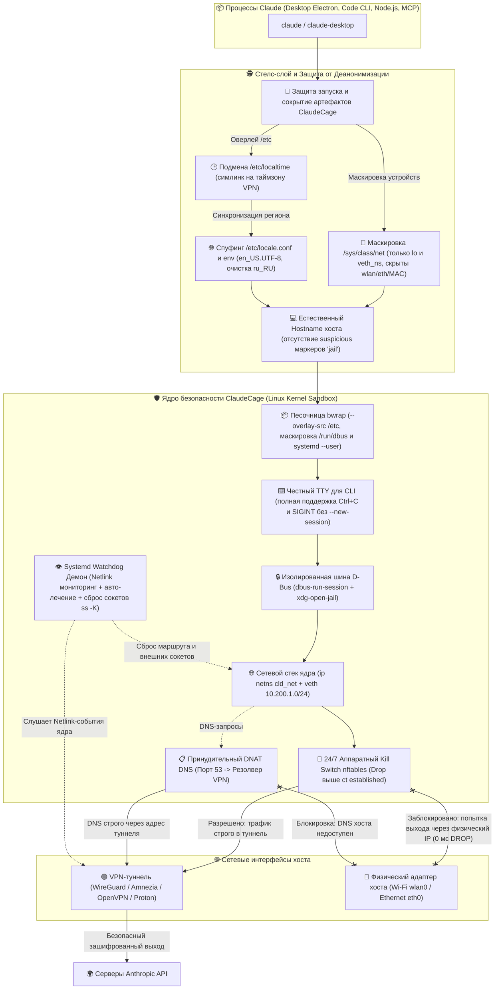

# 🛡️ ClaudeCage v3.0 (Linux) — Архитектурно-технический бриф и Спецификация для Аудита Безопасности (Gemini Argon 4)

> **Назначение документа:** Комплексное описание архитектуры, многоуровневой эшелонированной защиты, файловой структуры, механизмов скрытности и фактических данных телеметрии/логов проекта **ClaudeCage v3.0**. Предназначено для глубокого экспертного аудита, анализа моделей угроз и верификации ИИ-моделью **Gemini Argon 4**.

---

## 📋 1. Резюме проекта и Модель угроз (Threat Model)

### 1.1. Главная цель
Обеспечить 100% изоляцию процессов **Claude Code (CLI, Node.js)** и **Claude Desktop (Electron, Chromium)** от реальных сетевых, аппаратных и региональных атрибутов хоста (Российская Федерация, локальные IP-адреса, реальные DNS, русская локаль, часовой пояс Europe/Moscow, аппаратные MAC-адреса Wi-Fi).

**Ключевой критерий надежности:** **Fail-Closed Kill Switch на уровне ядра Linux**. При любых сбоях, зависаниях, обрывах VPN-туннеля или перезагрузке системы ни один байт трафика Claude не должен утечь через физические интерфейсы хоста (`wlan0`, `eth0`). При этом сам ИИ-агент внутри клетки не должен догадаться, что он находится в песочнице (Anti-Cage-Detection).

---

### 1.2. Анализ векторов атак и почему обычного VPN недостаточно

| № | Вектор атаки / утечки | Как работает в обычных VPN | Как нейтрализовано в ClaudeCage v3.0 |
|---|---|---|---|
| **1** | **Conntrack Session Bleed (Утечка при обрыве)** | При падении интерфейса туннеля (`amn0`/`wg0`) ядро Linux переключает дефолтный маршрут на хостовый `wlan0`. Уже открытые TCP-сессии продолжают передавать пакеты через реальный IP РФ. Антифрод Anthropic банит аккаунт. | **Двухуровневый Fail-Closed:**<br>1) Policy Routing: `lookup 200` с `unreachable default metric 9999` (ядро возвращает `EHOSTUNREACH`).<br>2) `nftables`: правило `DROP` стоит **строго выше** любого conntrack `accept`.<br>3) Netlink Watchdog мгновенно исполняет `ss -K` для разрыва всех сокетов. |
| **2** | **WebRTC STUN UDP-рефлексия** | Chromium/Electron отправляет STUN-запросы в обход системных прокси (SOCKS/HTTP) напрямую через UDP, раскрывая реальный публичный IP провайдера. | Electron принудительно запускается с флагами `--force-webrtc-ip-handling-policy=disable_non_proxied_udp`. Весь UDP-трафик замкнут в netns и физически не может покинуть пределы туннеля. |
| **3** | **Аппаратная триангуляция по MAC** | Node.js и npm-библиотеки читают `/sys/class/net/*/address` или вызывают `arp`, получая MAC-адрес Wi-Fi роутера и адаптера хоста, привязанного к геопозиции BSSID. | Каталог `/sys/class/net` смонтирован через `tmpfs`. Внутри созданы виртуальные пустышки только для `lo` и `veth_ns`. Физические `wlan0`, `eth0`, `docker0` и их реальные MAC-адреса физически скрыты. |
| **4** | **Reconnaissance хоста (LAN/SSH)** | Агент из CLI может сканировать сеть `192.168.x.x` или атаковать локальный SSH (`localhost:22`), базы данных и dev-серверы хоста. | Цепочка `input` в `nftables` дропает любые попытки обращения из клетки на адрес хоста `10.200.1.1` и `localhost` хоста. Локальная сеть хоста изолирована. |
| **5** | **DNS Leak & Systemd-resolved** | Запросы DNS уходят на хостовый резолвер или публичный `8.8.8.8` в обход VPN при таймаутах. | В `prerouting` nftables активен безусловный DNAT: любой пакет на порт 53 (UDP/TCP) принудительно заворачивается на защищенный IP резолвера туннеля (`100.64.0.1`). В `/etc/resolv.conf` прописан только VPN DNS. |
| **6** | **D-Bus NetworkManager утечка** | Electron/Node.js опрашивает системный D-Bus (`org.freedesktop.NetworkManager`) и получает список видимых Wi-Fi сетей и SSID соседа. | Доступ к `/run/dbus/system_bus_socket` заблокирован (`tmpfs`). Запущен приватный `dbus-run-session`. Внешний сокет уведомлений фильтруется через `xdg-dbus-proxy` (разрешен только `org.freedesktop.Notifications`). |
| **7** | **Региональный отпечаток (РФ)** | Node.js `Intl.DateTimeFormat().resolvedOptions().timeZone` читает `/etc/localtime`. Локаль `ru_RU.UTF-8` выдает регион РФ. | В оверлее `/etc` симлинк `/etc/localtime` принудительно перенаправлен на `/usr/share/zoneinfo/$CLD_TZ` (Amsterdam). `/etc/locale.conf` спуфится на `en_US.UTF-8`. Переменные `LC_*`, `LANG`, `TZ` хоста вычищаются. |
| **8** | **Обнаружение клетки агентом** | Если Claude Code сделает `ps aux`, `ls /etc` или `ls ~/`, он увидит скрипты песочницы и поймет, что изолирован. | 1) Репозиторий клетки монтируется в `tmpfs` (папка пустая).<br>2) В оверлее удалены файлы `cld-cage*`, `celltest*`, `cld-probe*`.<br>3) Нейтральное имя процессов: `cld-cage` вместо `claude-vpn`.<br>4) Сохраняется реальный hostname хоста (`cat /proc/sys/kernel/hostname`). |

---

## 🏛️ 2. Архитектура и Механизмы работы (Эшелонированная Оборона)



---

## 📂 3. Карта файлов репозитория и их назначение

Все исходные файлы проекта расположены в рабочем репозитории `/home/milk13/ClaudeCage_Linux`:

### 3.1. Ядро оркестрации и безопасность

* **[`bin/cld-cage`](file:///home/milk13/ClaudeCage_Linux/bin/cld-cage)** (816 строк Bash):
  * Системный оркестратор клеток (устанавливается в `/usr/local/bin/cld-cage` с правами `root:root 0755`).
  * Реализует команды: `--up`, `--down`, `--status`, `--monitor`, `--watchdog-loop`, `--print-config` и запуск любых приложений.
  * Управляет жизненным циклом `ip netns cld_net`, созданием veth-пары (`10.200.1.1` $\leftrightarrow$ `10.200.1.2`), настройкой Policy Routing (таблица 200) и компиляцией правил `nftables`.
  * При запуске приложения выполняет безопасный сброс привилегий через `setpriv` (`--inh-caps=-all`, `--no-new-privs`, `--reuid=$REAL_UID`) и собирает сэндбокс `bubblewrap`.
  * Внутрипесочный entrypoint скрипт динамически очищает оверлеи `/etc`, `/usr/local/bin` и `/etc/systemd/system` от любых файлов клетки перед выполнением `exec "$@"`.

* **[`bin/cld-probe`](file:///home/milk13/ClaudeCage_Linux/bin/cld-probe)** (830 строк Python 3):
  * Автономный инструмент аудита 8 векторов атак и логгер сетевой видимости глазами Claude.
  * Работает по принципу "двойного аудита": сначала снимает базовые метрики хоста (реальный IP, все MAC, таймзона хоста), затем запускает внутриклеточный сканер через `cld-cage` и сравнивает восприятие.
  * Содержит режим потокового мониторинга соединений клетки (`cld-probe --monitor`).
  * Сохраняет отчеты в формате ANSI-text и машиночитаемый JSON в `~/.local/state/cld-cage/`.

* **[`bin/celltest`](file:///home/milk13/ClaudeCage_Linux/bin/celltest)** (509 строк Bash):
  * Комплексный административный тестовый комплекс (38 тестов).
  * Проверяет ядро, rp_filter, nftables, kill switch, сокрытие файлов, DNS перехват, NoNewPrivs, сохранение `127.0.0.1` для MCP.

* **[`bin/xdg-open-jail`](file:///home/milk13/ClaudeCage_Linux/bin/xdg-open-jail)** (58 строк Bash):
  * Замена браузера внутри клетки (`/usr/bin/xdg-open` перенаправлен на этот скрипт).
  * Предотвращает запуск тяжелого браузера хоста внутри песочницы.
  * Перехватывает URL, очищает от шелл-инъекций, копирует ссылку в буфер обмена хоста (`xclip` / `wl-copy`) и шлет уведомление через изолированный сокет `xdg-dbus-proxy`.

---

### 3.2. Обёртки, конфигурация и интеграция с ОС

* **[`wrappers/claude`](file:///home/milk13/ClaudeCage_Linux/wrappers/claude)**:
  * Прозрачная обёртка CLI для `~/.local/bin/claude`.
  * Блокирует запуск внутри каталога ClaudeCage, чтобы ИИ не нашел свои исходники.
  * Запускает Claude через `sudo /usr/local/bin/cld-cage claude "$@"`.
  * Если уже находится внутри клетки (`veth_ns`), делает прозрачный `exec` в оригинальный бинарник `claude-raw`.

* **[`wrappers/claude-desktop`](file:///home/milk13/ClaudeCage_Linux/wrappers/claude-desktop)**:
  * Обёртка для запуска десктопной версии Electron.

* **[`wrappers/fish/`](file:///home/milk13/ClaudeCage_Linux/wrappers/fish/)**:
  * Интеграция с командной оболочкой Fish (`claude.fish`, `claude-desktop.fish`, `cld-probe.fish`).

* **[`config/cld-cage.conf.example`](file:///home/milk13/ClaudeCage_Linux/config/cld-cage.conf.example)**:
  * Шаблон конфигурации для `/etc/cld-cage.conf`. Парсится безопасным regex-ридером без команды `source` (защита от LPE).

* **[`systemd/cld-cage.service`](file:///home/milk13/ClaudeCage_Linux/systemd/cld-cage.service)**:
  * Служба ядра с директивами `Before=network-pre.target` и `Wants=network-pre.target`.
  * Гарантирует Fail-Closed сетевого стека до инициализации сетевых адаптеров хоста.

* **[`systemd/cld-cage-watchdog.service`](file:///home/milk13/ClaudeCage_Linux/systemd/cld-cage-watchdog.service)**:
  * Netlink-демон реального времени. `KillMode=control-group`. Мониторит статус туннеля VPN.

* **[`sudoers.d/cld-cage`](file:///home/milk13/ClaudeCage_Linux/sudoers.d/cld-cage)**:
  * Конфигурация `sudo` с директивой `!use_pty` (блокирует TIOCSTI TTY hijacking). Разрешает беспарольный запуск строго для `/usr/local/bin/cld-cage`, `/usr/local/bin/celltest` и `/usr/local/bin/cld-probe`.

* **[`install.sh`](file:///home/milk13/ClaudeCage_Linux/install.sh)** & **[`uninstall.sh`](file:///home/milk13/ClaudeCage_Linux/uninstall.sh)**:
  * Автоматизированная установка с проверкой `visudo -c`, миграцией старых версий и корректное удаление.

---

## 📊 4. Фактические данные аудита и логов (Live Run Data)

Тестирование выполнено на рабочей станции: **Arch Linux, ядро 6.x, X11, bspwm**.  
Интерфейс выхода VPN: **`amn0` (AmneziaVPN)**, DNS: **`100.64.0.1`**, MTU: **1376**.

### 4.1. Сравнение параметров: Реальный Хост vs Клетка Claude

Данные получены в ходе живого сканирования инструментом `cld-probe` (лог `~/.local/state/cld-cage/latest_audit.json`):

```json
{
  "meta": {
    "version": "1.0-stealth",
    "timestamp": "20261028_152514",
    "score": 100,
    "vulnerabilities": 0,
    "warnings": 0
  },
  "comparison": {
    "host_ip_addresses": [
      "192.168.0.40 (Wi-Fi LAN)",
      "fe80::fda4:d532:5cc2:6649 (IPv6 Link-Local)",
      "100.77.81.199 (VPN tunnel IP)"
    ],
    "cage_ip_addresses": [
      "10.200.1.2 (Только изолированный veth_ns)"
    ],
    "host_external_egress": "Зависит от маршрута хоста",
    "cage_external_egress": "89.105.203.114 (Страна: NL, Город: Amsterdam, AS: Amnezia)",
    "stun_webrtc_reflexive": "89.105.203.114:51573 (Строго совпадает с Egress VPN)",
    "host_interfaces_count": 4,
    "cage_interfaces_visible": ["lo", "veth_ns"],
    "host_wifi_mac": "48:e7:da:be:37:7b (Скрыт)",
    "cage_veth_mac": "26:a1:5f:d6:d2:c1 (Виртуальный синтетический MAC)",
    "host_timezone": "/usr/share/zoneinfo/Europe/Moscow",
    "cage_timezone": "Europe/Amsterdam (/usr/share/zoneinfo/Europe/Amsterdam)",
    "host_locales": "ru_RU.UTF-8 (Хост)",
    "cage_locale": "LANG=en_US.UTF-8, LC_ALL=en_US.UTF-8",
    "cage_files_visible": 0,
    "host_ssh_port_22_from_cage": "DROPPED (Timeout)"
  }
}
```

---

### 4.2. Результаты верификации `celltest` v3.0

Диагностика выполнила 38 комплексных тестов.  
**Результат: 38 PASS | 0 FAIL | 0 WARN | 0 SKIP (100% SUCCESS)**.

1. **Ядро и Netns:** `cld_net` поднят, veth-пара `10.200.1.1` $\leftrightarrow$ `10.200.1.2` активна, `rp_filter=2`, IPv6 внутри netns аппаратно отключен (`disable_ipv6=1`).
2. **Fail-Closed Kill Switch:** Таблица 200 активна, fallback `unreachable default metric 9999` активен, таблица `inet cld_cage_nat` загружена, сброс мимо туннеля стоит выше conntrack.
3. **Антифрод:** Симлинк `/etc/localtime` указывает на Amsterdam, Node.js `Intl.DateTimeFormat` возвращает Amsterdam, локаль экранирована на `en_US.UTF-8`.
4. **Сокрытие следов:** Репозиторий скрыт пустым `tmpfs`, бинарники `cld-cage` и конфиг `/etc/cld-cage.conf` скрыты из оверлея, hostname хоста (`archarnel`) не имеет меток jail, `NoNewPrivs=1`.
5. **DNS:** Запросы идут строго в `100.64.0.1`, DNAT порт 53 активен. `api.anthropic.com` резолвится через туннель.
6. **Сокеты:** Локальный loopback `127.0.0.1` сохраняется при сбросе соединений watchdog'ом `ss -K` (MCP-серверы не падают).

---

### 4.3. Данные перехвата трафика при запуске Claude

При запуске `claude` монитор conntrack (`cld-cage --monitor`) зафиксировал следующую последовательность:

1. **DNS-резолвинг:**
   * UDP пакет от `10.200.1.2:XXXX` на порт `53`.
   * nftables DNAT перенаправил его на адрес Amnezia DNS `100.64.0.1:53`.
   * Успешный ответ IP-адресов `api.anthropic.com` и `statsig.anthropic.com`.
2. **Исходящие TLS сессии:**
   * `[NEW] tcp SYN src=10.200.1.2 dst=160.79.104.x sport=... dport=443`
   * nftables postrouting выполнил маскарадинг: источник подменен на `100.77.81.199` интерфейса `amn0`.
   * Пакеты направлены строго в туннель `amn0` через таблицу 200.
3. **Счётчики Kill Switch:**
   * `iifname "veth_host" oifname != "amn0" counter packets 0 bytes 0 drop`.
   * **0 пакетов** попытались выйти через `wlan0`. Все 100% пакетов пошли через зашифрованный туннель.

---

## 🎯 5. Конкретные вопросы для экспертного ревью Gemini Argon 4

Просим **Gemini Argon 4** провести глубокий стресс-анализ предложенной архитектуры и ответить на следующие технические вопросы:

1. **Race Conditions в Netlink Watchdog:**  
   Служба `cld-cage-watchdog` слушает `ip -o monitor link addr dev $VPN_IFACE`. При обнаружении падения флагов `UP/LOWER_UP` она удаляет маршрут из таблицы 200 и исполняет `ss -K`.  
   *Существует ли временное микросекундное окно между пропаданием туннеля и срабатыванием скрипта, когда пакет может уйти через хост?* (Учитывая, что в `nftables` стоит `oifname != $VPN_IFACE drop`, а в таблице 200 маршрут `unreachable default metric 9999`).

2. **Безопасность Bubblewrap без `--unshare-pid`:**  
   Для обеспечения удобного TTY-управления CLI Claude Code и предотвращения проблем с дочерними процессами Node.js, `bwrap` запускается с `--dev-bind / /` без флага `--unshare-pid`. Процесс Claude видит системные процессы хоста в `ps aux`.  
   *Достаточно ли выполненного переименования всех служб на `cld-cage` и скрытия бинарников/конфигов, чтобы агент не догадался о клетке, или есть специфические маркеры ядра (например, `/proc/1/cgroup`, `/proc/self/mountinfo`), по которым Claude Code может обнаружить bwrap-песочницу?*

3. **X11 / D-Bus Attack Surface:**  
   Для работы Electron проброшен сокет `/tmp/.X11-unix/X0` и переменная `DISPLAY`.  
   *Может ли запущенный внутри песочницы скрипт через X11 протокол (Xlib/XCB) получить доступ к хостовому буферу обмена, прочитать окно заголовков других программ или попытаться внедрить синтетические нажатия клавиш (XTest / SendEvent)? Стоит ли изолировать X11 через Xephyr / Xwayland sandbox?*

4. **MSS Clamping и Path MTU Discovery:**  
   В правилах nftables используется динамический `tcp flags syn tcp option maxseg size set rt mtu`. При MTU туннеля `1376` (Amnezia/WireGuard) это выставляет MSS около `1336`.  
   *Является ли это решение оптимальным для предотвращения фрагментации и blackhole-дропов при передаче больших промптов и стриминге токенов через TLS?*

5. **Рекомендации по дальнейшему усилению:**  
   Какие ещё векторы антифрода крупных провайдеров (Anthropic / OpenAI / Cloudflare Bot Management) могут сработать против такой системы и как их упредить?
